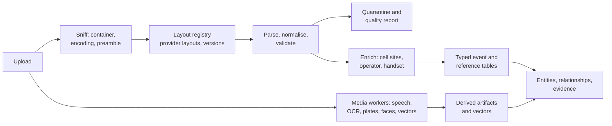
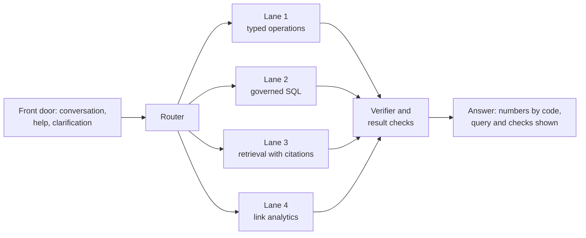

# NexusAI maturity roadmap: every data family, models, schema, query intelligence and link analysis

**Date:** 2026-10-12 · **Status:** proposed plan; decisions D1 and D2 were approved for drafting on 2026-10-12 and their drafts exist (nothing is applied to the live database, nothing else is approved or started) · **Author:** Claude session `local_c615940b` for the product owner

**Precedence.** This file sequences work. It does not replace the rules in `docs/architecture/QUERY_ANSWERING_DECISION_20261005.md` (three outcomes, the verifier, the case clock), `AGENTS.md`, or the country profile `configuration/forensic_country_profiles/pakistan.json`. Where it conflicts with an older roadmap, section 2 says which one wins and why.

**Evidence rules used here.** Facts about this repository were read from files or the running database. Facts about the real provider samples come from their structure only (column names, value formats, counts); no value, number, name or address from them appears in this file, and the extracted copies are deleted after use. Facts about outside models, datasets and papers come from web searches made on 2026-10-12; where a source was a vendor page, a mirror or a summary, the table says "verify". Figures from outside are leads to test, not predictions.

---

## 1. The answer in one page

**Where we are.** The question-answering core is strong on test data: on 161 questions with independent keys the lane (model drafts one SELECT, code verifies it, the database computes the answer) went from 39 wrong with the lane off to 0 wrong on the newest fresh seed (2 and 8 on the two seeds before it; the 8 became 2 after fixes, both a defect in how the factory words one question), and 40 of 42 new-shape probes on the multimodal case were right with none wrong. The measurement discipline (keys written independently, gates written first, fresh seeds) is the most valuable asset we have.

**Where we are not.** Four things stand between this and a product that survives real data:

1. **Real provider exports are mostly not ingested correctly yet.** I ran the repository's own CDR and IPDR adapters' `detect_schema` over the header rows of the 13 real layouts you supplied. The CDR adapter recognises **3 of 8** layouts and the IPDR adapter **0 of 5** (4 IPDR layouts and 1 application-usage layout; header-level check, no ingest was run; section 4). Everything downstream, every question, every link analysis, inherits that.
2. **The database cannot yet do the analysis you asked for.** The forensic database has TimescaleDB and `pg_trgm` installed and no relationship table (the entity index has 7 entity types and no edges). The current image already ships pgvector 0.8.1, `cube` and `earthdistance` (available, not installed), so vector search and "cells within N metres" need no image change; PostGIS (containment, line-of-travel, ellipsoid distance) is not in the image and would need a new image and a dump and restore. Only CDR has a typed table; IPDR, ANPR, tower and the rest live as JSON in `forensic.records`. *(Corrected 2026-10-12: the first version of this line said pgvector was missing; the extension list of the image was checked while drafting D2.)*
3. **Media models are weak where Pakistani evidence needs them most.** Measured in our own sealed tests: plate reading 13 of 22 exact on images, 3 of 41 on video at one frame per second, Urdu OCR 0 of 1 exact (line-level, one fixture), Urdu speech word error rate 45.5% and English 10.8% on small read-speech sets, and no Punjabi or Pashto speech support at all. These are small samples with wide uncertainty, which is itself the finding: we do not yet have test sets that match real evidence.
4. **Link analysis exists on paper.** 79 operations are registered; 62 are only "registered", 4 are product certified, and `relationship_network`, `cross_family_correlation` and `co_travel_or_co_presence` are registered with no independent proof.

**The plan, in one line.** Make the data right first (ingestion and typed schema for real layouts), then make the questions right for that data in every language we need, then deepen each media family against test sets built from real-shaped evidence, then build link analysis on top of an entity-and-relationship layer that is verified against planted ground truth. Hardware and licensing are decided early because they gate the rest.

| Phase | Weeks (estimate) | Outcome you can see | Gate to leave it |
|---|---|---|---|
| 0. Safeguards and decisions | 0 to 2 | Real-data vault and policy; provider layout registry v1; licence and hardware answers; two demo gaps closed | Owner decisions D1 to D6 made |
| 1. Real structured data | 2 to 8 | The 13 layouts ingest correctly; typed CDR/IPDR/app-usage/cell tables; entity and relationship layer v1; first link analyses (contacts, common contacts, path, co-location, IP attribution) | Parity and reconciliation gates in section 11 |
| 2. Questions in every language | 4 to 12 (parallel) | Conversation front door on; clarification policy; Urdu, Roman Urdu, Punjabi, Pashto question sets; model bake-off on the GPU | Pre-registered bake-off decision |
| 3. Media depth | 6 to 20 (parallel by family) | Speech in 5 languages, Urdu OCR, plate reading and video tracking, face candidates, each with its own sealed test set | Per-family gates |
| 4. Cross-family intelligence | 14 to 26 | Identifier mention index, entity resolution, relationship scoring, link chart, map, timeline | Planted-truth precision and recall |
| 5. Enterprise | 22 to 34 | Identity and case registry, read-only role, security and load proof, backup and restore | Release approval |

Weeks are planning estimates for one owner plus Claude sessions and will be re-planned at each gate; they are not commitments.

**The first 14 days** are in section 11. **The decisions only you can make** are in section 12.

---

## 2. Reconciliation: what is true now, and which document wins

### 2.1 State by area (read from the repository and the live database on 2026-10-12)

| Area | Built | Measured | Not built or not proven |
|---|---|---|---|
| Question answering, structured | Governed SQL lane (parse-tree validator, verifier with about twenty kinds of check, read-only executor, case clock), stage 2 on since 9 Oct; 17 semantic-layer families; 412 specs | 0 to 2 wrong per 161 on three fresh seeds; 40 of 42 probes right, 0 wrong on the multimodal case; 18 of 19 rows of the 28 Sep demo script still match | Speed (median 27 s on mixed families); two month-against-month shapes; free-word conditions; value lists |
| Question answering, text evidence | Retrieval with citations (full-text, trigram, vector) | 8 of 15 hand-written multimodal text questions answered | Routing errors (a document question sent to the access-log family); evidence inventory ("how many images") withheld |
| Operations catalogue | 79 registered operations | 4 product certified, 1 fixture certified, 12 source validated, 62 registered only | Independent proof for relationship and correlation operations |
| Ingestion, structured | Worker with 5 adapters (CDR, IPDR, ANPR, subscriber, tower), time policy, XLSX and TSV readers, schema profile | Adapters tested on repository synthetic fixtures | Real provider layouts: 3 of 8 CDR, 0 of 5 IPDR recognised (section 4) |
| Database | PostgreSQL 16, TimescaleDB 2.28 (hypertables `records`, `cdr_records`), RLS by tenant, `pg_trgm`, custody chain | 10,168 rows in the multimodal case, 23,080 across two cases | No relationship table, no typed IPDR/ANPR/tower tables, no read-only analyst role, no case registry; pgvector 0.8.1, `cube` and `earthdistance` are in the image but not installed; PostGIS is not in the image |
| Models in the worker | Qwen3-4B-Instruct (CPU, Q4_K_M), Qwen3-Embedding-0.6B, faster-whisper small (Urdu), whisper tiny, PaddleOCR PP-OCRv5 Arabic, FastALPR (YOLOv9-t 384 plus CCT-XS-v2), ONNX video ANPR V3, YuNet plus SFace, SigLIP base | See the media numbers in section 1 | TTS disabled; no diarization, language ID, reranker or tracker in the product |
| Link analysis | `frequent_contacts` and `temporal_activity` (product certified), `multi_source_comparison` (fixture certified), a multi-CDR common-contact comparison | Hand-authored three-source golden | Path, co-location, chaining, community, IP attribution, cross-family links |
| Governance | RLS, custody hash chain, country profile with real-data policy and provider onboarding steps | Isolation specs | Real per-user identity (the UI sends one fixed actor), case owner and members, read-only role |

### 2.2 Conflicts between documents, and the ruling

| Conflict | Ruling |
|---|---|
| `nexusai-next-generation-roadmap.md` says NX-Q2 (dynamic query intelligence) must use "no unrestricted SQL"; the 5 Oct decision lets the model write one SELECT. | **The decision record wins.** The lane is governed, not unrestricted: server-built views, parse-tree allowlist, read-only, scoped. NX-Q2 is delivered by the lane plus the typed lane; no change to the safety wall. |
| Two sequences exist: R0 to R9 (`ROADMAP_FREE_QUESTION_20261005.md`, restated in the decision record) and the NX tracks (NX-B2.1, NX-S2, NX-M2, NX-D2, NX-Q2, NX-X2, NX-C2). | **This file merges them** (table 2.3). New work is tracked in this file's phases; the NX names stay as labels for scope. |
| NX-B2.1 aimed at certifying all 79 operations one by one. | **Superseded for exact analytics by the verifier.** Operations remain the typed lane and the building blocks of link analysis, but a question is trusted because the lane verified it, not because its operation was certified. Certify the operations that link analysis needs (section 7), not all 79. |
| The decision record says names of people are not answerable because no field holds one. The subscriber layer does hold `full_name` (PII, masked). | Not a conflict in behaviour: the field exists but is not exposed to the model. Keep it, and state it as policy: names are masked, a question that names a person abstains and asks for a number, and a person-to-number link needs a verified source (section 7). |
| Accuracy so far was measured on synthetic and demo cases; real samples now exist. | **New rule: real data is a test input, never a repository file.** Real files are profiled for structure, and shape-preserving synthetic goldens are generated from the profile (the country profile already requires this). |
| The decision record's hardware section assumes the CPU laptop. | Re-measure on the owned HP EliteDesk with the RTX 2080 before any purchase (section 9). |

### 2.3 How the two sequences map

| Old label | Meaning | Where it lands here |
|---|---|---|
| R0, R1 (factory), M1 (measure the lane) | Done | Section 2.1 |
| R1b (free-word conditions), R2, R3 | Typed-lane verifier, new primitives | Phase 2 |
| R4 (governed SQL) | Done | Phase 2 extends it |
| R5 (retrieval path) | Text evidence | Phase 3 (documents) and Phase 4 (mention index) |
| R6 (retire the keyword ladder) | After parity | Phase 5 |
| R7 (speed) | Hardware and shared prompt start | Phase 0 and Phase 2 |
| R8 (model bake-off), Phase 5 fine-tuning | Only after a measured gap | Phase 2 and Phase 3 |
| R9 (identity, case registry, read-only role) | Owner decision | Phase 5, with the schema work started in Phase 1 |
| NX-S2 | Structured depth | Phase 1 |
| NX-M2 | Media depth | Phase 3 |
| NX-D2 | Documents, OCR, language | Phase 3 |
| NX-Q2 | Dynamic multilingual query intelligence | Phase 2 |
| NX-X2 | Cross-family intelligence | Phase 4 |
| NX-C2 | Enterprise certification | Phase 5 |
| NX-ADV | Advanced capability | Only by individual approval |

---
## 3. Principles and target architecture

### 3.1 Principles

Kept from the decision record and `AGENTS.md`: exact facts come from deterministic code and the database; the model never sees case rows and never writes a number into prose; abstention is a success and a confident answer to a different question is the one defect that must reach zero; every behaviour sits behind a default-off switch with gates written before measuring; real data never enters the repository.

New in this plan:

| # | Principle | What it forces |
|---|---|---|
| P1 | Every number shown carries lineage to source rows, the file, the layout and the mapping version that parsed it | Layout and mapping versions are stored on every row |
| P2 | A parser change is a data change | Re-parsing writes a new version; earlier answers keep their lineage |
| P3 | Each model has one role, a registry entry (id, hash, licence, languages), a sealed test set and a decision rule written first | No model is swapped or shipped on a leaderboard score |
| P4 | Associations are labelled by kind and strength and never called identity or ownership | Edges are `observed`, `inferred` or `candidate`, each with evidence rows |
| P5 | Sensitive capabilities are off by default and enabled per case with recorded authority | Face matching, voice biometrics, tower dump and geofence queries carry a legal-basis field and an audit trail |
| P6 | Time and place are first-class | Every event has a source time zone and a time basis; every location has a method and an uncertainty radius |
| P7 | Licence before download | No model or dataset is fetched or shipped without a licence ledger entry; downloads stay behind your approval |

### 3.2 Target architecture

**Ingest and store**



**Question answering**



| Plane | Contents | State |
|---|---|---|
| Ingest | Sniffing, layout registry, parsers, quality report, enrichment, media workers | Partly built: five adapters, shared worker; layout registry and quality report are new |
| Store | Typed tables, reference tables, entity and relationship tables, derived artifacts, vectors, geometry | Partly built: TimescaleDB, `records`, `cdr_records`, `derived_artifacts`, `record_entities`; typed families, vectors (pgvector is in the image), earth-distance lookups and relationships are new; PostGIS needs a new image (D2b) |
| Semantic layer | Curated families, synonyms, sensitivity, one YAML per family | Built for 17 families; extended with every new table |
| Question answering | Front door, router, four lanes, verifier | Lanes 1 to 3 built; front door built and off; lane 4 is new |
| Models | One registry with roles, hashes, licences, hardware needs | Catalogue exists in `configuration/`; a role-based registry with decision rules is new |
| Governance | Tenant isolation, custody chain, audit, masking, authority metadata | Partly built; identity, case registry, read-only role, per-capability policy are new |
| Evaluation | Question factory, probes, corpus, pre-flight, gates | Built for structured data; case generator with planted truth, per-modality sealed sets, multilingual sets are new |

---

## 4. Real samples, ingestion and schema

### 4.1 What the samples are

You supplied 13 distinct layouts across four operators, plus report metadata. They were read for structure only: column names, value formats, row counts. No value is reproduced here.

**Call records and geofence (tower dump) files**

| ID | Layout | Container | Columns that matter | Time format | What is unusual |
|---|---|---|---|---|---|
| C1 | "Company format", Mobilink-style, 16 columns | xlsx | Sr #, Call Type, A-Party, B-Party, Date & Time, Duration, Cell ID, IMEI, IMSI, Site, Longitude and Latitude, Node ID, IP, Port, Description, MACAddress | Excel serial number | Direction is inside Call Type ("Incoming SMS", "InComing", "Outgoing"); Cell ID is alphanumeric; no end time |
| C2 | `STRT_TM` layout, 14 columns (operator not stated) | xlsx, 3 preamble rows | CALL_TYPE ("Call - Incoming"), MSISDN, STRT_TM, BNUMBER, MINS, SECS, LAC_ID, CELL_ID, IMEI, SITE_ADDRESS, LNG, LAT | text dd/mm/yyyy hh:mm:ss | No IMSI, no end time; duration split into minutes and seconds |
| C3 | Ufone-style, 17 columns | xlsx, 3 preamble rows | IMEI, IMSI, A Number, B Number, Start Time, End Time, Service Provider, Type, Direction, Location, Cell Id, Cell Sector, Latitude, Longitude, Duration | Excel serial number | "Service Provider" is the peer network, with casing variants (ufone, UFONE) and labels such as INTERNET, SHORTCODE, UNKNOWN, INTERNATIONAL, NEW_NETWORK |
| C4 | Telenor-style, 18 columns | xlsx | MSISDN, call_org_num, CALL_DIALED_NUM, IMSI, IMEI, CALL_START_DT_TM, CALL_END_DT_TM, INBOUND_OUTBOUND_IND, Call_Network_Volume, Lac_Id, Site_Id, Cell_SITE_ID, lat, longitude, CALL_TYPE, location | Excel serial number | The repository's reference format: the one the adapter was written for |
| C5 | Mobilink geofence, 7 columns | xlsx | Sr #, Call Type, A-Party, B-Party, Date & Time, Duration, IMEI | Excel serial number | No cell columns; the file name carries a code, so the cell is probably implied by the query (confirm) |
| C6 | Telenor geofence, 15 columns | xlsx | C4 without a few columns; `CALL_ORIG_NUM` | Excel serial number | Header spelled `ORIG` where the adapter expects `org`; direction is numeric (0, 1 or 2) and 0 co-occurs with the GPRS rows, so it probably means "no direction" (confirm) |
| C7 | Ufone geofence, 13 columns | xlsx | CALL_START_DT, IMEI, IMSI, A_Number, B_Number, Call_Start_Time, Call_End_Time, Call_Duration, Cell_ID, LAC_ID, Cell_ID, CALL_INBOUND_OUTBOUND_DESC, LOCATION | text date plus text time | Two columns are both called `Cell_ID` (10 digits and 5 digits) |
| C8 | Zong geofence, 13 columns | xlsx | DLD_NO, CLD_IMIE, DLG_NO, CLG_IMEI, DIR_FLG, CLR_OEPRATOR, RCVR_OPERATOR, DRTN, STRT_TM, END_TM, ACTVY_TYPE_CD, LAC_ID, CELL_ID | text m/d/yyyy h:mm:ss AM/PM | Typos in headers and in values ("Incomming"); IMEI present for only one side of each record; peer operator column (PAKTEL, UFONE, MOBILINK, TELENOR, WARID, PTCL) |

**Operator names.** The call-record files C1 to C4 do not state their operator. C4 matches the Telenor-named geofence file column for column, C3 matches the Ufone-named one in vocabulary, and C1 matches the Mobilink-named one; C2 matches none of them. The country profile forbids inferring an operator from a number prefix, so treat these names as labels for the layouts and confirm each against the operator's export documentation.

**Internet records and application usage**

| ID | Layout | Container | Columns that matter | Time format | What is unusual |
|---|---|---|---|---|---|
| I1 | Jazz UFDR, 32 columns, plus a "Basic Information" metadata file | CSV, UTF-8 with BOM | UFDR start and end, IMSI, MSISDN, IMEISV, NAT start and end, Public IP and port, UE IP and port, Server IP and port, APN, charging characteristics, RAT type, gateway and serving node IP, ECGI, SAI, CGI, category, application, sub-application, protocol type, URL, bytes and packets up and down, duration in ms, data source | ISO, to the second | Two address spaces (UE IP private, Public IP after NAT); a 4G cell identity; several files are queried by NAT source IP, not by number |
| I2 | Telenor export, 18 columns | CSV | Start, End (milliseconds), Duration (ms), Active Time, IMSI, MSISDN, Private Source IP and Port, Protocol, Public Source IP and Port, Dest IP and Port, URL, APP Type, Service Type, CI | ISO with milliseconds | CI is one composite string of cell information |
| I3 | Ufone, 18 columns | SpreadsheetML XML saved with an `.xls` extension | Public IP, Public Port Start, Public Port End, Log Date, app, host, imei, imsi, msisdn, sid, url, cell/eci, dst_address, dst_port, lac/tac, protocol, src_address, src_port | text dd.mm.yyyy hh:mm:ss | A public port range per row; a numeric protocol (one and two digit codes, probably 6 and 17); a session id |
| I4 | Zong, 27 columns | UTF-16 tab-separated text with a 7-line metadata header, and the same data as xlsx | Public IP and Port, NAT Begin and End, Start and End, IMSI, MSISDN, IMEISV, MS IP and Port, Server IP and Port, APN, RAT, Serving and Gateway Node IP, bytes, category, application, sub-application, protocol type, URL, User Agent | text dd/mm/yyyy hh:mm | Two files, two encodings, one dataset |
| A1 | Application-usage export, 12 columns | xlsx, sheet named in Chinese | Start Time, End Time, MSISDN, IMSI, IMEI, Terminal, APN, APP Category, APP, APP Feature, Province, City | ISO | No IPs, bytes or cell; location only as province and city; handset model as text |

**Report metadata.** The Jazz "Basic Information" files carry the application name, report name, analysis time, analyst, query criteria (an MSISDN in one file, a NAT source IP in the other), time range, file generated time and a "shown / total records" pair. That pair is the only completeness signal any file gives.

### 4.2 Findings that change the design

| # | Finding | Consequence |
|---|---|---|
| F1 | 13 layouts, 4 operators, several layouts per operator (call records, geofence, internet) | A **layout registry** with versions and a header fingerprint, not one adapter per family |
| F2 | Several container shapes: xlsx, SpreadsheetML named `.xls`, CSV with and without a byte-order mark, UTF-16 tab-separated text, preambles of 3 and 7 lines, duplicate header names, header typos | Sniffing and preamble parsing before any mapping; typo-tolerant header matching |
| F3 | Times are Excel serial numbers, text in four formats, ISO with and without milliseconds; none states a time zone | A **declared source time zone per layout** and a `time_basis` on every row (`declared`, `assumed_by_profile`, `confirmed_by_analyst`); the country profile already forbids assuming Asia/Karachi from context alone |
| F4 | Party numbers come in 12-digit 92…, 11-digit 03…, 10-digit 3…, 13 and 14 digits (international), 3 to 6 digit short codes, alphabetic sender names, and labels such as INTERNET and UNKNOWN | **Number classes** (`person_like`, `short_code`, `sender_id`, `international`, `service_label`, `unknown`). Services never enter a person-to-person graph |
| F5 | Direction and type are encoded as "Incoming SMS", "InComing", "Call - Incoming", numeric 0 / 1 / 2, "Incomming" | Per-layout enumeration maps; an unknown code is kept and flagged, never guessed |
| F6 | Duration is seconds, minutes plus seconds in two columns, or milliseconds | A unit rule per layout, stored with the row |
| F7 | IMEI is 13, 14, 15 or 16 digits, IMSI is 15 digits (Pakistan's country code is 410 per the country profile), one layout has no IMSI | Length-aware validation; type allocation code (TAC) extracted only where at least 14 digits exist |
| F8 | Cell identity differs by operator: alphanumeric codes, 7, 8 and 10 digit identities, 3 to 5 digit LAC or TAC, ECGI, SAI, CGI strings, a composite "CI" string | A canonical `cell_key` and a parser per operator; a cell **reference** table with validity windows; coordinates found in a file are hints with `method = source_supplied` |
| F9 | Internet records carry NAT: public IP and port against a private UE address, port ranges, two timestamps, and some exports are queried by IP | An `ip_assignment` model with interval logic and an **IP attribution** operation (who held this public IP and port at this time) |
| F10 | One metadata file declares shown and total record counts | Load reconciliation: rows loaded against the declared total, with a flag when they differ |
| F11 | In all four call-record files (C1 to C4) a few rows (2% or fewer) hold Windows network-adapter names and MAC addresses in the `Description` and `MACAddress` columns. They are not call data | A quarantine rule for rows whose populated cells fall outside the table's dominant pattern; the quality report counts them |
| F12 | Some files exist twice, original and "updated", with slightly different row counts | Evidence versions: the update supersedes with a recorded diff and is never double counted |
| F13 | Geofence files hold many subscribers around one cell; call-record files hold one | Two dataset kinds with different question semantics (`target_cdr`, `tower_dump`) |
| F14 | Handset model strings, province and city appear only in the application-usage layout | A device reference (`TAC` to make and model) and an `app_usage` family with its own questions |
| F15 | The peer operator is labelled in text with casing variants and legacy names | An operator alias table; the profile forbids inferring an operator from a number prefix, so the label from the file wins and portability is stated |

### 4.3 What the repository's own adapters do with them

The test ran `detect_schema` from `ingestion/forensic_records/adapters/cdr` and `.../ipdr` over the header row of each layout, with the worker's own `normalize_header`. It is a header-level check: no file was ingested and no database was touched. The worker may also ask for a mapping review when detection fails; the result below says what is recognised automatically.

| Layout | CDR adapter | IPDR adapter | Cause |
|---|---|---|---|
| C1 company format | no (0 of 3 required groups) | no | "A-Party", "B-Party", "Date & Time" are not aliases |
| C2 `STRT_TM` layout | no (1 of 3) | no | "BNUMBER" and "STRT_TM" are not aliases; duration is two columns |
| C3 Ufone-style | **yes** (3 of 3) | no | |
| C4 Telenor-style | **yes** (3 of 3, 16 fields) | no | The reference format |
| C5 Mobilink geofence | no (0 of 3) | no | Seven columns, no identifier or time alias |
| C6 Telenor geofence | no (2 of 3) | no | `CALL_ORIG_NUM` against the alias `call_org_num` |
| C7 Ufone geofence | **yes** (3 of 3) | no | Matches, but the duplicate `Cell_ID` header is not handled |
| C8 Zong geofence | no (0 of 3) | no | Different vocabulary and typos |
| I1 Jazz UFDR | no (1 of 3) | no (0 of 3) | The IPDR adapter requires `source_ip`, `destination_ip` and a timestamp; the file has UE IP, Server IP, Public IP and UFDR start time |
| I2 Telenor export | no (2 of 3) | no (2 of 3) | "Private Source IP", "Dest IP" |
| I3 Ufone | no (1 of 3) | no (0 of 3) | |
| I4 Zong | no (2 of 3) | no (1 of 3) | |
| A1 application usage | no (2 of 3) | no (1 of 3) | A different family |

**Result: 3 of 8 call-record layouts and 0 of 5 internet or application layouts are recognised automatically.** The fix is not more aliases; it is the registry in 4.4, because layouts also differ in time format, units, enumerations and cell identity, which aliases cannot express.

### 4.4 Ingest v2

**Pipeline (each step has a contract and a test):**

1. **Land and protect.** Hash, size and type limits, archive limits (member count, depth, ratio), path-traversal checks; register evidence and custody (exists).
2. **Sniff.** Container and encoding (BOM, UTF-16, XLSX, SpreadsheetML, OLE `.xls`, CSV dialect, JSONL), sheet choice, preamble and footer detection, metadata blocks (4.1 "report metadata").
3. **Detect the layout.** Header fingerprint (normalised, order-insensitive) against the **layout registry**. Each entry is a versioned file: id, operator, family, dataset kind, header signature, column map, time rules (format, zone, basis), unit rules, enumeration maps, number-class rules, cell parser, quirks (duplicate headers, typos, junk columns), golden fixture id.
4. **Unknown layout, assisted mapping.** Profile the columns (value patterns, lengths, distinct counts, time-like columns), propose a mapping by deterministic similarity, and optionally ask the local model for a suggestion constrained to canonical field names. The analyst confirms or edits it; confirmation writes a new registry entry plus a generated synthetic golden. Nothing is promoted without a passing fixture. This is the `provider_onboarding` list already in the country profile, made into a screen.
5. **Parse and normalise.** Typed canonical output; the raw row is kept (JSON) with the layout and mapping version on the typed row.
6. **Validate.** Row rules (time present and in range, direction known, party present, identifier lengths), file rules (declared total against loaded, duplicate rate, time range plausibility, share of quarantined rows).
7. **Quarantine and report.** Rejected and foreign rows go to the errors table with a reason; the analyst-visible **quality report** lists rows read, accepted, duplicate, quarantined by reason, time range, null shares, number-class histogram.
8. **Enrich.** Cell reference join (time-valid), operator label normalisation, handset make and model from the TAC, number-class tagging, server-IP organisation and country from an open registry.
9. **Load.** Idempotent upsert keyed by a canonical hash, lineage kept for every duplicate, entity and relationship tables updated incrementally.
10. **Version.** A re-upload or an "updated" file becomes a new evidence version with a diff; answers keep the version they used.

**Adding data (what the analyst sees).** Drop files; each shows its detected layout, confidence and quality report; one click accepts, or opens mapping review for an unknown layout; a case summary updates (families present, time range, row counts) and the suggested questions refresh from what is actually in the case.

**Acceptance for a layout.** (a) A synthetic file with the same shape passes with exact expected counts; (b) a local-only comparison between the real file and the parsed tables passes on aggregates: row count, distinct counts per column, time range, null shares, number-class histogram, direction counts; (c) every quarantined row has a reason; (d) no value from the real file is written to the repository, the logs or a report.

### 4.5 Typed schema

New tables, all with `tenant_id`, `collection_id`, row-level security, lineage (`evidence_id`, `source_row`, `layout_id`, `layout_version`) and a raw payload column. Timescale hypertables for event tables, chunked by seven days.

| Table | Key columns | Notes |
|---|---|---|
| `comm_event` | `event_type` (voice, sms, data, ussd, other), `direction`, `a_raw`, `a_norm`, `a_kind`, `b_raw`, `b_norm`, `b_kind`, `start_utc`, `end_utc`, `duration_s`, `source_tz`, `time_basis`, `imsi`, `imei`, `tac`, `cell_key`, `lac_tac`, `cell_raw`, `lat`, `lon`, `loc_method`, `peer_operator`, `volume_bytes`, `dataset_kind` | Replaces `cdr_records`; one row per event; `a_*` is the party the file is about |
| `data_session` | `start_utc`, `end_utc`, `nat_start_utc`, `nat_end_utc`, `msisdn`, `imsi`, `imei`, `ue_ip`, `ue_port`, `public_ip`, `public_port_from`, `public_port_to`, `server_ip`, `server_port`, `protocol`, `apn`, `rat`, `cell_key`, `app_category`, `app`, `app_feature`, `host`, `url`, `user_agent`, `bytes_up`, `bytes_down`, `packets_up`, `packets_down`, `duration_ms`, `session_id` | IPv4 and IPv6 as `inet` |
| `app_usage` | `start_utc`, `end_utc`, `msisdn`, `imsi`, `imei`, `terminal`, `apn`, `app_category`, `app`, `app_feature`, `province`, `city` | Own family; no IPs |
| `cell_site` | `cell_key`, `operator`, `plmn`, `lac_tac`, `ci_eci`, `sector`, `azimuth`, `beamwidth`, `lat`, `lon`, `geom` (PostGIS, optional D2b), `radius_m`, `valid_from`, `valid_to`, `source` | Time-valid reference; never overwritten, retired sites kept |
| `subscriber` | `msisdn`, `imsi`, `iccid`, `status`, `activated_at`, `deactivated_at`, `valid_from`, `valid_to`, identity fields under field-level access | Exists as a family; typed |
| `device` | `imei`, `tac`, `make`, `model`, `first_seen`, `last_seen` | Derived; TAC reference joined |
| `ip_assignment` | `public_ip`, `port_from`, `port_to`, `valid_from`, `valid_to`, `msisdn`, `imsi`, `imei`, `source_row` | Derived from `data_session`; answers IP attribution |
| `plate_sighting` | `plate_raw`, `plate_norm`, `observed_utc`, `camera_id`, `lane`, `lat`, `lon`, `geom`, `confidence`, `province`, `crop_hash`, `source_kind` (csv, image, video) | Replaces JSON `anpr` rows |
| `entity` | `entity_id`, `entity_type` (phone, imsi, imei, ip, plate, account, cell, device, person), `canonical`, `first_seen`, `last_seen` | Stable identity per case |
| `entity_mention` | `entity_id`, `table`, `row_id`, `role`, `observed_at` | Supersedes `record_entities`; covers media text too |
| `relationship` | `rel_id`, `src_entity`, `dst_entity`, `rel_type`, `kind` (observed, inferred, candidate), `first_seen`, `last_seen`, `evidence_count`, `features` (jsonb), `score`, `derivation_id` | Typed edges |
| `relationship_evidence` | `rel_id`, `table`, `row_id` | Every edge is explainable to rows |
| `derivation` | `derivation_id`, `procedure`, `parameters`, `code_version`, `run_at`, `seed` | Records how an inferred edge or score was produced |
| `case_registry`, `case_member`, `case_authority` | owner, members, legal basis, enabled capabilities | R9; in Phase 5 |

**Drafted 2026-10-12, not applied.** Migrations `012_typed_families.sql` to `015_vectors_and_earth.sql` implement this table with these differences: `subscriber` is split into `subscriber_registration` (facts) and `subscriber_identity` (name, national ID number and address, with no access for the runtime role until R9); `device` is not a table (an `imei` entity plus `device_tac` covers it); `layout_versions`, `camera_site`, `ip_range_reference`, `derivation` and `content_embedding` are added; `case_registry`, `case_member` and `case_authority` stay in Phase 5; face relationships and face vectors are excluded while the face policy is at L0. Each typed row keeps its own `raw_payload`, so the legacy JSON copy in `forensic.records` can be retired after parity. Runbook: `docs/data/d2-migration-runbook.md`.

**Extensions.** Available in the current image and used by the drafted migration 015: pgvector 0.8.1 (text and image vectors; an HNSW index is created per model once a model is chosen; face vectors are excluded while the face policy is at L0), `cube` and `earthdistance` (radius lookups on cell sites and cameras now, as a spherical approximation). Not available: PostGIS (ellipsoid distance, containment in geofence polygons, line-of-travel). It needs a different image and a dump and restore, because the Alpine image (musl) and the usual PostGIS images (glibc) can order text differently, so it is proposed separately as D2b with a syntax-checked draft that has never been run. `btree_gist` is not needed by anything drafted. Installing extensions is a database change and needs your approval.

**Indexes and performance.** Hash and B-tree on normalised identifiers; GiST on geometry; BRIN or Timescale chunk pruning on time; partial indexes by `dataset_kind`; Timescale continuous aggregates for the daily contact matrix and hourly cell activity so the lane and link analyses read small tables.

**Read-only analyst role (R9).** A database role that can read only the analyst views, so a mistake in the validator still cannot reach a base table.

### 4.6 Migration: expand, then contract

1. Add the new tables and extensions in a numbered migration with preflight, verify and rollback scripts, following the pattern of `008_phase3_evidence_control_plane.sql` with its helper scripts in `ops/008_phase3_evidence_control_plane/` (helper scripts never sit at the top level, where a fresh database would run them).
2. Make the worker dual-write the old and new shapes.
3. Backfill from `forensic.records` JSON and `cdr_records`; reconcile with SQL (row counts, distinct counts, hashes) before anything reads the new tables.
4. Switch one family's semantic-layer views to the typed table, re-run that family's factory set and the corpus; the lane's gates must hold or the family stays on the old view.
5. Retire the JSON-backed view for a family only after two weeks of parity. Keep the old table for rollback until then.

---
## 5. Per-family maturity plans

Each plan has the same parts: where the family stands, what it becomes, the models and data, the questions it must answer, and what "done" means. Numeric targets are **proposals to be pre-registered** before the first measurement, as every gate in this project has been; where a baseline is unknown the target says "set after baseline".

### 5.1 Call records and geofence files (voice, SMS, data events)

| | |
|---|---|
| **Now** | One adapter (Telenor-style), typed `cdr_records`, 18 registered operations (2 product certified), lane views. 3 of 8 real layouts recognised |
| **Becomes** | All eight layouts in the registry (C1 to C8); `comm_event`, `cell_site`, `device`; two dataset kinds (`target_cdr`, `tower_dump`); every row with a declared time zone and basis |
| **Ingest** | Number classes (F4), direction and type maps (F5), units (F6), foreign-row quarantine (F11), declared-total reconciliation (F10), versions for "updated" files (F12), duplicate header handling, Excel serial dates |
| **Enrich** | Cell reference by operator with validity windows; handset make and model from the type allocation code (an open TAC list needs checking: the commercial GSMA list is not open); peer-operator alias table |
| **Questions it must answer** | Counts and rankings by number, direction, type, day, hour (case clock); duration thresholds with units; first and last seen; silence gaps; busiest day; SMS against voice; international, short-code and sender-ID splits; IMEI and IMSI changes; for tower dumps: who was at cell X in a window, which numbers appear at two cells, devices seen at three or more sites |
| **Analyses** | Contact profile, common contacts, paths, co-location (section 7) |
| **Done means** | Layout acceptance (4.4) for C1 to C8; question-factory set built on multi-provider synthetic cases: at least 90% correct and at most 1% wrong; every answer states its time basis; load reconciliation shows zero silent drops |
| **Risks** | Operator format drift (answer: the registry versions every layout and a failing golden blocks promotion); time zone ambiguity (answer: declared per layout); tower-dump legal exposure (section 9) |

### 5.2 Internet records (IPDR, UFDR) and application usage

| | |
|---|---|
| **Now** | Generic adapter, JSON rows, 7 registered operations; 0 of 5 real layouts recognised |
| **Becomes** | `data_session`, `app_usage`, `ip_assignment`; layouts I1 to I4 and A1; metadata files parsed into the evidence record; IPv4 and IPv6 |
| **Ingest** | Streaming load for files of millions of rows; public port ranges; two timestamps (flow and NAT); duplicate text and xlsx copies of one dataset; query criteria stored (by number or by NAT source IP) |
| **Enrich** | Server IP to organisation and country from an open registry (licence to verify); domain and application taxonomy (vendor category vocabularies mapped to one canonical list); user-agent parsing into device and operating system |
| **Questions it must answer** | Top applications and domains by period; night usage; volume spikes; sessions during a call; first and last use of an app; **IP attribution** (who held this public IP and port at this time); numbers that shared a public IP in a window; numbers that reached a domain; usage by handset model |
| **Verification added** | An attribution answer must state the interval logic and list every candidate when two subscribers could hold the same public IP and port range, never a single name when the evidence is ambiguous |
| **Done means** | Parity with an independent Python computation on synthetic cases with planted address-translation collisions; real-file aggregate reconciliation; attribution precision and recall of 1.0 on unambiguous plants and an explicit "ambiguous" on collisions |
| **Risks** | Shared-address ambiguity (stated, not hidden); volume (partitioning, continuous aggregates); URLs are sensitive (field-level masking by case policy) |

### 5.3 Subscriber, SIM, device and cell reference

| | |
|---|---|
| **Now** | Subscriber and tower adapters with synthetic fixtures; subscriber `full_name` and `cnic` are PII and masked; no real subscriber or tower-reference sample was supplied (the "GF" files are geofence call data, not reference) |
| **Becomes** | Valid-time subscriber table; SIM and device tables; time-valid `cell_site` with geometry, sector and uncertainty |
| **Needs from you** | Samples of provider subscriber exports and cell-site lists, under the same real-data policy |
| **Questions it must answer** | Who was registered to this number at this time; ownership history without merging conflicting rows; SIMs per device and devices per SIM; reused numbers; where a cell is and how sure that is |
| **Policy** | A person-to-number statement is always "registered subscriber per source X at time T", never identity or guilt |
| **Done means** | Valid-time tests with planted reuse, swaps and conflicts; coordinate audit; conflict audit; an open cell list (for example OpenCelliD, licence to verify) used only as a labelled low-confidence fallback |

### 5.4 Plates: structured sightings, images and video

**Measured baselines (our own sealed tests, 2026-08-30):** on images, plate detection 20 of 22 and exact reading 13 of 22 (59%) on the sealed holdout (5 of 10 on development); on video at one frame per second, 3 of 19 events and 3 of 41 plate occurrences read exactly (7%). The video number is from the old sampling policy; the V3 pipeline at 4 frames per second has not been measured on the same sealed video. The sets are small, so the intervals are wide.

| Component | Now | Plan |
|---|---|---|
| Evidence for training and testing | 32 human-labelled images, one 60 s video; synthetic packs; dataset registry with licence status | Build a Pakistani plate set: owner-authorised capture (a protocol exists), synthetic plates from province and series templates, and public sets after licence review. Sealed holdout of at least 300 plate tracks across day, night, rain, blur and angle, with frame-level boxes. Registry already records: CCPD (MIT, usable for detector robustness, not for Pakistani reading), P-LPCD Punjab set (licence conflict to resolve), UFPR-ALPR and RodoSol (non-commercial: evaluation only or rejected) |
| Detector | FastALPR YOLOv9-t 384 (package tagged MIT; YOLOv9's upstream terms need review) | Fine-tune on Pakistani data; compare licence-clean alternatives (RT-DETR family and YOLOX are Apache-2.0, to verify). Decision rule: recall at IoU 0.5, then false positives per hour, then latency |
| Reader | CCT-XS-v2 global model (package tagged MIT) | Fine-tune on Pakistani crops; constrain decoding with province and series grammar; keep the top candidates with confidence; challenger: fine-tuned PaddleOCR recogniser |
| Video | ONNX V3 at 4 frames per second, plate groups with first and last seen | Add tracking (ByteTrack or OC-SORT, both believed MIT, to confirm), pick the sharpest crop per track, vote character by character across the track, sample faster on motion. Super-resolution only as an aid to detection; the evidential crop stays the original |
| Search | Exact and normalised match | **Confusion-aware matching**: a query like MM51VSU also surfaces MW51VSU with the reason (M and W confusion), ranked by visual edit cost, labelled as candidate |
| Structured sightings | Camera sightings, co-travel and route operations registered | Camera registry with geometry; route and co-travel as verified analyses (section 7) |
| **Done means (proposed)** | | Exact read at least 90% on the sealed image set with the lower 95% bound at least 85%; detection recall at least 98%; track-level exact read at least 85% on sealed video with false plates per hour reported; calibration (when confidence is at least 0.9, accuracy at least 95%) |

### 5.5 Faces: detection, comparison and recognition

This capability is the one with the strongest legal, bias and reputational risk, so it is **policy first**.

**Levels (each off by default, enabled per case with recorded authority):**

| Level | What it does | Output rule |
|---|---|---|
| L0 detection and quality | Finds faces, scores sharpness, pose and size | Always allowed; no embedding stored |
| L1 within-evidence clustering | "These images may show the same face" | Candidate groups, reviewer confirms |
| L2 gallery search (1 to N) | Compares a face with an analyst-supplied reference set | Ranked candidates with similarity and the error rate at that threshold; every result says "candidate, review required"; no name unless the analyst assigned one |
| L3 large watchlist | Out of scope until counsel and the owner approve | Not planned |

**Models and licences (verified 2026-10-12 by search; confirm each file's licence before use):**

| Model | Code licence | Weights | Verdict |
|---|---|---|---|
| YuNet (detector, OpenCV Zoo) | MIT | MIT | Keep for L0 |
| SFace (OpenCV Zoo) | Apache-2.0 | Labelled Apache-2.0, but reported to be trained on CASIA-WebFace, which dataset guides place in the research-only or share-alike group, so commercial clearance is unresolved | Current model; needs a provenance review |
| InsightFace, ArcFace weights | MIT | Research-only; commercial use needs the vendor's licence | Option: buy a licence for named weights |
| AdaFace | MIT | WebFace-trained checkpoints are non-commercial | Not shippable as is |
| EdgeFace | n/a | CC BY-NC-SA 4.0 on the cards seen | Research only |

**Evaluation (before any L2 use):** a consented South Asian set with CCTV-like degradation, masks, pose and age spread; ROC, false non-match rate at false match rates of 1e-3 and 1e-4, precision at k, and per-group error rates; thresholds calibrated on a held-out set and re-checked on drift. Public face sets are mostly research-licensed and cannot back a product claim.

**Integration:** a face link between two images is an `inferred` or `candidate` edge with its score; link analysis uses only analyst-confirmed face links.

**Decision for you (D5):** choose the licence route (buy named weights, keep SFace after review, or train on documented consented data) and the legal sign-off. Until then the product stays at L0, with the current behaviour: detection counts, never identification.

### 5.6 OCR and documents

| | Now | Plan |
|---|---|---|
| Printed Latin | PaddleOCR PP-OCRv5: 83% exact on a small English fixture | Keep; extend the test set to scene text, screenshots and documents |
| Urdu (Nastaliq) | 0% exact, character error rate 0.36 on one synthetic line | Build a labelled Urdu set (500 to 1,000 lines: newspapers, screenshots, social posts, documents, with Latin digits mixed in). Compare Tesseract (floor), PP-OCRv5 Arabic, a fine-tuned TrOCR, a Nastaliq-specific recogniser, and a small vision-language model on the GPU. Published figures to test against, not rely on: on the UNB newspaper set the best classic engine was TrOCR at word error 0.42 against 2.40 for Tesseract, and a hosted frontier model reached 0.13 (not usable: data would leave the premises); one open Urdu vision-language model reports 0.048 on an unnamed set (verify). Fine-tune a recogniser on synthetic Nastaliq text from openly licensed fonts plus real lines |
| Pashto | Not supported | Evaluation first (a 2026 benchmark found open vision-language models behind hosted ones); fine-tune only after a measured gap |
| Documents and scans | Native PDF and DOCX extraction; scanned PDF not validated | Docling (MIT) for conversion, layout and tables; page and box citations; scanned-page OCR evaluated on the same sets |
| Forms and ID documents | Not built | Field extraction with validators (13-digit CNIC pattern, IBAN checksum, dates); PII policy applies; only with case authority |
| Retrieval | Full-text, trigram, Qwen3-Embedding-0.6B | BGE-M3 (MIT) embeddings, a cross-encoder reranker (licence to verify), pgvector, Urdu-aware normalisation (zero-width characters, Arabic and Persian letter forms, Arabic-Indic digits) |
| **Done means (proposed)** | | Character error rate per script and domain after baseline; exact match of 10 to 16 digit identifiers at least 95% on clean print; low-confidence regions flagged, never silently dropped; every OCR text region cited with page and box |

### 5.7 Audio and speech

**Languages, in priority order:** English (Pakistani accent), Urdu; then Punjabi (Shahmukhi, Arabic script) and Pashto; then Saraiki, Sindhi, Balochi and Hindko; plus Urdu and English code-switching and Roman Urdu. The country profile already lists these as the primary workflow languages.

**What the research says (2026 sources; verify before relying on any number):**

| Finding | Source type |
|---|---|
| Whisper large-v3 zero-shot on Pashto reaches 89.8% word error on FLEURS and above 100% on filtered Common Voice, mostly from output in the wrong script and repetition loops | arXiv 2604.04598 |
| Fine-tuning Whisper large-v3 turbo on 113 hours of Pashto Common Voice cut word error from 110% to 23.4% | arXiv 2604.06507 |
| Whisper large-v3 on Punjabi (vendor figure, 92.9%) and Urdu (vendor 46.6%; a replication reports 21.5%) | Vendor pages and a replication repository: wide disagreement, verify |
| SeamlessM4T was best of five on Urdu (16.3%) and Punjabi (22.1%) FLEURS word error; a rule-based script-conversion step recovered up to 25 points for Whisper | Interspeech 2026 paper via summary; its weights are CC BY-NC, so research use only |
| Omnilingual ASR (Meta, Apache-2.0 code and weights, 1,600+ languages) returned Pashto script over 93% of the time where Whisper managed under 1%; no per-language error rate found for Pashto, Punjabi or Urdu | arXiv 2511.09690 and 2604.04598 |
| Qwen3-ASR (Apache-2.0) does not list Urdu, Pashto or Punjabi | Model documentation via search |
| Pashto Common Voice is CC0 and large (hour totals differ between sources: about 2,769 to 5,314 recorded hours); no open Shahmukhi Punjabi speech corpus was found | Mozilla and arXiv sources |

**Plan:**

1. **Gold sets first.** For each language a labelled set that matches the evidence: read speech, conversation, and telephone-band audio (resampled to 8 kHz with phone codecs applied to clean audio, plus real call audio where authorised), with noise. Labelling by native speakers; normalisation rules written down (Urdu zero-width and letter-form rules, Roman Urdu). Start with 2 to 5 hours per language.
2. **Bake-off under a decision rule written first:** current faster-whisper small (Urdu), Whisper large-v3 and turbo (zero-shot and LoRA-fine-tuned), Omnilingual ASR (CTC 300M, 1B and the 7B model with a language-model head), IndicConformer (MIT per its project page, with an Urdu checkpoint), a fine-tuned wav2vec2-XLS-R (licence to verify). SeamlessM4T is evaluation only. Metrics: word and character error with the written normalisation, **digit-sequence exact match** (phone numbers and plates are the evidence), share of output in the expected script, repetition and hallucination rate, timestamp error, real-time factor on the target hardware.
3. **Pipeline:** audio normalisation, voice activity detection (Silero, licence of the exact artifact to verify), language identification per segment (MMS-LID or VoxLingua107, to evaluate, because Whisper's language labels do not work for Pashto), diarization (pyannote Community-1 is CC BY 4.0 behind an access gate, or DiariZen, licence unknown; test on 8 kHz audio), ASR with timestamps, Unicode normalisation, **spoken-number conversion** (digit words to digits in Urdu, Punjabi and Pashto), identifier extraction, Roman Urdu rendering (exists), a script-conversion rule layer for known confusions.
4. **Data:** Common Voice Pashto, Urdu and Saraiki (CC0), FLEURS for test (licence to verify), the Common Voice for Pakistan corpus announced for LREC 2026 (check whether it includes Shahmukhi and its licence), and a consented recording campaign for Shahmukhi Punjabi because nothing open was found. Synthetic entity-dense audio from text-to-speech helps numbers and names but can mislead; it never enters a test set.
5. **Fine-tune only after a measured gap.** LoRA adapters served beside the base model, switchable off, never trained on test sets.
6. **Voice identification stays out of scope** (the earlier decision, "speaker identity rejected", stands until you change it). If ever enabled it follows the face policy: off by default, per-case authority, candidate output only.

**Done means (proposed):** per language, after the baseline: word error at or below a target set from the baseline; digit-sequence exact match at least 90% on clean speech with telephone-band results reported separately; correct script at least 99%; hallucination loops at most 1% of files; every transcript segment cited with start and end time.

### 5.8 Video

| Layer | Plan |
|---|---|
| Frames | Adaptive sampling (4 frames per second or more on motion), shot boundaries, duplicate frame removal, keyframes |
| Plates and faces | Section 5.4 and 5.5 pipelines on frames, with tracking so one vehicle or person is one track |
| Text | OCR on frames for signs, screens and overlays |
| Audio | The speech pipeline (5.7) on the audio track, linked to frame times |
| Description | A vision-language model (for example Qwen3-VL on the GPU) may caption frames; captions are stored as "model description, unreviewed", searchable but never counted as facts |
| Timeline | One event timeline per video with source seconds; seek links in citations (exists) |
| **Done means (proposed)** | Event recall on a human-labelled sealed video set; track consistency; every claim with a frame and box |

### 5.9 Other families

| Family | Plan |
|---|---|
| Financial transactions | PKR minor units, IBAN checksum, reversal semantics; counterparty graph, repeated-amount and structuring patterns as verified analyses |
| Access and security logs | Session reconstruction, failed-login bursts, IP reputation as labelled hints |
| Generic tabular | Profile and assisted mapping (the same flow as 4.4), never inferring domain meaning |
| **New: message exports** | Chat and email exports (sender, recipient, time, text, attachments) are common evidence and link directly to phone entities; add after the core families, with the same layout registry and a conversation view |
| **New: location history** | Phone and cloud location exports, as a family with method and uncertainty on every point |
| Documents and text | Section 5.6 |
| Text to speech | Remains blocked; it is not evidence processing and needs its own admission |

---
## 6. Query intelligence, conversation and models

### 6.1 Four lanes behind one verifier

| Lane | Does | Who writes the query | State |
|---|---|---|---|
| 1. Typed operations | Exact, parameterised analytics: contact profile, common contacts, paths, co-location, IP attribution | Code. The model only picks the operation and fills a JSON parameter object that code validates | Built for a few operations; becomes the home of link analysis |
| 2. Governed SQL | The long tail over curated views | The model writes one SELECT; code validates, verifies and runs it read-only | Built and on |
| 3. Retrieval | Text, transcripts, OCR with citations | Code (full-text, trigram, vector, reranker) | Built; routing errors and inventory gap to fix |
| 4. Analytics procedures | Bounded graph, co-location and trajectory procedures with stored parameters | Code | New (section 7) |

**Router.** Deterministic rules first (an identifier in the question, "between A and B", time words, a family word), then a model classification constrained to the lane labels. Every routing decision is logged and scored against an intent test set. An ambiguous question gets a clarification (6.3), not a guess.

**Answer types.** Every answer is one of: scalar, ranked list, table, time series, path or graph, text or transcript passages, map. Each type has a display schema and its own result checks in the verifier (the lane's result-shape checks already do this for scalars and comparisons).

**Verifier extensions per family.** Time basis stated for every time condition; number class respected (a service number is not a person); direction semantics per layout; cell and time-validity for any location claim; for IP attribution, interval overlap and ambiguity; for every inferred relationship, kind and evidence count shown.

### 6.2 What the language model does, and does not do

| # | Role | Rule |
|---|---|---|
| R1 | Query writer for lane 2 | Sees view definitions and the question, never rows |
| R2 | Parameter filler for lanes 1 and 4 | Fills a JSON schema; code validates entity existence, time range, hop caps and case scope |
| R3 | Clarifier | Writes at most one question with at most four options; the options come from the data (candidate entities, the unmet condition), never from imagination |
| R4 | Concierge (front door) | Greetings, "what can I ask here?", help, concept explanations. Suggested questions are generated from what the case actually holds (families present, real counts) by code; concept answers come from a curated glossary (CDR, IPDR, IMSI, IMEI, CGNAT, LAC, cell identity) and contain no case facts |
| R5 | Follow-up resolver | Resolves "and in June?" or "their top contacts" from a structured memory of the last result (entities, time window, family), and shows the assumption it made |
| R6 | Explainer | Describes the query and the checks in plain language. A **number lock** checks that every number in the text exists in the result; otherwise the templated text is shown |
| R7 | Narrator (optional) | Summarises multi-part results under the same number lock; never adds a fact |
| R8 | Mapper | Suggests a column mapping for an unknown layout; suggestion only |
| R9 | Question normaliser | Turns Urdu, Roman Urdu, Punjabi, Pashto and mixed questions into the same frame (entity, time, measure, family) |

The model never: sees case rows; computes a number; judges legality; names a person from a face, voice or number; writes a query outside lane 2.

### 6.3 Clarification and assumptions

| Situation | Action |
|---|---|
| Entity missing ("his calls") | Ask: offer up to four candidate entities from context, or "type a number" |
| Time vague ("recently", "at night") | Apply the stated default (case clock; night is hours 0 to 5) and show it as an assumption the analyst can change in one click |
| Field ambiguous across families ("duration": seconds in call records, milliseconds in sessions) | Choose by family and state the unit |
| Not supported | Abstain with the reason and the nearest supported question |
| Named number not in the case | "No record contains X: every identifier field was searched" (exists) |
| Conflicting sources (two subscribers for one number and time) | Show both with their sources |
| Sensitive request (identify a person from a face or voice) | State the policy and offer the candidate-review workflow if the case enables it |

Measured: clarification precision (asked when needed), unnecessary clarification at most 10%, resolution after one turn at least 80%, and zero wrong answers produced by a default the analyst could not see.

### 6.4 Questions in Urdu, Roman Urdu, Punjabi and Pashto

1. Detect language and script per question; normalise digits (Arabic-Indic, Persian-Indic to Latin) and letter variants.
2. Extend the semantic layer's synonym lists per language, curated by native speakers (not generated by the model), the same way "log entries" was added for English.
3. The model maps the question to the frame; deterministic rules handle numbers, dates, identifiers.
4. Answer in the question's language with localised templates (right-to-left layout, number and date format); the number itself still comes from code.
5. **Evaluation:** native-speaker question sets, at least 200 per language across the families, scored on frame accuracy and end-to-end accuracy; gates set after a baseline.
6. Model language claims are not evidence: Qwen3 is reported to cover 119 languages and Qwen3.5 201, but none of the sources found names Pashto or Punjabi. Test on our sets before relying on either.

### 6.5 Model plan

| Role | Now | Candidates | Decision rule |
|---|---|---|---|
| Query writer, clarifier, concierge | Qwen3-4B-Instruct-2507, Q4_K_M, CPU | Qwen3-8B and 14B; Qwen3.5 small and medium (verify availability and licence); Arctic-Text2SQL-R1 7B and 14B (best open SQL specialists found: 68.9 and 70.1 on BIRD dev, 7B listed Apache-2.0 on one source, verify); OmniSQL 7B and 14B (Apache-2.0 listing) | **Pre-registered bake-off** on factory seeds 5 to 7, the new multi-provider sets and the multilingual sets, with the verifier unchanged: most correct, no more wrong than today, then 90th-percentile latency on the target hardware. BIRD scores are not the rule: one 2026 audit reports annotation errors in over half of BIRD labels (verify) |
| Embeddings | Qwen3-Embedding-0.6B | BGE-M3 (MIT) | Urdu, English and mixed retrieval sets |
| Reranker | none admitted (the earlier challenger lost at rank one) | A multilingual cross-encoder (licence to verify) | Re-test on the multilingual sets |
| Speech, OCR, plates, faces, vision-language | Section 5 | Section 5 | Section 5 |
| Fine-tuning | none | LoRA or QLoRA adapters served beside the base model | Only if the bake-off leaves a measured gap; trained on verified question and query pairs from the factory and the case generator plus native-speaker paraphrases; never on test sets; adapter switchable off |

### 6.6 Hardware

Measured on 2 Oct: a single memory channel (DDR4-3200), 7 to 9 tokens a second writing, memory-bound; a repeated prompt start costs 1 s against 61 s cold. Today's lane answers on mixed families: median 27 s, 90th percentile 42 s.

1. Measure the shared prompt start (the spec exists, unmeasured).
2. Add a second memory stick for dual channel (cheapest lever on the laptop; the slot is unconfirmed).
3. **Measure the owned HP EliteDesk with the RTX 2080 (8 GB).** It can hold an 8B model at 4 bits and Whisper large-v3; it cannot hold a 14B model. Run it as an inference node (the remote setup guide exists).
4. Buy only if the bake-off picks a model that does not fit: a 16 GB card for 14B, a 24 GB card for 30B-class. Rented GPUs only for demo and synthetic data, never case evidence.
5. **Latency budget (proposed):** lane answer 90th percentile at most 15 s on the GPU node; speech at most 0.5 times real time for English and Urdu; one request never exceeds 60 s without progress shown.

**Gap found in the rehearsal:** when the lane declines, the older path can take minutes (458 s, 443 s and 409 s on three different questions). The likely cause is its model calls running to their timeouts; confirm in the logs. Phase 0 caps older-path model calls after a lane decline to one attempt and 30 s, then returns the clarification.

### 6.7 Answer and interface

Numbers come from code and are shown with the query and the conditions checked; assumptions appear as chips; an abstention says which condition failed and what to change; every answer links to source rows, pages, boxes or seconds; answers can be exported with an evidence appendix; right-to-left layout and four-width responsive checks stay as acceptance items.

---

## 7. Correlation, connectivity and link analysis

### 7.1 The model: entities, relationships, evidence

Entities are things with strong keys: phone number, IMSI, IMEI (device), IP, plate, account, cell. A person is an entity only when an analyst creates it; names are never used as keys. Relationships connect entities and always have a **kind**: `observed` (a record says it), `inferred` (a rule derived it from observed facts) or `candidate` (a model suggested it and a person has not confirmed it). Every relationship is explainable to rows through `relationship_evidence`, and every inferred one points to a `derivation` row (procedure, parameters, code version, seed).

| Relationship | Between | Derived from | Kind | Caveat shown with results |
|---|---|---|---|---|
| `called`, `texted`, `contacted` | phone and phone | voice and SMS events | observed | Direction as recorded; services excluded from person graphs |
| `used_device`, `used_sim` | phone, IMSI, IMEI | identifiers in the same row | observed | A SIM swap changes the pairing over time; both pairings kept with dates |
| `at_cell` | entity and cell, time | events and sessions | observed | A cell is not a position; the cell's coverage uncertainty is stated |
| `co_located` | phone and phone | same cell or sector within a window | inferred | Proximity is not association; busy cells are down-weighted by chance level |
| `co_traveled` | plate and plate, phone and phone | camera or cell sequences | inferred | Same caveat |
| `shared_ip` | phone and phone | public IP and port interval overlap | inferred | Address translation can put unrelated subscribers on one address; ambiguity listed |
| `used_app`, `visited_domain` | phone and application or domain | sessions and application records | observed | Vendor classification, not content |
| `mentioned_in` | entity and document, audio or image | identifier extracted from text, transcript or OCR | observed | Carries the OCR or speech confidence |
| `paid` | account and account | transactions | observed | |
| `successor_candidate` | phone and phone | silence of one then a similar contact set on another | candidate | Behavioural similarity, not identity |
| `face_candidate` | image and image | face embeddings (case-enabled) | candidate | Candidate, review required |

### 7.2 Analyses to build

| # | Analysis | Example question | Method | Output | Check |
|---|---|---|---|---|---|
| A1 | Contact profile | Who does X talk to most? | Aggregate of events by counterparty | Ranked contacts with counts, durations, first and last, hours | Exists, certified |
| A2 | Common contacts | Who do X and Y both contact? | Join of the two contact sets, services excluded | Shared numbers with each side's counts | Exact parity with oracle |
| A3 | **Connectivity between two entities** | How are X and Y connected? | Bounded breadth-first search (at most 4 hops) over observed and inferred relationships; strongest and shortest paths; hubs suppressed | Up to N paths, each hop with its kind, count, dates and evidence rows; "no path within k hops" stated | Exact path set on planted graphs |
| A4 | Contact chaining | Expand two hops from X without services | Recursive SQL with a cap and cycle guard | A subgraph with per-edge evidence | Parity with oracle |
| A5 | Co-location | When were X and Y at the same cell? | Range join on `cell_key` and time with a stated window | Windows, counts, sector, chance-adjusted lift | Parity; lift on planted noise |
| A6 | Tower dump and geofence | Who was at these cells between t1 and t2? Who appears at two of them? | Population query on dump files | Device and number lists with counts | Parity; **authority-gated** (section 9) |
| A7 | Possible meeting | Did X and Y probably meet? | Co-location plus calls shortly before, scored | Candidate meetings with features | Precision and recall on planted meetings |
| A8 | Device and SIM changes | Did X change phone? | Pairing timelines of IMSI, IMEI, number | Swap events, shared devices, handset models | Parity |
| A9 | Successor candidates | Who may have replaced this number? | Silence detection, then similarity of weighted contact sets and device or cell footprint | Candidates with scores and evidence | Precision and recall on planted swaps |
| A10 | Movement and anchors | Where did X go, and where do they stay? | Cell sequence to path, dwell clusters at night and by day, impossible-speed alerts | Map path, anchor candidates with uncertainty | Planted trajectories |
| A11 | Temporal behaviour | When is X active, and what changed? | Hour-of-week profile, change points | Profile and flagged changes with explanations | Planted changes |
| A12 | Communities and centrality | Which groups exist around X? | Louvain communities and degree, betweenness, PageRank on a bounded subgraph; parameters and seed recorded | Groups, brokers, with the caveat on sampling | Planted communities (adjusted Rand index) |
| A13 | IP attribution | Who held this public IP and port at this time? | Interval lookup on `ip_assignment` | Candidates with intervals; "ambiguous" when more than one | Planted collisions |
| A14 | Mentions across evidence | Where does this number or plate appear in documents, audio, images? | Identifier mention index | Snippets with time or page and confidence | Planted mentions, OCR and speech noise |
| A15 | Plates and cameras | Which plates travelled with this one? | Camera sequences within a window; confusion-aware plate matching | Co-travel candidates with reasons | Planted convoys |
| A16 | One timeline per entity | Everything about X in order | Merge events from every family with time basis | Ordered timeline | Parity |
| A17 | Financial flow | Where did money go? | Transfer graph, round-trip and structuring rules | Paths and flagged patterns | Planted flows |
| A18 | Anomaly summary | What looks unusual for X? | Rule and statistic pack with explanations | Ranked flags with the rule that fired | Planted anomalies |

### 7.3 Explainable link strength

A first version is a **documented formula, not a learned model**: it combines frequency, recency, duration, reciprocity, share of night and weekend contact, number of independent evidence types (calls, co-location, shared device), and time consistency. The score is always shown with its features and weights, calibrated on planted truth, and never replaces the evidence list. A learned model is considered only if it measurably beats the formula and remains explainable.

### 7.4 Implementation

- **SQL first.** Relationship tables, Timescale continuous aggregates for contact pairs and cell activity, recursive queries with hop caps and cycle guards, range joins on time and cell for co-location.
- **Graph algorithms in a worker** on bounded subgraphs, using NetworkX (BSD) including its Louvain implementation; igraph and leidenalg are GPL and avoided. Results are stored with parameters and seed.
- **A graph database is not adopted now.** Apache AGE's newest release is 1.8.0 (6 Aug 2026), packaged for PostgreSQL 18 with release-candidate labels; PostgreSQL 17 stays on 1.7.x; the database here is PostgreSQL 16. Revisit only if recursive SQL fails the performance budget below at a measured scale.
- **Operations are typed.** Each analysis has a parameter schema, an oracle, a caveat text that is always displayed, and a switch.
- **Performance budget (proposed):** contact profile at most 2 s on 10 million events; a path at 3 hops at most 5 s; co-location for two entities over three months at most 10 s; communities on 50,000 nodes at most 60 s.

### 7.5 Verification

1. **Planted-truth case generator** (section 8): synthetic multi-provider cases with known communities, chains, co-location events, meetings, device swaps, successor numbers, address-translation collisions, mentions in documents and speech, and messy layouts. The generator writes the answer keys.
2. **Independent oracle:** each analysis is re-implemented in plain Python over the same rows and compared with the SQL result.
3. **Metamorphic tests:** relabelling entities, shifting time zones consistently, or adding below-threshold noise must not change the answer.
4. **Explanation completeness:** every edge shown maps to at least one evidence row.
5. **Gates (proposed):** exact analyses (A1 to A6, A13) at 100% parity with the oracle on every planted case; inferred analyses report precision and recall with thresholds set after the baseline; nothing ships without its caveat text.

### 7.6 Presentation

A link chart (node type by shape, relationship kind by line style, click an edge for its evidence rows), a path explanation in words, a map with cell uncertainty circles, one timeline per entity, export with an evidence appendix, and the labels `observed`, `inferred`, `candidate` everywhere. Co-location results carry the line "proximity is not association".

---
## 8. Data and evaluation program

### 8.1 Handling real data

The country profile already says: never commit real subscriber, location, identity, financial, biometric, image, audio or communications data; derive shape-preserving synthetic cases instead. This plan turns that into a routine.

1. **Vault.** Real files live in one encrypted local folder outside every repository, container context, cloud-synced folder and scratch directory; only you have access. The authority under which each file may be used is recorded next to it.
2. **Profile locally.** A local script reads a real file and writes only a structure report (columns, formats, vocabularies, number-class histogram). This session produced exactly that and then deleted its extracted copies.
3. **Generate shape-preserving synthetic goldens** from the report: same layout, same header quirks, same formats and distributions, fake values drawn from reserved ranges that cannot be real: IP addresses from the documentation blocks (192.0.2.0/24, 198.51.100.0/24, 203.0.113.0/24, 2001:db8::/32), the test mobile network code (001 01) for IMSI, a reserved block of fake MSISDNs. Only the synthetic files are committed.
4. **Reconcile on aggregates.** A local script compares a real file with what the pipeline loaded: row count, distinct counts per column, time range, null shares, number-class and direction histograms. Only pass or fail leaves the machine.
5. **Layouts are data, not code.** What is learned from a real file is stored as a registry entry (headers, maps, rules), which contains no values.

### 8.2 Datasets, and what each is for

Nothing here is downloaded without your approval, and each gets a licence ledger entry first. "Verified" means a search found the stated licence on a project or dataset page; open each licence file before use.

| Dataset or source | Family | Licence status found | Use | Next step |
|---|---|---|---|---|
| Your real samples (13 layouts) | Call records, internet records, application usage | Private; authority required | Parsers, reconciliation, synthetic goldens | Profiled; extracted copies deleted; vault policy (D1) |
| In-house **case generator with planted truth** | All structured families | Owned | Test and train link analysis and question answering | Build in Phase 1 |
| Common Voice Pashto (v24 or v25) | Speech | CC0 per Mozilla listing; hour totals disagree between sources (2,769 to 5,314 h) | Fine-tuning and test | Confirm version and size before download |
| Common Voice Urdu | Speech | CC0 (verify) | Fine-tuning and test | Verify |
| Common Voice Saraiki (v24) | Speech | CC0 per Mozilla listing | Fine-tuning and test | Verify |
| FLEURS (Urdu, Pashto, Punjabi) | Speech | Verify | Test only | Verify licence and which Punjabi script |
| "Common Voice for Pakistan" (LREC 2026, 39 languages) | Speech | Unknown | Possible source for Shahmukhi and others | Check language list and licence |
| Shahmukhi Punjabi speech | Speech | **None found** | Gap | Consented recording campaign |
| Urdu and Shahmukhi Punjabi evaluation tooling (GIFT University, Zenodo) | Speech and text | Apache-2.0 code, CC-BY-4.0 data per its record; early stage | Benchmark tooling | Check |
| Omnilingual ASR training corpus | Speech | CC-BY-4.0, only a subset is public | Supplement | Check coverage |
| UNB newspaper set (LREC 2026) | Urdu OCR | Access unknown | Test | Verify |
| PsOCR (a million synthetic Pashto images) | Pashto OCR | Unknown | Test and pretraining | Verify |
| Urdu text-line generator with openly licensed fonts | Urdu OCR | Owned | Synthetic training data | Build |
| P-LPCD (Punjab plate characters, Zenodo) | Plates | Licence conflict noted in the registry | Pakistani plate reading | Ask the publisher |
| CCPD | Plates | MIT per its repository | Detector robustness only | Already piloted |
| SYNLIP, Artificial Mercosur | Plates | CC BY 4.0 | Supplement | As registry |
| UFPR-ALPR, RodoSol-ALPR | Plates | Non-commercial | Evaluation only, or rejected (as registry) | Keep out of product claims |
| Owner-authorised Pakistani plate captures | Plates and video | Owned | The main sealed set | Capture protocol exists |
| Consented face volunteers | Faces | Consent | The only face set that can back a claim | Recruit and consent |
| OpenCelliD | Cell reference | Licence to verify (reported CC-BY-SA) | Labelled low-confidence fallback for cell positions | Verify |
| TAC list (handset make and model) | Devices | The commercial GSMA list is not open; open lists exist | Enrichment | Find an open list and check its licence |
| RIR delegation files, open IP geolocation lite databases | Server IP enrichment | Public registry data; vendor terms vary | Organisation and country of server IPs | Verify |
| Public mobile-phone datasets | Link analysis | Those known are aggregated or anonymised by area; none was verified for subscriber-level analysis | Scale tests only | The planted generator replaces them |

### 8.3 Test assets to build

| Asset | For | Size to start |
|---|---|---|
| Multi-provider question factory (v2) over generated cases | Lane and typed operations | 500 questions per seed, fresh seeds before fixes |
| Planted-truth cases | Link analysis (section 7.5) | 20 cases, each with a known graph |
| Intent and routing set | Router | 300 questions with the correct lane and family |
| Clarification dialogues | Section 6.3 | 150 two-turn dialogues |
| Multilingual question sets (Urdu, Roman Urdu, Punjabi, Pashto, mixed) | Section 6.4 | 200 per language, written by native speakers |
| Speech gold sets per language | Section 5.7 | 2 to 5 hours per language with telephone-band variants |
| Urdu OCR set | Section 5.6 | 500 to 1,000 labelled lines |
| Plate sets | Section 5.4 | At least 300 sealed plate tracks, frame-level boxes |
| Face set | Section 5.5 | Consented, with degradations |
| Red-team set | Security | Instruction injection in evidence text, SQL escape attempts, PII extraction attempts |

### 8.4 Regression and gates

Keep as they are: the 103-question corpus, the 38-question pre-flight, the factory seeds, the probes. Add the new sets above. Rules that stay: gates written before measuring; a fresh seed before a fix and a different fresh seed after; a prompt-hash comparison to prove what a change can reach; mutation tests that prove the specs catch a broken check. New: an analyst "this answer is wrong" button that files the question with its query and checks into a triage queue, so every field error becomes a test.

---

## 9. Governance, security and licensing

| Area | Plan |
|---|---|
| Authority and policy | A `case_authority` record per case: legal basis and reference, who authorised, which sensitive capabilities are enabled. Off by default: face levels L1 and L2, voice identification, tower-dump and geofence analyses |
| Identity | Replace the constant actor with per-user sign-in carried through the proxy to the API (LocalAI already has users); roles analyst, reviewer, administrator; optional second-person approval to enable a sensitive capability |
| Audit | Every query, answer, export and sensitive view is logged in the custody-chain style (append-only, hash-chained) |
| Data protection | Encryption at rest and in transit; field-level masking for names, CNIC and URLs by case policy; retention and disposal per case policy set with counsel (no universal schedule encoded) |
| Isolation | Row-level security by tenant and case (exists); a read-only database role that can read only analyst views (R9) |
| Model supply chain | Pin file hashes, keep a licence ledger, no network egress from model containers, record model id, hash and parameters on every derived artifact |
| Prompt injection | Evidence text can contain instructions. Tools are read-only, scope is server-set, the model never sees rows; test it with the red-team set |
| Legal | Lawful use, retention, interception, tower-dump and face-recognition questions need Pakistan-qualified counsel. Recent US court decisions on tower-dump and geofence warrants (2024 to 2026, in conflict with one another) are not Pakistani law and are noted only as a sign that the question is contested; I did not verify Pakistani law |

**Open licence questions (each blocks shipping that component until closed):**

| Component | Issue |
|---|---|
| Face embeddings | SFace training-data provenance; InsightFace, AdaFace and EdgeFace weights are non-commercial or need a vendor licence |
| SeamlessM4T | CC BY-NC: evaluation only |
| Meta MMS | Believed non-commercial for the large checkpoints; verify |
| YOLOv9 detector | The package is tagged MIT but YOLOv9's upstream terms (GPL or AGPL, per sources) need review; prefer Apache-2.0 detectors |
| Silero VAD | One packaged copy is under a vendor agreement and some forks show CC BY-NC; check the exact artifact |
| pyannote Community-1 | CC BY 4.0 behind an access gate; DiariZen licence unknown |
| Datasets | Non-commercial sets (UFPR-ALPR, RodoSol) stay out of product claims |

---

## 10. Gaps and issues register

Severity: P1 blocks a trustworthy product, P2 degrades it, P3 is polish or process.

| ID | Gap | Evidence | Sev | Phase | Needs you |
|---|---|---|---|---|---|
| G1 | 5 of 8 call-record layouts and all 5 internet or application layouts are not recognised by the adapters | Section 4.3 | P1 | 1 | |
| G2 | No layout registry and no assisted mapping | Section 4.4 | P1 | 0 and 1 | |
| G3 | No typed tables for IPDR, ANPR, tower; those families are JSON | Database read 2026-10-12 | P1 | 1 | D2 |
| G4 | Vectors, radius lookups and geometry are not installed; PostGIS is not even available | `pg_extension` lists only `pg_trgm`, `pgcrypto`, `plpgsql`, `timescaledb`; `pg_available_extensions` lists `vector` 0.8.1, `cube`, `earthdistance`, `btree_gist` and no `postgis` | P1 | 1 | D2, D2b |
| G5 | No relationship layer: `record_entities` has 7 entity types and no edges | Database read | P1 | 1 | D2 |
| G6 | Relationship and correlation operations are registered, not proven | 62 of 79 operations only registered | P1 | 1 and 4 | |
| G7 | No sample file states a time zone; times are Excel serials or text | Section 4.2, F3 | P1 | 1 | |
| G8 | Foreign rows (adapter names, MAC addresses) inside call-record files | F11 | P2 | 1 | |
| G9 | No completeness check against a declared total | F10 | P2 | 1 | |
| G10 | "How many images are in this case?" is withheld: no evidence-inventory view | Rehearsal 9 Oct | P2 | 0 | D8 |
| G11 | Free-word and value-list questions declined ("still need manual review", "what languages") | Rehearsal | P2 | 2 | |
| G12 | A document question was sent to the access-log family | Rehearsal, DOC-05 | P2 | 0 | |
| G13 | When the lane declines, the older path can take minutes | 458 s, 443 s, 409 s | P1 for demos | 0 | |
| G14 | Lane switches are lost on a full stack restart. **Done 2026-10-12**: the compose file defaults both switches to true; proven by recreating the API container with no switch variable set | Handoff | P2 | 0 | D7 |
| G15 | Front door off; greetings return an error | 28 Sep script | P2 | 2 | D6 |
| G16 | Month-against-month comparisons sometimes declined | Run 17 | P3 | 2 | |
| G17 | Speed on CPU: median 27 s on mixed families | Rehearsal | P1 for use | 0 and 2 | D3 |
| G18 | Questions in Urdu, Punjabi, Pashto unmeasured | None run | P1 | 2 | D10 |
| G19 | Speech: Urdu 45.5% word error on a 2-clip set, no Punjabi, no Pashto | NX-MMR reports | P1 | 3 | D4, D10 |
| G20 | Urdu OCR 0 of 1 exact; Pashto absent | NX-MMR OCR benchmark | P1 | 3 | D4 |
| G21 | Plates: 59% exact on images, 7% on video at one frame per second | NX-MMR benchmarks | P1 | 3 | D4 |
| G22 | Face model licence and policy unresolved | Section 5.5 | P1 for recognition | owner | D5 |
| G23 | No accuracy evidence on real-shaped data | All measured sets are synthetic or demo | P1 | 0 and 1 | D1 |
| G24 | No read-only database role | R9 | P2 | 5 (earlier if possible) | D2 |
| G25 | No case registry, one fixed actor | 2 Oct research | P2 | 5 | |
| G26 | UI changes (query panel, fixtures) uncommitted in the main checkout | Handoff | P3 | 0 | D13 |
| G27 | The repository commit gate cannot pass as imported | Commit gate repair note | P3 | 0 | D13 |
| G28 | Lane-only synonyms not in the shared semantic layer | Run 16 | P3 | 0 | D8 |
| G29 | Text to speech blocked | Readiness matrix | P3 | not planned | |
| G30 | Dashboard counts 750 plate sightings, the lane 1,057 | Rehearsal | P3 | 0 (copy) | |
| G31 | `factory.py` crashes on an empty answer key (`date_in`) | Rehearsal | P3 | 0 | |
| G32 | Three sources show "retained copy missing" | Dashboard | P2 | 0 | |
| G33 | Multilingual embedding and reranker unmeasured | Section 6.5 | P2 | 3 | |
| G34 | No legal-basis fields for sensitive analyses | Section 9 | P1 before A6 or face L2 | 4 | D5, D11 |

---

## 11. Phases, gates and the first 14 days

Each phase ends at a gate. A gate is written before the phase's measurements, as every gate in this project has been. Estimates are for planning.

### Phase 0: safeguards and decisions (weeks 0 to 2)

- Real-data vault and policy (D1). Confirm the extracted sample copies from this session are deleted.
- **Layout registry v1:** specification, loader, the 13 entries (headers, maps, rules only), synthetic goldens built from the profile reports with reserved ranges, tests in `ingestion/forensic_records/tests`. *Built 2026-10-12 as drafts* (`ingestion/forensic_records/layout_registry`, `docs/data/layout-registry.md`, 50 tests, goldens by `tools/real_data/make_golden.py`, entries registered in `forensic.layout_versions` on the disposable database): all 13 entries stay `draft`, because their headers come from a structure-only inspection; each is promoted only after `tools/real_data/confirm_layout.py` and the real-file reconciliation pass in the vault and its listed unconfirmed items (time zone, direction codes, slash-date order and so on) are settled.
- **Reconciliation tool** (local, aggregates only) and its first run on the 13 real files.
- Product fixes found in the rehearsal: cap the older path's model calls after a lane decline (G13); routing of the word "access" (G12); evidence-inventory view (G10, needs D8); persistent switches in the compose file (G14, needs D7); `factory.py` guard for an empty key (G31).
- Licence ledger started (*done 2026-10-12*: `docs/compliance/licence-ledger.csv` and `.md`, 75 rows, `tools/licence_ledger/check_ledger.py` with 13 tests; three models that run today have unresolved weight terms and the AGPL video-plate stack is blocked, see the document); EliteDesk RTX 2080 measured; shared prompt start measured.
- Phase 1 gates pre-registered.

**Gate:** decisions D1 to D6 recorded; 13 registry entries load; synthetic goldens pass; ledger exists; one full run of corpus, pre-flight and probes shows no regression.

### Phase 1: real structured data and the link-analysis foundation (weeks 2 to 8)

- Migration (D2): typed tables, reference tables, entity and relationship tables, pgvector and earth-distance (all in the current image), with preflight, verify, smoke and rollback scripts (drafted and tested on a disposable database 2026-10-12: `db/forensic_records/012` to `015`, runbook `docs/data/d2-migration-runbook.md`); dual-write; backfill with SQL reconciliation; family-by-family view switch. PostGIS only as the separate D2b.
- **Ingest v2:** parsers for C1 to C8, I1 to I4, A1; declared time zones and time basis; number classes; quarantine; completeness check; versions; quality report.
- Cell reference, operator alias table, TAC list, server-IP enrichment.
- **Case generator v1** with planted truth, and factory v2 intents (multi-provider, IP attribution, common contacts, path, co-location). *Specification v0.2 approved 2026-10-12 (`docs/data/case-generator-spec.md`); step 2 built the same day: `tools/case_generator/` writes a seeded case (people, contact structure, planted common contacts with a service decoy and a hub decoy) as exports in the four target-export layouts, with an answer key and an independent audit; 16 tests. Steps 3 to 6 (co-location, tower-dump and IPDR layouts, defects, throwaway-database load) are next.*
- Verifier extensions (time basis, number class, direction semantics, IP interval).
- Typed analyses A1 to A5, A8, A13 with oracles.
- Import wizard and assumption chips in the UI.

**Gate (proposed):** all 13 layouts pass acceptance (4.4); zero silent drops; factory v2 at least 90% correct and at most 1% wrong on fresh seeds; exact analyses at 100% parity with their oracles; no regression on the corpus and pre-flight; a real-file aggregate reconciliation passes for each layout.

### Phase 2: questions in every language, conversation and models (weeks 4 to 12, parallel with Phase 1)

- Front door on (D6), concierge and glossary, clarification policy, follow-up memory, explainer with number lock.
- Multilingual synonyms and question sets with native reviewers (D10); baselines recorded.
- **Pre-registered bake-off** of query-writer models on the GPU node (D3, D4); decision; optional adapter fine-tune only for a measured gap.
- Free-word and value-list shapes (G11); typed-lane verifier (R2); speed work.

**Gate:** bake-off decision recorded; multilingual baselines recorded; clarification metrics at target; no wrong answer from an invisible default.

### Phase 3: media depth (weeks 6 to 20, four tracks)

- **3A speech:** gold sets, bake-off, pipeline, spoken-number conversion, Pashto and Shahmukhi data work.
- **3B OCR and retrieval:** Urdu set, bake-off, synthetic fine-tune, BGE-M3, reranker, pgvector retrieval.
- **3C plates and video:** dataset, detector and reader fine-tune, tracking and voting, confusion-aware search.
- **3D faces:** L0 now; L1 and L2 only after D5, the evaluation set and approval.

**Gate:** each track's pre-registered thresholds on its sealed set.

### Phase 4: cross-family intelligence (weeks 14 to 26)

- Identifier mention index across documents, OCR and speech into `entity_mention`.
- Entity resolution rules, relationship derivations, the link-strength formula; analyses A6 to A12 and A14 to A18.
- Link chart, map, timeline, export with evidence appendix.
- New families: message exports and location history.

**Gate:** precision and recall on planted cases at thresholds set after the baseline; an analyst usability test on a real-shaped case.

### Phase 5: enterprise (weeks 22 to 34)

- Identity, case registry and authority (R9), read-only role.
- Injection and isolation tests, load tests, backup and restore, observability.
- Retire older-path families once parity is proven (R6); deployment on the GPU node; release documents and support runbooks.

**Gate:** NX-C2 release approval.

### The first 14 days

| Days | Work | Output |
|---|---|---|
| 1 to 2 | Decisions D1 to D6; vault set up | Written decisions |
| 2 to 4 | Layout registry specification and the 13 entries; synthetic goldens | Registry in the repository, tests green |
| 3 to 5 | Reconciliation tool; run on the 13 real files locally | Pass or fail per layout, no values leave |
| 4 to 6 | Licence ledger; EliteDesk measurement; shared prompt start measurement | Measured tokens per second and latency |
| 5 to 8 | Product fixes G10, G12, G13, G14, G31; one full regression run | Regression report |
| 7 to 10 | Migration drafts with preflight, verify and rollback; Phase 1 gates pre-registered | Files for your approval |
| 8 to 12 | Case generator skeleton with planted contacts and co-location; oracles for A2 and A5; factory v2 intents | First planted case passes |
| 10 to 14 | C3 and C4 (already recognised) moved onto the registry as the pilot, then C1 and C2 | First quality reports; Phase 1 go or no-go |

---

## 12. Decisions only you can make

| # | Decision | Why now | Recommended |
|---|---|---|---|
| D1 | Real-data policy: vault location, recorded authority for each file, who may see it | Every later step uses the samples | Approved for drafting 2026-10-12; policy and tools drafted (`docs/data/real-data-handling-policy.md`, `tools/real_data/`); **approved 2026-10-12 and the vault created** (C:\NexusAI-RealDataVault; disk encryption still to confirm); a sample is registered only with its authority fields |
| D2 | Database changes: typed tables, reference tables, entity and relationship tables, pgvector and earth-distance (all in the current image; backup first) | Phase 1 cannot start without it | Approved for drafting 2026-10-12; migrations 012 to 015 and scripts drafted and tested on a disposable database; applying to the live database needs a separate go-ahead |
| D2b | PostGIS: a different image and a dump and restore | Only needed for polygons, line-of-travel and ellipsoid distance | Defer; `earthdistance` covers radius lookups now |
| D3 | Hardware: measure the EliteDesk RTX 2080; buy a second RAM stick; later a GPU only if the bake-off needs it | Speed and the bake-off | Measure first, buy nothing yet |
| D4 | Downloads: models and datasets, item by item after the licence ledger | Standing rule | Approve per item |
| D5 | Face policy: stay at detection only (L0) for now; licence route and legal sign-off for any recognition | Highest legal and reputational risk | Stay at L0; start the licence review |
| D6 | Switch the conversation front door on | Greetings and help return errors today | Yes, behind its measured gates |
| D7 | Persist the lane switches in the compose file and redeploy once | A restart silently turns the lane off | **Done 2026-10-12** on the owner's instruction (compose defaults true/true, one recreate of the API container) |
| D8 | Shared semantic layer: add an evidence-inventory view; promote lane-only synonyms | Common questions are withheld | Yes |
| D9 | More real samples: subscriber exports, cell-site lists, other operators, plate images and video, call audio, under authority; operator documentation for direction codes | Layouts and models need real shapes | Provide what is lawful to share |
| D10 | Languages and reviewers: native speakers for Urdu, Punjabi (Shahmukhi) and Pashto; consent for recordings | Gold sets cannot be made by the model | Name reviewers |
| D11 | Scope of tower-dump and geofence analyses and the legal-basis fields they require | Contested law; sensitive | Build with authority gating, off by default |
| D12 | Priority if capacity is limited | Parallel work competes | Structured data and link analysis first, then media |
| D13 | Commit the UI changes and decide the commit-gate repair | Process debt | Yes |

---

## 13. Appendices

### A. Layout registry entry (illustrative, no real values)

```yaml
layout_id: call-geofence-c6
version: 1
family: communications
dataset_kind: tower_dump
operator_label: telenor            # label from the file name; not inferred from a number prefix
container: {type: xlsx, sheet: first, preamble_rows: 0}
header_fingerprint: [msisdn, call_orig_num, imsi, imei, call_start_dt_tm, call_end_dt_tm,
                     inbound_outbound_ind, call_network_volume, lac_id, site_id, cell_site_id,
                     lat, longitude, call_type, location]
columns:
  a_raw: MSISDN
  b_raw: CALL_ORIG_NUM            # typo-tolerant alias of call_org_num
  imsi: IMSI
  imei: IMEI
  start: CALL_START_DT_TM
  end: CALL_END_DT_TM
  direction: INBOUND_OUTBOUND_IND
  volume: Call_Network_Volume
  lac_tac: Lac_Id
  site: Site_Id
  cell_raw: CELL_SITE_ID
  lat: LAT
  lon: LONGITUDE
  event_type: CALL_TYPE
  location_text: LOCATION
time: {format: excel_serial_1900, source_tz: Asia/Karachi, basis: declared_by_profile}
duration: {from: [start, end], unit: seconds}
enums:
  direction: {"0": none, "1": unconfirmed, "2": unconfirmed}   # confirm with operator documentation
  event_type: {CALL: voice, SMS: sms, GPRS: data}
number_classes: [person_like, short_code, sender_id, international, service_label, unknown]
quirks: [header_typo_orig_vs_org]
golden: tests/fixtures/layouts/call-geofence-c6.synthetic.csv
```

### B. Table sketch (illustrative)

```sql
CREATE TABLE forensic.comm_event (
  tenant_id text NOT NULL, collection_id text NOT NULL,
  event_id bigint GENERATED ALWAYS AS IDENTITY,
  evidence_id uuid NOT NULL, source_row bigint NOT NULL,
  layout_id text NOT NULL, layout_version int NOT NULL,
  dataset_kind text NOT NULL,                    -- target_cdr | tower_dump
  event_type text NOT NULL, direction text,
  a_raw text, a_norm text, a_kind text,          -- number class
  b_raw text, b_norm text, b_kind text,
  start_utc timestamptz NOT NULL, end_utc timestamptz, duration_s integer,
  source_tz text NOT NULL, time_basis text NOT NULL,
  imsi text, imei text, tac text,
  cell_key text, lac_tac text, cell_raw text,
  lat double precision, lon double precision, loc_method text,
  peer_operator text, volume_bytes numeric,
  raw_payload jsonb NOT NULL,
  PRIMARY KEY (tenant_id, collection_id, event_id, start_utc)
);
SELECT create_hypertable('forensic.comm_event', 'start_utc', chunk_time_interval => interval '7 days');
CREATE INDEX ON forensic.comm_event (tenant_id, collection_id, a_norm, start_utc);
CREATE INDEX ON forensic.comm_event (tenant_id, collection_id, b_norm, start_utc);
CREATE INDEX ON forensic.comm_event (tenant_id, collection_id, cell_key, start_utc);
```

### C. Sources found by search on 2026-10-12

Not every page was read in full; vendor pages, mirrors and summaries are marked in the text as "verify".

- Pashto speech: [Benchmarking Multilingual Speech Models on Pashto (arXiv 2604.04598)](https://arxiv.org/pdf/2604.04598); [Fine-tuning Whisper for Pashto ASR (arXiv 2604.06507)](https://arxiv.org/abs/2604.06507); [Pashto Common Voice (arXiv 2603.27021)](https://arxiv.org/abs/2603.27021); [Common Voice 25.0 Pashto listing](https://mozilladatacollective.com/datasets/cmndf6mgs001lnz07bf9t3skp)
- Urdu, Punjabi, Pashto ASR comparison: [Dissecting ASR Failures in Low-Resource South Asian Languages (Interspeech 2026)](https://aghaaliraza.com/publications/2026--Interspeech--Dissecting_ASR_Failures_in_Low-Resource_South_Asian_Languages.pdf); [Benchmarking Whisper on Pashto, Punjabi and Urdu (CHiPSAL 2025)](https://aclanthology.org/2025.chipsal-1.20.pdf); [WER We Stand: Benchmarking Urdu ASR Models](https://arxiv.org/abs/2409.11252)
- Models: [Omnilingual ASR (arXiv 2511.09690)](https://arxiv.org/abs/2511.09690) and its [Apache-2.0 model card](https://huggingface.co/facebook/omniASR-LLM-7B); [Qwen3-ASR technical report](https://arxiv.org/abs/2601.21337); [SeamlessM4T v2 licence discussion](https://discuss.huggingface.co/t/commerical-use-of-seemlessm4t-v2/64805); [pyannote Community-1](https://www.pyannote.ai/blog/community-1)
- Corpora: [Common Voice for Pakistan (LREC 2026)](https://aclanthology.org/2026.lrec-1.265/); [Urdu-Punjabi Eval v0.1 (Zenodo)](https://zenodo.org/records/22714462)
- OCR: [From Press to Pixels: Evolving Urdu Text Recognition (LREC 2026)](https://arxiv.org/abs/2505.13943); [PsOCR benchmark](https://www.sciencedirect.com/science/article/pii/S2090447926000511); [Qaari Urdu OCR model card](https://huggingface.co/oddadmix/Qaari-0.1-Urdu-OCR-VL-2B-Instruct)
- Plates: [Pakistani plate localisation and recognition (PMC8622297)](https://www.ncbi.nlm.nih.gov/pmc/articles/PMC8622297/); [Vehicle and licence plate recognition with a novel dataset for toll collection (arXiv 2202.05631)](https://arxiv.org/abs/2202.05631); [fast-plate-ocr](https://github.com/ankandrew/fast-plate-ocr); [YOLOv9 licensing note](https://roboflow.com/model-licenses/yolov9)
- Faces: [InsightFace licensing](https://www.insightface.ai/); [AdaFace repository](https://github.com/mk-minchul/AdaFace); [EdgeFace card](https://huggingface.co/Idiap/EdgeFace-XXS); [LocalAI face recognition notes](https://localai.io/docs/features/face-recognition/index.html)
- Text to SQL: [Arctic-Text2SQL-R1 (arXiv 2505.20315)](https://arxiv.org/abs/2505.20315); [On-prem open LLMs on BIRD (arXiv 2606.29733)](https://arxiv.org/abs/2606.29733); [Pervasive annotation errors in text-to-SQL benchmarks](https://rmarcus.info/dbscholar/papers/14621)
- Graph and link analysis: [Apache AGE 1.8.0 release notes](https://www.enterprisedb.com/docs/pg_extensions/apache_age/rel_notes/apache_age_1.8.0_rel_notes/); [Cellular tower dump analysis (MSAB)](https://www.msab.com/glossary/cellular-tower-dump-analysis/); [Calabrese et al., PLoS ONE 2011](https://doi.org/10.1371/journal.pone.0020814); [Techdirt on 2026 tower-dump rulings](https://techdirt.com/2026/08/07/another-federal-judge-says-cell-tower-dumps-are-unconstitutional)
- Repository sources used: `docs/architecture/QUERY_ANSWERING_DECISION_20261005.md`, `docs/work/ROADMAP_FREE_QUESTION_20261005.md`, `docs/roadmap/nexusai-next-generation-roadmap.md`, `docs/research/*`, `reports/nxb21/*`, `reports/nexusai-nxmmr-*benchmark*`, `configuration/forensic_country_profiles/pakistan.json`, `configuration/nexusai_test_dataset_registry.json`, `api/forensic_records/contracts/operation-certification-v1.json`, `reports/governed-sql-20261005/PREREGISTRATION.md`
