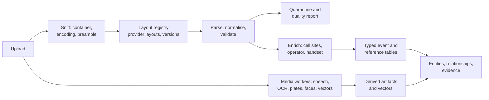
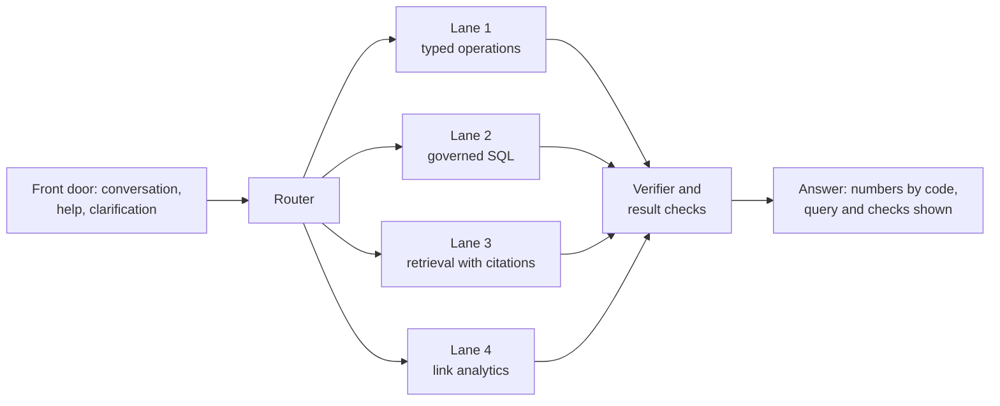
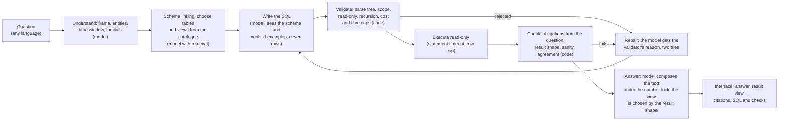

# NexusAI maturity roadmap: every data family, models, schema, query intelligence and link analysis

**Date:** 2026-10-12, revised 2026-10-14, **reconciled with the code and the live system on 2026-10-19** · **Status:** plan in progress. Decisions D1, D2 and D14 to D16 are made and carried out as recorded in section 12; Phase 0 is mostly done and Phase 1 is under way (section 1); the owner's directions of 2026-10-13 and 2026-10-14 on the interface, the Ask engine and the acceptance collection are merged in (sections 6.8, 7.8, 7.9 and 8.5), and decisions D17 to D21 were made by the owner on 2026-10-14 (D21 laptop first) · **Author:** Claude session `local_c615940b` for the product owner

**Precedence.** This file sequences work. It does not replace the rules in `docs/architecture/QUERY_ANSWERING_DECISION_20261005.md` (three outcomes, the verifier, the case clock), `AGENTS.md`, or the country profile `configuration/forensic_country_profiles/pakistan.json`. Where it conflicts with an older roadmap, section 2 says which one wins and why.

**Evidence rules used here.** Facts about this repository were read from files or the running database. Facts about the real provider samples come from their structure only (column names, value formats, counts); no value, number, name or address from them appears in this file, and the extracted copies are deleted after use. Facts about outside models, datasets and papers come from web searches made on 2026-10-12; where a source was a vendor page, a mirror or a summary, the table says "verify". Figures from outside are leads to test, not predictions.

**Revision of 2026-10-14.** Merged here, on the owner's instructions: (a) the state of the work since 2026-10-12 (section 1 and 2.1a); (b) **the Ask engine becomes model-written SQL for every data family, link analysis included, with no per-question templates or predefined operations; the model understands the question, writes the query from the schema, and explains the result under the safety wall that stays in code** (sections 3.2, 6.1, 6.2 and 6.8, with 7.2 and 7.4 adjusted); (c) where each new view belongs in the application served at `http://localhost:4181`, with the visual spike's views integrated into it (7.8) and the offline-map defect (7.9); (d) the multimodal acceptance collection as the standing place to test and demonstrate on real-shaped data, and how files are added to it (8.5); (e) new gaps G35 to G45 (section 10); (f) the phases re-planned and the next 14 days counted from 2026-10-14 (section 11); (g) decisions D17 to D21 (section 12). Earlier text is kept; where it was overtaken, an italic *Update 2026-10-14* line says so. **This revision is a plan only: nothing in sections 6.8, 7.8 and 8.5 has been built.** *Update 2026-10-19: superseded. Milestones M1 and M2 of 6.8 are built, measured and live behind their switches, M3 is partly built, rows 1 to 3 of 7.8.3 are built, 8.5 (wave 1) is not started. The reconciliation paragraph below and the sections it points to (1, 2.1b, 6.8.11, 6.8.13, 10, 11, 12) say exactly what is true.*

**Reconciliation of 2026-10-19.** The plan was read against the repository, the live database and stack, and the measurements recorded in `docs/data/ask-engine-v2.md`, `docs/data/analysis-views.md` and the handoff. Nothing in the plan was removed. What changed: section 1 has a progress table for 2026-10-14 to 2026-10-19; 2.1b says what is now true by area; 6.8.11 carries a status for each milestone and 6.8.13 the laptop measurements and the budgets they set; 7.8.3 says which rows are built; section 10 lists the gaps whose status changed and six new gaps (G47 to G52); section 11 has the outcome of the last 14 days and a new plan for 2026-10-19 to 2026-11-02; section 12 adds D22 (decided) and lists the decisions still open. **Where this paragraph and an older sentence disagree, this paragraph wins.**

---

## 1. The answer in one page

**Where we are.** The question-answering core is strong on test data: on 161 questions with independent keys the lane (model drafts one SELECT, code verifies it, the database computes the answer) went from 39 wrong with the lane off to 0 wrong on the newest fresh seed (2 and 8 on the two seeds before it; the 8 became 2 after fixes, both a defect in how the factory words one question), and 40 of 42 new-shape probes on the multimodal case were right with none wrong. The measurement discipline (keys written independently, gates written first, fresh seeds) is the most valuable asset we have.

**Where we are not.** Five things stand between this and a product that survives real data:

1. **Real provider exports are mostly not ingested correctly yet.** I ran the repository's own CDR and IPDR adapters' `detect_schema` over the header rows of the 13 real layouts you supplied. The CDR adapter recognises **3 of 8** layouts and the IPDR adapter **0 of 5** (4 IPDR layouts and 1 application-usage layout; header-level check, no ingest was run; section 4). Everything downstream, every question, every link analysis, inherits that. *Update 2026-10-14: the registry and Ingest v2 now read all 13 layouts and write typed rows (proven through the live upload on synthetic files of every layout); questions still read version 1 for the cases that exist, and the registry recognises only 6 of the 34 files of the four older collections (`docs/data/typed-family-switch.md`).*
2. **The database cannot yet do the analysis you asked for.** The forensic database has TimescaleDB and `pg_trgm` installed and no relationship table (the entity index has 7 entity types and no edges). The current image already ships pgvector 0.8.1, `cube` and `earthdistance` (available, not installed), so vector search and "cells within N metres" need no image change; PostGIS (containment, line-of-travel, ellipsoid distance) is not in the image and would need a new image and a dump and restore. Only CDR has a typed table; IPDR, ANPR, tower and the rest live as JSON in `forensic.records`. *(Corrected 2026-10-12: the first version of this line said pgvector was missing; the extension list of the image was checked while drafting D2.)* *Update 2026-10-14: the typed tables, pgvector, `cube` and `earthdistance` were applied to the live database on 2026-10-13; the entity and relationship tables exist and are empty; PostGIS is still not in the image.*
3. **Media models are weak where Pakistani evidence needs them most.** Measured in our own sealed tests: plate reading 13 of 22 exact on images, 3 of 41 on video at one frame per second, Urdu OCR 0 of 1 exact (line-level, one fixture), Urdu speech word error rate 45.5% and English 10.8% on small read-speech sets, and no Punjabi or Pashto speech support at all. These are small samples with wide uncertainty, which is itself the finding: we do not yet have test sets that match real evidence.
4. **Link analysis exists on paper.** 79 operations are registered; 62 are only "registered", 4 are product certified, and `relationship_network`, `cross_family_correlation` and `co_travel_or_co_presence` are registered with no independent proof. *Update 2026-10-14: the case generator now holds the answer keys for A1, A2 and A5 to A11 and A13, and a loader shows that the typed tables reproduce them (174 SQL checks); no product path answers them yet.*
5. **The Ask engine is still partly rule-based and cannot yet answer link-analysis or typed-family questions.** *(Added 2026-10-14 on the owner's direction.)* Today a question reaches the model-written SQL lane through a router and a view shortlist built from curated vocabulary (the code says so: the shortlist is deterministic and "not an embedding ranker", because embeddings caused two live defects), the lane reads curated views over `forensic.records`, and the typed lane, the older ladder and retrieval answer the rest. That is safe and measured, and it is also the dependence on predefined paths that you asked us to remove. Nothing lets the model write a query over the typed tables, the entity and relationship layer or a chain of joins, so a question such as "how are X and Y connected" has no path to an answer. Section 6.8 is the design. *Update 2026-10-19: built as milestones M1 and M2 and live (see the table below); the shortlist and the example retrieval are rule-based by design and are measured (recall 100% on the author's English set, which says little about analysts' own phrasing); the older paths still answer whatever the engine declines.*

**Progress since this plan was written (2026-10-12 to 2026-10-14).** Each line is recorded in a commit and, where it touched the live system, in a runbook or handoff entry.

| Item | State on 2026-10-14 | Where |
|---|---|---|
| Real-data vault and policy (D1), reconciliation and structure tools | Done; vault created; samples registered with their authority; 32 tool tests and 13 vault checks | `docs/data/real-data-handling-policy.md`, `tools/real_data/` |
| Layout registry v1 | 13 layouts, all `draft` until each is confirmed on a real file; recorded in the live `forensic.layout_versions` (14 rows) on 2026-10-13; 54 tests | `docs/data/layout-registry.md` |
| Licence ledger | 83 rows (18 approved, 34 conditional, 8 blocked, 23 unverified) with a checker | `docs/compliance/` |
| Database migration (D2) | Applied to the live database on 2026-10-13 after a validated backup and a rehearsal: 18 tables and 3 extensions, nothing existing changed | `docs/data/d2-migration-runbook.md` |
| Case generator with planted truth | Steps 1 to 6 built: 20 cases with a hash register, oracles for A1, A2, A5 to A11 and A13, a loader whose 174 SQL checks equal the key | `docs/data/case-generator-spec.md`, `tools/case_generator/` |
| Phase 0 visual spike (D14 to D16) | Built and decided: Cytoscape.js, MapLibre GL JS, Apache ECharts; the shared tile service reached through our own cache (built and tested, not deployed) | `docs/roadmap/visual-spike-findings-20261013.md`, `tools/visual_spike/`, `tools/tilecache/` |
| Ingest v2 (typed writer) | Running in shadow on the live worker since 2026-10-13: call records, internet records and application usage are also written to the typed tables with lineage; proven on one synthetic file per layout (live upload); a UTF-16 `.txt` export and an Excel 2003 XML `.xls` export now reach it; version 1 was found to give wrong event times to eight workbook layouts | `docs/data/ingest-v2.md` |
| Typed family switch | First slice for call records, lane only: migration 016 (a view with the columns of `forensic.records`) and `FORENSIC_TYPED_FAMILIES`; built and tested, **not applied, not deployed** | `docs/data/typed-family-switch.md` |
| Product fixes from the rehearsal | G12, G13, G14 and G31 fixed and deployed on 2026-10-12 (API image `012863c71aad`) | handoff |
| The application as it is | Read on 2026-10-14: seven analyst pages and ECharts, no graph or map library, two of the five collections configured (section 7.8) | section 7.8 |

**Progress since 2026-10-14 (to 2026-10-19).** Each line is in a commit and, where it touched the live system, in the handoff.

| Item | State on 2026-10-19 | Where |
|---|---|---|
| Analyst views and the read-only role (M1, D19) | Migration 017 (schema `analyst`, seven views, role `forensic_analyst_ro`) **applied to the live database on 2026-10-15** after a backup and a rehearsal; migration 019 (a cell's position from the records that observed it) applied 2026-10-16 | `docs/data/analyst-views.md`, `db/forensic_records/017_*`, `019_*` |
| **The Ask engine v2 (M1, M2)** | Built and live: catalogue, validator (a 96-statement red team, all refused, with a control), obligations, probe, executor with cost ceiling, timeout, row cap, audit row for every question, coverage guard; `FORENSIC_ASK_V2` and `_FIRST` on, **agreement off** (measured: it abstains on half the questions and doubles the time, 0 wrong prevented); API image `591e0076cc11` | `docs/data/ask-engine-v2.md` |
| Measured runs on fresh seeds (generated cases, independent oracle) | Seeds 73, 79 and 83 each found a defect (the oracle's, the judge's or the engine's) that was fixed and measured again on a fresh seed; **seed 89: 42 of 42, 0 wrong; seed 97: 43 of 43, 0 wrong** (p50 30.5 s, p90 51.4 s on the CPU laptop); factory with the engine first: no verdict changed (the guard declined the 173 questions of the two untyped cases); the project's own demonstration files 25 of 26, 0 wrong; the real collection 6 of 6 | same |
| Coverage guard | The views read typed tables only; a case that is not fully typed is declined with the reason and the older path answers; the live typed cases are the real-data collection and the Ingest v2 synthetic one | same |
| Interface (7.8 rows 2 and 3, 7.7) | The case tab **Connections** (link chart, filters in the address, shared contacts, path, panel with questions, table twin and CSV), **Timeline: Chronology or Places** (map with the offline basemap and a movement slider), **result views by shape** in an Ask answer (link chart, map, with the table one click away), carrier badges, theme and right-to-left checked, accessibility script clean; two read-only endpoints `GET /analysis/connections` and `/places`; 424 workspace tests | `docs/data/analysis-views.md` |
| Phase 1 measurements (laptop CPU, idle) | Reading the prompt about 22 tokens a second, writing about 5.5; a repeated prompt start costs 2 s, a changed one 49 s; a fixed all-in prefix saves about 5 s at the median and changes the SQL in 7 of 12 questions, so it is not adopted; the 18-question red team of the question text: 0 escapes | `docs/data/ask-engine-v2.md` (Phase 1) |
| Audit review of the live table | 541 rows: 21 answered, 520 declined; **347 were the interface's own template requests written as rows** (fixed in source, not deployed) | same |
| **D22: what "connected" means** | **Decided by the owner 2026-10-19: the shared-contact meaning** (two numbers are connected directly or through others, in either direction; the answer names the shared number). Example, answer sentence, oracle and judge changed. **Measured on three fresh seeds:** seed 101 failed the connection gate on the form of three yes-or-no answers (right values, no number named), seed 103 had 0 wrong and two declines, and after a result rule and a question-turn hint **seed 107 was clean: 45 of 45 correct, all 7 connection questions correct and naming the numbers**; a connection question takes 59 to 120 s | `docs/data/ask-engine-v2.md` |
| **Deployed 2026-10-19** (owner's go) | The answer wording fix, no audit rows for the interface's template requests and D22, in API image `0b65976498f3` (rollback tag `before-d22-20261019` = `591e0076cc11`); the six live checks on the real collection 6 of 6, the D22 live check 3 of 3, and a template request writes no audit row (713 rows before and after) | the handoff, `docs/data/ask-engine-v2.md` |

**The plan, in one line.** Make the data right first (ingestion and typed schema for real layouts), then make the questions right for that data in every language we need, then deepen each media family against test sets built from real-shaped evidence, then build link analysis on top of an entity-and-relationship layer that is verified against planted ground truth. Hardware and licensing are decided early because they gate the rest.

**The owner's direction of 2026-10-14, in one line.** The Ask engine understands the question, writes the SQL from the schema, runs it and explains the result, for every data family and for link analysis, without per-question templates; the safety wall, the verifier and the number lock stay in code; every new view is placed where an analyst would look for it in the application at `localhost:4181`; and the multimodal acceptance collection is where each step is tested and shown on real-shaped data.

| Phase | Weeks (estimate) | Outcome you can see | Status 2026-10-14 | Gate to leave it |
|---|---|---|---|---|
| 0. Safeguards and decisions | 0 to 2 | Real-data vault and policy; provider layout registry v1; licence and hardware answers; two demo gaps closed | **Mostly done.** Open: D3 (EliteDesk and shared-prompt-start measurements), D5, D6, D8 (evidence inventory, G10), the Phase 1 gates written down | Owner decisions D1 to D6 made |
| 1. Real structured data | 2 to 8 | The 13 layouts ingest correctly; typed CDR/IPDR/app-usage/cell tables; entity and relationship layer v1; first link analyses (contacts, common contacts, path, co-location, IP attribution) | **Under way.** Typed tables applied, typed writer live in shadow, generator and oracles built, call-record switch built. Open: the switch applied and measured, the other families, the relationship layer populated, real-file confirmation of the layouts | Parity and reconciliation gates in section 11 |
| 2. **Ask engine v2**, questions in every language, conversation and models | 4 to 14 (parallel) | **The engine of 6.8: model-written SQL for every family and for link analysis**; conversation front door on; clarification policy; Urdu, Roman Urdu, Punjabi, Pashto question sets; model bake-off on the GPU | **Not started.** Design in 6.8; first milestone M1 proposed for the next 14 days | Pre-registered engine and bake-off gates |
| 3. Media depth | 6 to 20 (parallel by family) | Speech in 5 languages, Urdu OCR, plate reading and video tracking, face candidates, each with its own sealed test set | Not started | Per-family gates |
| 4. Cross-family intelligence | 14 to 26 | Identifier mention index, entity resolution, relationship scoring, link chart, map, timeline in the workspace | Not started (the spike's views exist outside the workspace) | Planted-truth precision and recall |
| 5. Enterprise | 22 to 34 | Identity and case registry, read-only role (**moved earlier, see D19**), security and load proof, backup and restore | Not started | Release approval |

Weeks are planning estimates for one owner plus Claude sessions and will be re-planned at each gate; they are not commitments.

**Reconciled again on 2026-10-20 (evening): `docs/roadmap/reconciliation-20261020.md` is the later reading of every status below, with the next steps, the re-sequenced phases (a new Phase 1.5, "dependable and fast") and the testing tiers.** **Status of the phases on 2026-10-19.** Phase 0: decisions D1 to D4, D7, D14 to D21 and D22 are made; open are D3 (the RTX 2080 measurement, optional under D21), D5 (stays at detection only), D6 (front door), D8 (evidence inventory), D9, D10 (reviewers), D11, D12 and D13 with D20 (one repository history). Phase 1: typed tables applied, typed writer live in shadow, the call-record and internet-record switch applied **for the real-data collection only** (the four older collections are not typed: G40, G43), generator and oracles built; open: wave 1 into the acceptance collection (D18), the other families' writers, the relationship layer populated, real-file confirmation of the 13 layouts. Phase 2: **started**: M1 and M2 done, M3 partly (6.8.11), the interface placement rows 2 and 3 done; M3 bank stage 1 (A1, A2, A3, A4, A8, A13) built and measured on 2026-10-20, 81 of 81 correct on the unspent judgement case 108 after one fix (details in `docs/data/ask-engine-v2.md`); bank stage 2 (A5 co-location at the hour) measured on judgement cases 102, 104 and 106 the same day, 72 of 72 correct; open: A5 at 15 minutes and A7 possible meetings, M4 to M8, the front door, languages, the bake-off. Phases 3 to 5: not started.

**Every phase ships its interface.** *(Owner instruction, 2026-10-13.)* A capability is not finished until an analyst can use it in the interface, with charts, link charts, maps and timelines suited to it, drilling down to the evidence rows, and until it has been tested in the browser on generated cases and shown there. Section 7.7 is the programme; each phase in section 11 lists its interface work, and each gate includes a demonstration.

**The first 14 days** are in section 11. **The decisions only you can make** are in section 12.

---

## 2. Reconciliation: what is true now, and which document wins

### 2.1 State by area (read from the repository and the live database on 2026-10-12)

| Area | Built | Measured | Not built or not proven |
|---|---|---|---|
| Question answering, structured | Governed SQL lane (parse-tree validator, verifier with about twenty kinds of check, read-only executor, case clock), stage 2 on since 9 Oct; 17 semantic-layer families; 412 specs | 0 to 2 wrong per 161 on three fresh seeds; 40 of 42 probes right, 0 wrong on the multimodal case; 18 of 19 rows of the 28 Sep demo script still match | Speed (median 27 s on mixed families); two month-against-month shapes; free-word conditions; value lists |
| Question answering, text evidence | Retrieval with citations (full-text, trigram, vector) | 8 of 15 hand-written multimodal text questions answered | Routing errors (a document question sent to the access-log family); evidence inventory ("how many images") withheld |
| Operations catalogue | 79 registered operations | 4 product certified, 1 fixture certified, 12 source validated, 62 registered only | Independent proof for relationship and correlation operations |
| Ingestion, structured | Worker with 5 adapters (CDR, IPDR, ANPR, subscriber, tower), time policy, XLSX and TSV readers, schema profile | Adapters tested on repository synthetic fixtures | Real provider layouts: 3 of 8 CDR, 0 of 5 IPDR recognised (section 4) |
| Database | PostgreSQL 16, TimescaleDB 2.28 (hypertables `records`, `cdr_records`), RLS by tenant, `pg_trgm`, custody chain | 10,168 rows in the multimodal case, 23,080 across two cases | No relationship table, no typed IPDR/ANPR/tower tables, no read-only analyst role, no case registry; pgvector 0.8.1, `cube` and `earthdistance` are in the image but not installed; PostGIS is not in the image |
| Models in the worker | Qwen3-4B-Instruct (CPU, Q4_K_M), Qwen3-Embedding-0.6B, faster-whisper small (Urdu), whisper tiny, PaddleOCR PP-OCRv5 Arabic, FastALPR (YOLOv9-t 384 plus CCT-XS-v2), ONNX video ANPR V3, YuNet plus SFace, SigLIP base | See the media numbers in section 1 | TTS disabled; no diarization, language ID, reranker or tracker in the product |
| Link analysis | `frequent_contacts` and `temporal_activity` (product certified), `multi_source_comparison` (fixture certified), a multi-CDR common-contact comparison | Hand-authored three-source golden | Path, co-location, chaining, community, IP attribution, cross-family links |
| Governance | RLS, custody hash chain, country profile with real-data policy and provider onboarding steps | Isolation specs | Real per-user identity (the UI sends one fixed actor), case owner and members, read-only role |

### 2.1a What changed between 2026-10-12 and 2026-10-14

| Area | Now (2026-10-14) | Still missing |
|---|---|---|
| Ingestion, structured | Layout registry (13 drafts); shared readers; typed writer in shadow on the live worker (call records, internet records, application usage); UTF-16 `.txt` and Excel 2003 XML `.xls` exports reach it; quality summary in the audit log | Typed writers for ANPR, subscriber, tower reference, transactions and access logs; layouts for the canonical-header files of the existing cases; a typed quarantine table; each draft layout confirmed on a real file |
| Database | Typed, reference, entity and relationship tables, pgvector, `cube`, `earthdistance` applied; typed rows only for the synthetic collection (3,580 call, 1,534 session and 505 application-usage rows) | Relationship tables empty; no backfill of the existing cases; no read-only analyst role; PostGIS not in the image |
| Question answering | Governed lane first and persistent; G12, G13, G14, G31 fixed; call-record typed switch (lane only) built, migration 016 not applied | **The Ask engine of 6.8**; the other families; the typed compiler and the older path still read version 1 |
| Link analysis | Generator oracles for A1, A2, A5 to A11, A13; typed tables reproduce them | Any product path: no model-written SQL over the typed tables, no entity or relationship population |
| Interface | Workspace with Dashboard, Cases, Overview, Evidence with viewers, Ask, Timeline, Activity and ECharts; the spike's Cytoscape link chart, MapLibre map and ECharts timelines outside it | None of the spike's views in the workspace; no graph or map library in it; two of five collections configured; the spike's map shows nothing while the tile cache is not running (7.9) |
| Test data | 20-case generated set with hash register; 13 synthetic uploads in `ingest-v2-shadow-synthetic-20261013`; the acceptance collection (43 sources, 10,168 structured rows) | Real-shaped files in the acceptance collection and a repeatable way to add them (8.5) |
| Governance | Licence ledger; vault and policy | Read-only role, case registry, identity |

### 2.1b What changed between 2026-10-14 and 2026-10-19

| Area | Now (2026-10-19) | Still missing |
|---|---|---|
| Question answering | The Ask engine v2 answers call-record and internet-record questions on the typed cases, first and persistent (`FORENSIC_ASK_V2`, `_FIRST`), over the analyst views, with the obligations, the probe, a coverage guard and one audit row per question; p50 30.5 s and p90 51.4 s on the laptop, 0 wrong on the last two fresh seeds | M3's bank (A5 co-location, A7 possible meetings, A8 device and SIM changes through the engine at scale), M4 to M8; the untyped cases are still answered by the older paths (minutes when the lane declines) |
| Link analysis | Common contacts, connections (shared-contact meaning, D22), devices, address holder and cells used are answered through the engine and drawn in the workspace (Connections, Places, result views); the oracles of A1, A2, A5 to A11, A13 exist | Questions for A5, A7 to A11 through the engine; the relationship tables are empty; the question bank of G46 |
| Database | 017 and 019 applied (the analyst schema and role); typed rows for the real-data collection and the synthetic Ingest v2 collection | Two of the four older collections are typed (multimodal acceptance, forensic-demo; 2026-10-20), runtime-acceptance and records-demo are not; PostGIS not in the image; no per-user rate limit |
| Interface | Connections, Places, result views by shape, carrier badges, a theme-aware link chart and map, the Data tab for the real-data collection; 4 collections configured | Lanes, calendar, entity drawer, the quality tab and import wizard, the demonstration panel, the dashboard engine tile, the Activity triage queue (7.8.3 rows 1 and 4 to 14); the code lives in two working trees that are copied by hand (D20, G51) |
| Governance | Read-only analyst role live; per-statement cost, timeout and row cap; audit row per question; commit gate repaired for the lane (`.githooks/pre-commit`, lane-only Go changes); real-data scanner | Per-user identity, case registry, rate limit |
| Process | Gates written before runs and recorded; fresh seed after every fix; the oracle's and the judge's own defects reported (three in run 1, two in run 2) | The judgement and sealed cases of the generator's register have not been used for an engine gate yet |

### 2.2 Conflicts between documents, and the ruling

| Conflict | Ruling |
|---|---|
| `nexusai-next-generation-roadmap.md` says NX-Q2 (dynamic query intelligence) must use "no unrestricted SQL"; the 5 Oct decision lets the model write one SELECT. | **The decision record wins.** The lane is governed, not unrestricted: server-built views, parse-tree allowlist, read-only, scoped. NX-Q2 is delivered by the lane plus the typed lane; no change to the safety wall. |
| Two sequences exist: R0 to R9 (`ROADMAP_FREE_QUESTION_20261005.md`, restated in the decision record) and the NX tracks (NX-B2.1, NX-S2, NX-M2, NX-D2, NX-Q2, NX-X2, NX-C2). | **This file merges them** (table 2.3). New work is tracked in this file's phases; the NX names stay as labels for scope. |
| NX-B2.1 aimed at certifying all 79 operations one by one. | **Superseded for exact analytics by the verifier.** Operations remain the typed lane and the building blocks of link analysis, but a question is trusted because the lane verified it, not because its operation was certified. Certify the operations that link analysis needs (section 7), not all 79. |
| The decision record says names of people are not answerable because no field holds one. The subscriber layer does hold `full_name` (PII, masked). | Not a conflict in behaviour: the field exists but is not exposed to the model. Keep it, and state it as policy: names are masked, a question that names a person abstains and asks for a number, and a person-to-number link needs a verified source (section 7). |
| Accuracy so far was measured on synthetic and demo cases; real samples now exist. | **New rule: real data is a test input, never a repository file.** Real files are profiled for structure, and shape-preserving synthetic goldens are generated from the profile (the country profile already requires this). |
| The decision record's hardware section assumes the CPU laptop. | Re-measure on the owned HP EliteDesk with the RTX 2080 before any purchase (section 9). |
| This plan (10-12) made lanes 1 and 4 (typed operations and analytics procedures, written by code) the home of link analysis and left the model as a parameter filler there. The owner's direction of 2026-10-14 is model-written SQL for every family and for link analysis, without per-question templates. | **The owner's direction wins.** Lane 2 becomes the Ask engine for every family (6.8); typed operations stay as independent oracles in the tests and as optional, measured accelerators, never as a prerequisite; heavy graph computations that SQL cannot express are tools the model calls with its own parameters. The safety wall of the decision record is unchanged. |
| Section 6.2 and principle P1 say the model never sees case rows. Explaining a result "through the model" needs the model to see the result. | **A decision is needed (D17).** Proposal: the model sees only the query result the analyst is already looking at, with sensitive columns masked, capped in size, never free evidence text outside the retrieval lane, on local models with no network egress; the number lock stays. Until D17 is made the engine shows the deterministic sentence and uses the model only to understand the question and write the query. |
| `docs/ux/NEXUSAI_PRODUCT_UX.md` 6.6 keeps the compiled plan and SQL "one level deeper, for admins and audit" and fixes the order of the Ask screen. | The contract's order and states stay. Section 9 and 13.3 also say an analyst never sees SQL or a model, and 6.6 allows narration below the deterministic answer. Decision D17 chooses between two options. Option A (recommended, no amendment): the analyst sees the derivation and the checks in plain words, the query stays one level deeper for administrators and audit as the contract says, and narration stays visually separate from the deterministic result. Option B: a named power-user role may open, edit and re-run the query (needs contract 9 and 13.3 amended). |
| Section 7.7 said the interface has no chart library. | Out of date for the workspace: `apps/investigation-workspace` already uses Apache ECharts 6.1 (and has no graph or map library). The statement was about `core/http/react-ui`. Corrected in 7.7. |

### 2.3 How the two sequences map

| Old label | Meaning | Where it lands here |
|---|---|---|
| R0, R1 (factory), M1 (measure the lane) | Done | Section 2.1 |
| R1b (free-word conditions), R2, R3 | Typed-lane verifier, new primitives | Phase 2 |
| R4 (governed SQL) | Done | Phase 2 extends it |
| R5 (retrieval path) | Text evidence | Phase 3 (documents) and Phase 4 (mention index) |
| R6 (retire the keyword ladder) | After parity | Phase 5 |
| R7 (speed) | Hardware and shared prompt start | Phase 0 and Phase 2 |
| R8 (model bake-off), Phase 5 fine-tuning | Only after a measured gap | Phase 2 and Phase 3 |
| R9 (identity, case registry, read-only role) | Owner decision | Phase 5, with the schema work started in Phase 1 |
| NX-S2 | Structured depth | Phase 1 |
| NX-M2 | Media depth | Phase 3 |
| NX-D2 | Documents, OCR, language | Phase 3 |
| NX-Q2 | Dynamic multilingual query intelligence | Phase 2 |
| NX-X2 | Cross-family intelligence | Phase 4 |
| NX-C2 | Enterprise certification | Phase 5 |
| NX-ADV | Advanced capability | Only by individual approval |

---
## 3. Principles and target architecture

### 3.1 Principles

Kept from the decision record and `AGENTS.md`: exact facts come from deterministic code and the database; the model never sees case rows and never writes a number into prose; abstention is a success and a confident answer to a different question is the one defect that must reach zero; every behaviour sits behind a default-off switch with gates written before measuring; real data never enters the repository.

New in this plan:

| # | Principle | What it forces |
|---|---|---|
| P1 | Every number shown carries lineage to source rows, the file, the layout and the mapping version that parsed it | Layout and mapping versions are stored on every row |
| P2 | A parser change is a data change | Re-parsing writes a new version; earlier answers keep their lineage |
| P3 | Each model has one role, a registry entry (id, hash, licence, languages), a sealed test set and a decision rule written first | No model is swapped or shipped on a leaderboard score |
| P4 | Associations are labelled by kind and strength and never called identity or ownership | Edges are `observed`, `inferred` or `candidate`, each with evidence rows |
| P5 | Sensitive capabilities are off by default and enabled per case with recorded authority | Face matching, voice biometrics, tower dump and geofence queries carry a legal-basis field and an audit trail |
| P6 | Time and place are first-class | Every event has a source time zone and a time basis; every location has a method and an uncertainty radius |
| P7 | Licence before download | No model or dataset is fetched or shipped without a licence ledger entry; downloads stay behind your approval |
| P8 | A capability is done when it has its interface | Every analysis ships with its view, its browser test on a generated case and a demonstration at the gate; the interface is reviewed and improved at every stage, not at the end (section 7.7) |
| P9 | Pictures tell the truth the tables tell | A chart, graph or map shows nothing a query and its evidence rows do not support: it carries the observed / inferred / candidate labels, the uncertainty, the conditions and a way to see the rows behind every mark |

### 3.2 Target architecture

**Ingest and store**



**Question answering**



| Plane | Contents | State |
|---|---|---|
| Ingest | Sniffing, layout registry, parsers, quality report, enrichment, media workers | Partly built: five adapters, shared worker; layout registry and quality report are new |
| Store | Typed tables, reference tables, entity and relationship tables, derived artifacts, vectors, geometry | Partly built: TimescaleDB, `records`, `cdr_records`, `derived_artifacts`, `record_entities`; typed families, vectors (pgvector is in the image), earth-distance lookups and relationships are new; PostGIS needs a new image (D2b) |
| Semantic layer | Curated families, synonyms, sensitivity, one YAML per family | Built for 17 families; extended with every new table |
| Question answering | Front door, router, four lanes, verifier | Lanes 1 to 3 built; front door built and off; lane 4 is new. *Revised 2026-10-14: the Ask engine of 6.8 replaces the lane split as the main path.* |
| Models | One registry with roles, hashes, licences, hardware needs | Catalogue exists in `configuration/`; a role-based registry with decision rules is new |
| Governance | Tenant isolation, custody chain, audit, masking, authority metadata | Partly built; identity, case registry, read-only role, per-capability policy are new |
| Evaluation | Question factory, probes, corpus, pre-flight, gates | Built for structured data; case generator with planted truth, per-modality sealed sets, multilingual sets are new |

**Question answering, revised 2026-10-14 (the Ask engine; detail in 6.8).** The diagram above shows the plan as written on 2026-10-12. On the owner's direction the main path is one engine for every family:



Retrieval (text, transcripts, OCR with citations) stays its own path and is called by the engine for questions about what a document or recording says. The model writes and explains; code validates, executes, checks and counts. Section 6.8 has the steps, the catalogue the model reads, how link analysis is asked, the checks, the safety prerequisites, the evaluation and the milestones.

---

## 4. Real samples, ingestion and schema

### 4.1 What the samples are

You supplied 13 distinct layouts across four operators, plus report metadata. They were read for structure only: column names, value formats, row counts. No value is reproduced here.

**Call records and geofence (tower dump) files**

| ID | Layout | Container | Columns that matter | Time format | What is unusual |
|---|---|---|---|---|---|
| C1 | "Company format", Mobilink-style, 16 columns | xlsx | Sr #, Call Type, A-Party, B-Party, Date & Time, Duration, Cell ID, IMEI, IMSI, Site, Longitude and Latitude, Node ID, IP, Port, Description, MACAddress | Excel serial number | Direction is inside Call Type ("Incoming SMS", "InComing", "Outgoing"); Cell ID is alphanumeric; no end time |
| C2 | `STRT_TM` layout, 14 columns (operator not stated) | xlsx, 3 preamble rows | CALL_TYPE ("Call - Incoming"), MSISDN, STRT_TM, BNUMBER, MINS, SECS, LAC_ID, CELL_ID, IMEI, SITE_ADDRESS, LNG, LAT | text dd/mm/yyyy hh:mm:ss | No IMSI, no end time; duration split into minutes and seconds |
| C3 | Ufone-style, 17 columns | xlsx, 3 preamble rows | IMEI, IMSI, A Number, B Number, Start Time, End Time, Service Provider, Type, Direction, Location, Cell Id, Cell Sector, Latitude, Longitude, Duration | Excel serial number | "Service Provider" is the peer network, with casing variants (ufone, UFONE) and labels such as INTERNET, SHORTCODE, UNKNOWN, INTERNATIONAL, NEW_NETWORK |
| C4 | Telenor-style, 18 columns | xlsx | MSISDN, call_org_num, CALL_DIALED_NUM, IMSI, IMEI, CALL_START_DT_TM, CALL_END_DT_TM, INBOUND_OUTBOUND_IND, Call_Network_Volume, Lac_Id, Site_Id, Cell_SITE_ID, lat, longitude, CALL_TYPE, location | Excel serial number | The repository's reference format: the one the adapter was written for |
| C5 | Mobilink geofence, 7 columns | xlsx | Sr #, Call Type, A-Party, B-Party, Date & Time, Duration, IMEI | Excel serial number | No cell columns; the file name carries a code, so the cell is probably implied by the query (confirm) |
| C6 | Telenor geofence, 15 columns | xlsx | C4 without a few columns; `CALL_ORIG_NUM` | Excel serial number | Header spelled `ORIG` where the adapter expects `org`; direction is numeric (0, 1 or 2) and 0 co-occurs with the GPRS rows, so it probably means "no direction" (confirm) |
| C7 | Ufone geofence, 13 columns | xlsx | CALL_START_DT, IMEI, IMSI, A_Number, B_Number, Call_Start_Time, Call_End_Time, Call_Duration, Cell_ID, LAC_ID, Cell_ID, CALL_INBOUND_OUTBOUND_DESC, LOCATION | text date plus text time | Two columns are both called `Cell_ID` (10 digits and 5 digits) |
| C8 | Zong geofence, 13 columns | xlsx | DLD_NO, CLD_IMIE, DLG_NO, CLG_IMEI, DIR_FLG, CLR_OEPRATOR, RCVR_OPERATOR, DRTN, STRT_TM, END_TM, ACTVY_TYPE_CD, LAC_ID, CELL_ID | text m/d/yyyy h:mm:ss AM/PM | Typos in headers and in values ("Incomming"); IMEI present for only one side of each record; peer operator column (PAKTEL, UFONE, MOBILINK, TELENOR, WARID, PTCL) |

**Operator names.** The call-record files C1 to C4 do not state their operator. C4 matches the Telenor-named geofence file column for column, C3 matches the Ufone-named one in vocabulary, and C1 matches the Mobilink-named one; C2 matches none of them. The country profile forbids inferring an operator from a number prefix, so treat these names as labels for the layouts and confirm each against the operator's export documentation.

**Internet records and application usage**

| ID | Layout | Container | Columns that matter | Time format | What is unusual |
|---|---|---|---|---|---|
| I1 | Jazz UFDR, 32 columns, plus a "Basic Information" metadata file | CSV, UTF-8 with BOM | UFDR start and end, IMSI, MSISDN, IMEISV, NAT start and end, Public IP and port, UE IP and port, Server IP and port, APN, charging characteristics, RAT type, gateway and serving node IP, ECGI, SAI, CGI, category, application, sub-application, protocol type, URL, bytes and packets up and down, duration in ms, data source | ISO, to the second | Two address spaces (UE IP private, Public IP after NAT); a 4G cell identity; several files are queried by NAT source IP, not by number |
| I2 | Telenor export, 18 columns | CSV | Start, End (milliseconds), Duration (ms), Active Time, IMSI, MSISDN, Private Source IP and Port, Protocol, Public Source IP and Port, Dest IP and Port, URL, APP Type, Service Type, CI | ISO with milliseconds | CI is one composite string of cell information |
| I3 | Ufone, 18 columns | SpreadsheetML XML saved with an `.xls` extension | Public IP, Public Port Start, Public Port End, Log Date, app, host, imei, imsi, msisdn, sid, url, cell/eci, dst_address, dst_port, lac/tac, protocol, src_address, src_port | text dd.mm.yyyy hh:mm:ss | A public port range per row; a numeric protocol (one and two digit codes, probably 6 and 17); a session id |
| I4 | Zong, 27 columns | UTF-16 tab-separated text with a 7-line metadata header, and the same data as xlsx | Public IP and Port, NAT Begin and End, Start and End, IMSI, MSISDN, IMEISV, MS IP and Port, Server IP and Port, APN, RAT, Serving and Gateway Node IP, bytes, category, application, sub-application, protocol type, URL, User Agent | text dd/mm/yyyy hh:mm | Two files, two encodings, one dataset |
| A1 | Application-usage export, 12 columns | xlsx, sheet named in Chinese | Start Time, End Time, MSISDN, IMSI, IMEI, Terminal, APN, APP Category, APP, APP Feature, Province, City | ISO | No IPs, bytes or cell; location only as province and city; handset model as text |

**Report metadata.** The Jazz "Basic Information" files carry the application name, report name, analysis time, analyst, query criteria (an MSISDN in one file, a NAT source IP in the other), time range, file generated time and a "shown / total records" pair. That pair is the only completeness signal any file gives.

### 4.2 Findings that change the design

| # | Finding | Consequence |
|---|---|---|
| F1 | 13 layouts, 4 operators, several layouts per operator (call records, geofence, internet) | A **layout registry** with versions and a header fingerprint, not one adapter per family |
| F2 | Several container shapes: xlsx, SpreadsheetML named `.xls`, CSV with and without a byte-order mark, UTF-16 tab-separated text, preambles of 3 and 7 lines, duplicate header names, header typos | Sniffing and preamble parsing before any mapping; typo-tolerant header matching |
| F3 | Times are Excel serial numbers, text in four formats, ISO with and without milliseconds; none states a time zone | A **declared source time zone per layout** and a `time_basis` on every row (`declared`, `assumed_by_profile`, `confirmed_by_analyst`); the country profile already forbids assuming Asia/Karachi from context alone |
| F4 | Party numbers come in 12-digit 92…, 11-digit 03…, 10-digit 3…, 13 and 14 digits (international), 3 to 6 digit short codes, alphabetic sender names, and labels such as INTERNET and UNKNOWN | **Number classes** (`person_like`, `short_code`, `sender_id`, `international`, `service_label`, `unknown`). Services never enter a person-to-person graph |
| F5 | Direction and type are encoded as "Incoming SMS", "InComing", "Call - Incoming", numeric 0 / 1 / 2, "Incomming" | Per-layout enumeration maps; an unknown code is kept and flagged, never guessed |
| F6 | Duration is seconds, minutes plus seconds in two columns, or milliseconds | A unit rule per layout, stored with the row |
| F7 | IMEI is 13, 14, 15 or 16 digits, IMSI is 15 digits (Pakistan's country code is 410 per the country profile), one layout has no IMSI | Length-aware validation; type allocation code (TAC) extracted only where at least 14 digits exist |
| F8 | Cell identity differs by operator: alphanumeric codes, 7, 8 and 10 digit identities, 3 to 5 digit LAC or TAC, ECGI, SAI, CGI strings, a composite "CI" string | A canonical `cell_key` and a parser per operator; a cell **reference** table with validity windows; coordinates found in a file are hints with `method = source_supplied` |
| F9 | Internet records carry NAT: public IP and port against a private UE address, port ranges, two timestamps, and some exports are queried by IP | An `ip_assignment` model with interval logic and an **IP attribution** operation (who held this public IP and port at this time) |
| F10 | One metadata file declares shown and total record counts | Load reconciliation: rows loaded against the declared total, with a flag when they differ |
| F11 | In all four call-record files (C1 to C4) a few rows (2% or fewer) hold Windows network-adapter names and MAC addresses in the `Description` and `MACAddress` columns. They are not call data | A quarantine rule for rows whose populated cells fall outside the table's dominant pattern; the quality report counts them |
| F12 | Some files exist twice, original and "updated", with slightly different row counts | Evidence versions: the update supersedes with a recorded diff and is never double counted |
| F13 | Geofence files hold many subscribers around one cell; call-record files hold one | Two dataset kinds with different question semantics (`target_cdr`, `tower_dump`) |
| F14 | Handset model strings, province and city appear only in the application-usage layout | A device reference (`TAC` to make and model) and an `app_usage` family with its own questions |
| F15 | The peer operator is labelled in text with casing variants and legacy names | An operator alias table; the profile forbids inferring an operator from a number prefix, so the label from the file wins and portability is stated |

### 4.3 What the repository's own adapters do with them

The test ran `detect_schema` from `ingestion/forensic_records/adapters/cdr` and `.../ipdr` over the header row of each layout, with the worker's own `normalize_header`. It is a header-level check: no file was ingested and no database was touched. The worker may also ask for a mapping review when detection fails; the result below says what is recognised automatically.

| Layout | CDR adapter | IPDR adapter | Cause |
|---|---|---|---|
| C1 company format | no (0 of 3 required groups) | no | "A-Party", "B-Party", "Date & Time" are not aliases |
| C2 `STRT_TM` layout | no (1 of 3) | no | "BNUMBER" and "STRT_TM" are not aliases; duration is two columns |
| C3 Ufone-style | **yes** (3 of 3) | no | |
| C4 Telenor-style | **yes** (3 of 3, 16 fields) | no | The reference format |
| C5 Mobilink geofence | no (0 of 3) | no | Seven columns, no identifier or time alias |
| C6 Telenor geofence | no (2 of 3) | no | `CALL_ORIG_NUM` against the alias `call_org_num` |
| C7 Ufone geofence | **yes** (3 of 3) | no | Matches, but the duplicate `Cell_ID` header is not handled |
| C8 Zong geofence | no (0 of 3) | no | Different vocabulary and typos |
| I1 Jazz UFDR | no (1 of 3) | no (0 of 3) | The IPDR adapter requires `source_ip`, `destination_ip` and a timestamp; the file has UE IP, Server IP, Public IP and UFDR start time |
| I2 Telenor export | no (2 of 3) | no (2 of 3) | "Private Source IP", "Dest IP" |
| I3 Ufone | no (1 of 3) | no (0 of 3) | |
| I4 Zong | no (2 of 3) | no (1 of 3) | |
| A1 application usage | no (2 of 3) | no (1 of 3) | A different family |

**Result: 3 of 8 call-record layouts and 0 of 5 internet or application layouts are recognised automatically.** The fix is not more aliases; it is the registry in 4.4, because layouts also differ in time format, units, enumerations and cell identity, which aliases cannot express.

### 4.4 Ingest v2

**Pipeline (each step has a contract and a test):**

1. **Land and protect.** Hash, size and type limits, archive limits (member count, depth, ratio), path-traversal checks; register evidence and custody (exists).
2. **Sniff.** Container and encoding (BOM, UTF-16, XLSX, SpreadsheetML, OLE `.xls`, CSV dialect, JSONL), sheet choice, preamble and footer detection, metadata blocks (4.1 "report metadata").
3. **Detect the layout.** Header fingerprint (normalised, order-insensitive) against the **layout registry**. Each entry is a versioned file: id, operator, family, dataset kind, header signature, column map, time rules (format, zone, basis), unit rules, enumeration maps, number-class rules, cell parser, quirks (duplicate headers, typos, junk columns), golden fixture id.
4. **Unknown layout, assisted mapping.** Profile the columns (value patterns, lengths, distinct counts, time-like columns), propose a mapping by deterministic similarity, and optionally ask the local model for a suggestion constrained to canonical field names. The analyst confirms or edits it; confirmation writes a new registry entry plus a generated synthetic golden. Nothing is promoted without a passing fixture. This is the `provider_onboarding` list already in the country profile, made into a screen.
5. **Parse and normalise.** Typed canonical output; the raw row is kept (JSON) with the layout and mapping version on the typed row.
6. **Validate.** Row rules (time present and in range, direction known, party present, identifier lengths), file rules (declared total against loaded, duplicate rate, time range plausibility, share of quarantined rows).
7. **Quarantine and report.** Rejected and foreign rows go to the errors table with a reason; the analyst-visible **quality report** lists rows read, accepted, duplicate, quarantined by reason, time range, null shares, number-class histogram.
8. **Enrich.** Cell reference join (time-valid), operator label normalisation, handset make and model from the TAC, number-class tagging, server-IP organisation and country from an open registry.
9. **Load.** Idempotent upsert keyed by a canonical hash, lineage kept for every duplicate, entity and relationship tables updated incrementally.
10. **Version.** A re-upload or an "updated" file becomes a new evidence version with a diff; answers keep the version they used.

**Adding data (what the analyst sees).** Drop files; each shows its detected layout, confidence and quality report; one click accepts, or opens mapping review for an unknown layout; a case summary updates (families present, time range, row counts) and the suggested questions refresh from what is actually in the case.

**Status of this pipeline (2026-10-13).** Steps 2, 3, 5, 7 (counts and reasons, not yet a table) and 9 (idempotent load) exist as the typed shadow write in `ingestion/forensic_records/typed_ingest.py`, behind `FORENSIC_INGEST_V2` (off by default; `docs/data/ingest-v2.md`): shared readers, layout detection by the registry, parsing by the layout's rules under the job's time policy (no zone declared: rows are quarantined, never guessed), lineage and hashes, repeats flagged, `ON CONFLICT DO NOTHING`, a quality summary in the audit log. Evidence: 38 unit tests with 20 deliberate breakages caught, a generated case through the code into a throwaway database (174 of 174 SQL checks, row hashes equal to the reference loader's), and the same inside the current worker image as the application role (180 checks, failures contained). **Running in shadow on the live worker since 2026-10-13** (an overlay on the running image; `docs/data/ingest-v2.md` section 9). **Step 3 done the same day (section 10): 13 synthetic files, one per layout, through the live upload; 11 reached the typed writer and match the tested code exactly; two intake gaps found (a UTF-16 `.txt` goes to the document route, **fixed the same day in the worker and verified live: section 11**; a SpreadsheetML `.xls` was registered but never queued, **fixed the same day in the API and the worker and verified live: section 12**), and version 1 was found to give the wrong event time to eight workbook layouts (six store the ingestion instant, one the year 2065, one rejects every row), measured on synthetic files shaped like the real exports.** **Not yet:** file-level validation rules (declared total against loaded, quarantine share), a typed quarantine table, enrichment (step 8), entity updates, versions (step 10), and the unknown-layout assisted mapping (step 4).

**Acceptance for a layout.** (a) A synthetic file with the same shape passes with exact expected counts; (b) a local-only comparison between the real file and the parsed tables passes on aggregates: row count, distinct counts per column, time range, null shares, number-class histogram, direction counts; (c) every quarantined row has a reason; (d) no value from the real file is written to the repository, the logs or a report.

### 4.5 Typed schema

New tables, all with `tenant_id`, `collection_id`, row-level security, lineage (`evidence_id`, `source_row`, `layout_id`, `layout_version`) and a raw payload column. Timescale hypertables for event tables, chunked by seven days.

| Table | Key columns | Notes |
|---|---|---|
| `comm_event` | `event_type` (voice, sms, data, ussd, other), `direction`, `a_raw`, `a_norm`, `a_kind`, `b_raw`, `b_norm`, `b_kind`, `start_utc`, `end_utc`, `duration_s`, `source_tz`, `time_basis`, `imsi`, `imei`, `tac`, `cell_key`, `lac_tac`, `cell_raw`, `lat`, `lon`, `loc_method`, `peer_operator`, `volume_bytes`, `dataset_kind` | Replaces `cdr_records`; one row per event; `a_*` is the party the file is about |
| `data_session` | `start_utc`, `end_utc`, `nat_start_utc`, `nat_end_utc`, `msisdn`, `imsi`, `imei`, `ue_ip`, `ue_port`, `public_ip`, `public_port_from`, `public_port_to`, `server_ip`, `server_port`, `protocol`, `apn`, `rat`, `cell_key`, `app_category`, `app`, `app_feature`, `host`, `url`, `user_agent`, `bytes_up`, `bytes_down`, `packets_up`, `packets_down`, `duration_ms`, `session_id` | IPv4 and IPv6 as `inet` |
| `app_usage` | `start_utc`, `end_utc`, `msisdn`, `imsi`, `imei`, `terminal`, `apn`, `app_category`, `app`, `app_feature`, `province`, `city` | Own family; no IPs |
| `cell_site` | `cell_key`, `operator`, `plmn`, `lac_tac`, `ci_eci`, `sector`, `azimuth`, `beamwidth`, `lat`, `lon`, `geom` (PostGIS, optional D2b), `radius_m`, `valid_from`, `valid_to`, `source` | Time-valid reference; never overwritten, retired sites kept |
| `subscriber` | `msisdn`, `imsi`, `iccid`, `status`, `activated_at`, `deactivated_at`, `valid_from`, `valid_to`, identity fields under field-level access | Exists as a family; typed |
| `device` | `imei`, `tac`, `make`, `model`, `first_seen`, `last_seen` | Derived; TAC reference joined |
| `ip_assignment` | `public_ip`, `port_from`, `port_to`, `valid_from`, `valid_to`, `msisdn`, `imsi`, `imei`, `source_row` | Derived from `data_session`; answers IP attribution |
| `plate_sighting` | `plate_raw`, `plate_norm`, `observed_utc`, `camera_id`, `lane`, `lat`, `lon`, `geom`, `confidence`, `province`, `crop_hash`, `source_kind` (csv, image, video) | Replaces JSON `anpr` rows |
| `entity` | `entity_id`, `entity_type` (phone, imsi, imei, ip, plate, account, cell, device, person), `canonical`, `first_seen`, `last_seen` | Stable identity per case |
| `entity_mention` | `entity_id`, `table`, `row_id`, `role`, `observed_at` | Supersedes `record_entities`; covers media text too |
| `relationship` | `rel_id`, `src_entity`, `dst_entity`, `rel_type`, `kind` (observed, inferred, candidate), `first_seen`, `last_seen`, `evidence_count`, `features` (jsonb), `score`, `derivation_id` | Typed edges |
| `relationship_evidence` | `rel_id`, `table`, `row_id` | Every edge is explainable to rows |
| `derivation` | `derivation_id`, `procedure`, `parameters`, `code_version`, `run_at`, `seed` | Records how an inferred edge or score was produced |
| `case_registry`, `case_member`, `case_authority` | owner, members, legal basis, enabled capabilities | R9; in Phase 5 |

**Drafted 2026-10-12, not applied.** Migrations `012_typed_families.sql` to `015_vectors_and_earth.sql` implement this table with these differences: `subscriber` is split into `subscriber_registration` (facts) and `subscriber_identity` (name, national ID number and address, with no access for the runtime role until R9); `device` is not a table (an `imei` entity plus `device_tac` covers it); `layout_versions`, `camera_site`, `ip_range_reference`, `derivation` and `content_embedding` are added; `case_registry`, `case_member` and `case_authority` stay in Phase 5; face relationships and face vectors are excluded while the face policy is at L0. Each typed row keeps its own `raw_payload`, so the legacy JSON copy in `forensic.records` can be retired after parity. Runbook: `docs/data/d2-migration-runbook.md`.

**Extensions.** Available in the current image and used by the drafted migration 015: pgvector 0.8.1 (text and image vectors; an HNSW index is created per model once a model is chosen; face vectors are excluded while the face policy is at L0), `cube` and `earthdistance` (radius lookups on cell sites and cameras now, as a spherical approximation). Not available: PostGIS (ellipsoid distance, containment in geofence polygons, line-of-travel). It needs a different image and a dump and restore, because the Alpine image (musl) and the usual PostGIS images (glibc) can order text differently, so it is proposed separately as D2b with a syntax-checked draft that has never been run. `btree_gist` is not needed by anything drafted. Installing extensions is a database change and needs your approval.

**Indexes and performance.** Hash and B-tree on normalised identifiers; GiST on geometry; BRIN or Timescale chunk pruning on time; partial indexes by `dataset_kind`; Timescale continuous aggregates for the daily contact matrix and hourly cell activity so the lane and link analyses read small tables.

**Read-only analyst role (R9).** A database role that can read only the analyst views, so a mistake in the validator still cannot reach a base table.

### 4.6 Migration: expand, then contract

1. Add the new tables and extensions in a numbered migration with preflight, verify and rollback scripts, following the pattern of `008_phase3_evidence_control_plane.sql` with its helper scripts in `ops/008_phase3_evidence_control_plane/` (helper scripts never sit at the top level, where a fresh database would run them).
2. Make the worker dual-write the old and new shapes.
3. Backfill from `forensic.records` JSON and `cdr_records`; reconcile with SQL (row counts, distinct counts, hashes) before anything reads the new tables.
4. Switch one family's semantic-layer views to the typed table, re-run that family's factory set and the corpus; the lane's gates must hold or the family stays on the old view. *First slice built 2026-10-14 for call records, lane only, switch off and migration 016 not applied: `docs/data/typed-family-switch.md`.*
5. Retire the JSON-backed view for a family only after two weeks of parity. Keep the old table for rollback until then.

---
## 5. Per-family maturity plans

Each plan has the same parts: where the family stands, what it becomes, the models and data, the questions it must answer, and what "done" means. Numeric targets are **proposals to be pre-registered** before the first measurement, as every gate in this project has been; where a baseline is unknown the target says "set after baseline".

### 5.1 Call records and geofence files (voice, SMS, data events)

| | |
|---|---|
| **Now** | One adapter (Telenor-style), typed `cdr_records`, 18 registered operations (2 product certified), lane views. 3 of 8 real layouts recognised |
| **Becomes** | All eight layouts in the registry (C1 to C8); `comm_event`, `cell_site`, `device`; two dataset kinds (`target_cdr`, `tower_dump`); every row with a declared time zone and basis |
| **Ingest** | Number classes (F4), direction and type maps (F5), units (F6), foreign-row quarantine (F11), declared-total reconciliation (F10), versions for "updated" files (F12), duplicate header handling, Excel serial dates |
| **Enrich** | Cell reference by operator with validity windows; handset make and model from the type allocation code (an open TAC list needs checking: the commercial GSMA list is not open); peer-operator alias table |
| **Questions it must answer** | Counts and rankings by number, direction, type, day, hour (case clock); duration thresholds with units; first and last seen; silence gaps; busiest day; SMS against voice; international, short-code and sender-ID splits; IMEI and IMSI changes; for tower dumps: who was at cell X in a window, which numbers appear at two cells, devices seen at three or more sites |
| **Analyses** | Contact profile, common contacts, paths, co-location (section 7) |
| **Done means** | Layout acceptance (4.4) for C1 to C8; question-factory set built on multi-provider synthetic cases: at least 90% correct and at most 1% wrong; every answer states its time basis; load reconciliation shows zero silent drops |
| **Risks** | Operator format drift (answer: the registry versions every layout and a failing golden blocks promotion); time zone ambiguity (answer: declared per layout); tower-dump legal exposure (section 9) |

### 5.2 Internet records (IPDR, UFDR) and application usage

| | |
|---|---|
| **Now** | Generic adapter, JSON rows, 7 registered operations; 0 of 5 real layouts recognised |
| **Becomes** | `data_session`, `app_usage`, `ip_assignment`; layouts I1 to I4 and A1; metadata files parsed into the evidence record; IPv4 and IPv6 |
| **Ingest** | Streaming load for files of millions of rows; public port ranges; two timestamps (flow and NAT); duplicate text and xlsx copies of one dataset; query criteria stored (by number or by NAT source IP) |
| **Enrich** | Server IP to organisation and country from an open registry (licence to verify); domain and application taxonomy (vendor category vocabularies mapped to one canonical list); user-agent parsing into device and operating system |
| **Questions it must answer** | Top applications and domains by period; night usage; volume spikes; sessions during a call; first and last use of an app; **IP attribution** (who held this public IP and port at this time); numbers that shared a public IP in a window; numbers that reached a domain; usage by handset model |
| **Verification added** | An attribution answer must state the interval logic and list every candidate when two subscribers could hold the same public IP and port range, never a single name when the evidence is ambiguous |
| **Done means** | Parity with an independent Python computation on synthetic cases with planted address-translation collisions; real-file aggregate reconciliation; attribution precision and recall of 1.0 on unambiguous plants and an explicit "ambiguous" on collisions |
| **Risks** | Shared-address ambiguity (stated, not hidden); volume (partitioning, continuous aggregates); URLs are sensitive (field-level masking by case policy) |

### 5.3 Subscriber, SIM, device and cell reference

| | |
|---|---|
| **Now** | Subscriber and tower adapters with synthetic fixtures; subscriber `full_name` and `cnic` are PII and masked; no real subscriber or tower-reference sample was supplied (the "GF" files are geofence call data, not reference) |
| **Becomes** | Valid-time subscriber table; SIM and device tables; time-valid `cell_site` with geometry, sector and uncertainty |
| **Needs from you** | Samples of provider subscriber exports and cell-site lists, under the same real-data policy |
| **Questions it must answer** | Who was registered to this number at this time; ownership history without merging conflicting rows; SIMs per device and devices per SIM; reused numbers; where a cell is and how sure that is |
| **Policy** | A person-to-number statement is always "registered subscriber per source X at time T", never identity or guilt |
| **Done means** | Valid-time tests with planted reuse, swaps and conflicts; coordinate audit; conflict audit; an open cell list (for example OpenCelliD, licence to verify) used only as a labelled low-confidence fallback |

### 5.4 Plates: structured sightings, images and video

**Measured baselines (our own sealed tests, 2026-08-30):** on images, plate detection 20 of 22 and exact reading 13 of 22 (59%) on the sealed holdout (5 of 10 on development); on video at one frame per second, 3 of 19 events and 3 of 41 plate occurrences read exactly (7%). The video number is from the old sampling policy; the V3 pipeline at 4 frames per second has not been measured on the same sealed video. The sets are small, so the intervals are wide.

| Component | Now | Plan |
|---|---|---|
| Evidence for training and testing | 32 human-labelled images, one 60 s video; synthetic packs; dataset registry with licence status | Build a Pakistani plate set: owner-authorised capture (a protocol exists), synthetic plates from province and series templates, and public sets after licence review. Sealed holdout of at least 300 plate tracks across day, night, rain, blur and angle, with frame-level boxes. Registry already records: CCPD (MIT, usable for detector robustness, not for Pakistani reading), P-LPCD Punjab set (licence conflict to resolve), UFPR-ALPR and RodoSol (non-commercial: evaluation only or rejected) |
| Detector | FastALPR YOLOv9-t 384 (package tagged MIT; YOLOv9's upstream terms need review) | Fine-tune on Pakistani data; compare licence-clean alternatives (RT-DETR family and YOLOX are Apache-2.0, to verify). Decision rule: recall at IoU 0.5, then false positives per hour, then latency |
| Reader | CCT-XS-v2 global model (package tagged MIT) | Fine-tune on Pakistani crops; constrain decoding with province and series grammar; keep the top candidates with confidence; challenger: fine-tuned PaddleOCR recogniser |
| Video | ONNX V3 at 4 frames per second, plate groups with first and last seen | Add tracking (ByteTrack or OC-SORT, both believed MIT, to confirm), pick the sharpest crop per track, vote character by character across the track, sample faster on motion. Super-resolution only as an aid to detection; the evidential crop stays the original |
| Search | Exact and normalised match | **Confusion-aware matching**: a query like MM51VSU also surfaces MW51VSU with the reason (M and W confusion), ranked by visual edit cost, labelled as candidate |
| Structured sightings | Camera sightings, co-travel and route operations registered | Camera registry with geometry; route and co-travel as verified analyses (section 7) |
| **Done means (proposed)** | | Exact read at least 90% on the sealed image set with the lower 95% bound at least 85%; detection recall at least 98%; track-level exact read at least 85% on sealed video with false plates per hour reported; calibration (when confidence is at least 0.9, accuracy at least 95%) |

### 5.5 Faces: detection, comparison and recognition

This capability is the one with the strongest legal, bias and reputational risk, so it is **policy first**.

**Levels (each off by default, enabled per case with recorded authority):**

| Level | What it does | Output rule |
|---|---|---|
| L0 detection and quality | Finds faces, scores sharpness, pose and size | Always allowed; no embedding stored |
| L1 within-evidence clustering | "These images may show the same face" | Candidate groups, reviewer confirms |
| L2 gallery search (1 to N) | Compares a face with an analyst-supplied reference set | Ranked candidates with similarity and the error rate at that threshold; every result says "candidate, review required"; no name unless the analyst assigned one |
| L3 large watchlist | Out of scope until counsel and the owner approve | Not planned |

**Models and licences (verified 2026-10-12 by search; confirm each file's licence before use):**

| Model | Code licence | Weights | Verdict |
|---|---|---|---|
| YuNet (detector, OpenCV Zoo) | MIT | MIT | Keep for L0 |
| SFace (OpenCV Zoo) | Apache-2.0 | Labelled Apache-2.0, but reported to be trained on CASIA-WebFace, which dataset guides place in the research-only or share-alike group, so commercial clearance is unresolved | Current model; needs a provenance review |
| InsightFace, ArcFace weights | MIT | Research-only; commercial use needs the vendor's licence | Option: buy a licence for named weights |
| AdaFace | MIT | WebFace-trained checkpoints are non-commercial | Not shippable as is |
| EdgeFace | n/a | CC BY-NC-SA 4.0 on the cards seen | Research only |

**Evaluation (before any L2 use):** a consented South Asian set with CCTV-like degradation, masks, pose and age spread; ROC, false non-match rate at false match rates of 1e-3 and 1e-4, precision at k, and per-group error rates; thresholds calibrated on a held-out set and re-checked on drift. Public face sets are mostly research-licensed and cannot back a product claim.

**Integration:** a face link between two images is an `inferred` or `candidate` edge with its score; link analysis uses only analyst-confirmed face links.

**Decision for you (D5):** choose the licence route (buy named weights, keep SFace after review, or train on documented consented data) and the legal sign-off. Until then the product stays at L0, with the current behaviour: detection counts, never identification.

### 5.6 OCR and documents

| | Now | Plan |
|---|---|---|
| Printed Latin | PaddleOCR PP-OCRv5: 83% exact on a small English fixture | Keep; extend the test set to scene text, screenshots and documents |
| Urdu (Nastaliq) | 0% exact, character error rate 0.36 on one synthetic line | Build a labelled Urdu set (500 to 1,000 lines: newspapers, screenshots, social posts, documents, with Latin digits mixed in). Compare Tesseract (floor), PP-OCRv5 Arabic, a fine-tuned TrOCR, a Nastaliq-specific recogniser, and a small vision-language model on the GPU. Published figures to test against, not rely on: on the UNB newspaper set the best classic engine was TrOCR at word error 0.42 against 2.40 for Tesseract, and a hosted frontier model reached 0.13 (not usable: data would leave the premises); one open Urdu vision-language model reports 0.048 on an unnamed set (verify). Fine-tune a recogniser on synthetic Nastaliq text from openly licensed fonts plus real lines |
| Pashto | Not supported | Evaluation first (a 2026 benchmark found open vision-language models behind hosted ones); fine-tune only after a measured gap |
| Documents and scans | Native PDF and DOCX extraction; scanned PDF not validated | Docling (MIT) for conversion, layout and tables; page and box citations; scanned-page OCR evaluated on the same sets |
| Forms and ID documents | Not built | Field extraction with validators (13-digit CNIC pattern, IBAN checksum, dates); PII policy applies; only with case authority |
| Retrieval | Full-text, trigram, Qwen3-Embedding-0.6B | BGE-M3 (MIT) embeddings, a cross-encoder reranker (licence to verify), pgvector, Urdu-aware normalisation (zero-width characters, Arabic and Persian letter forms, Arabic-Indic digits) |
| **Done means (proposed)** | | Character error rate per script and domain after baseline; exact match of 10 to 16 digit identifiers at least 95% on clean print; low-confidence regions flagged, never silently dropped; every OCR text region cited with page and box |

### 5.7 Audio and speech

**Languages, in priority order:** English (Pakistani accent), Urdu; then Punjabi (Shahmukhi, Arabic script) and Pashto; then Saraiki, Sindhi, Balochi and Hindko; plus Urdu and English code-switching and Roman Urdu. The country profile already lists these as the primary workflow languages.

**What the research says (2026 sources; verify before relying on any number):**

| Finding | Source type |
|---|---|
| Whisper large-v3 zero-shot on Pashto reaches 89.8% word error on FLEURS and above 100% on filtered Common Voice, mostly from output in the wrong script and repetition loops | arXiv 2604.04598 |
| Fine-tuning Whisper large-v3 turbo on 113 hours of Pashto Common Voice cut word error from 110% to 23.4% | arXiv 2604.06507 |
| Whisper large-v3 on Punjabi (vendor figure, 92.9%) and Urdu (vendor 46.6%; a replication reports 21.5%) | Vendor pages and a replication repository: wide disagreement, verify |
| SeamlessM4T was best of five on Urdu (16.3%) and Punjabi (22.1%) FLEURS word error; a rule-based script-conversion step recovered up to 25 points for Whisper | Interspeech 2026 paper via summary; its weights are CC BY-NC, so research use only |
| Omnilingual ASR (Meta, Apache-2.0 code and weights, 1,600+ languages) returned Pashto script over 93% of the time where Whisper managed under 1%; no per-language error rate found for Pashto, Punjabi or Urdu | arXiv 2511.09690 and 2604.04598 |
| Qwen3-ASR (Apache-2.0) does not list Urdu, Pashto or Punjabi | Model documentation via search |
| Pashto Common Voice is CC0 and large (hour totals differ between sources: about 2,769 to 5,314 recorded hours); no open Shahmukhi Punjabi speech corpus was found | Mozilla and arXiv sources |

**Plan:**

1. **Gold sets first.** For each language a labelled set that matches the evidence: read speech, conversation, and telephone-band audio (resampled to 8 kHz with phone codecs applied to clean audio, plus real call audio where authorised), with noise. Labelling by native speakers; normalisation rules written down (Urdu zero-width and letter-form rules, Roman Urdu). Start with 2 to 5 hours per language.
2. **Bake-off under a decision rule written first:** current faster-whisper small (Urdu), Whisper large-v3 and turbo (zero-shot and LoRA-fine-tuned), Omnilingual ASR (CTC 300M, 1B and the 7B model with a language-model head), IndicConformer (MIT per its project page, with an Urdu checkpoint), a fine-tuned wav2vec2-XLS-R (licence to verify). SeamlessM4T is evaluation only. Metrics: word and character error with the written normalisation, **digit-sequence exact match** (phone numbers and plates are the evidence), share of output in the expected script, repetition and hallucination rate, timestamp error, real-time factor on the target hardware.
3. **Pipeline:** audio normalisation, voice activity detection (Silero, licence of the exact artifact to verify), language identification per segment (MMS-LID or VoxLingua107, to evaluate, because Whisper's language labels do not work for Pashto), diarization (pyannote Community-1 is CC BY 4.0 behind an access gate, or DiariZen, licence unknown; test on 8 kHz audio), ASR with timestamps, Unicode normalisation, **spoken-number conversion** (digit words to digits in Urdu, Punjabi and Pashto), identifier extraction, Roman Urdu rendering (exists), a script-conversion rule layer for known confusions.
4. **Data:** Common Voice Pashto, Urdu and Saraiki (CC0), FLEURS for test (licence to verify), the Common Voice for Pakistan corpus announced for LREC 2026 (check whether it includes Shahmukhi and its licence), and a consented recording campaign for Shahmukhi Punjabi because nothing open was found. Synthetic entity-dense audio from text-to-speech helps numbers and names but can mislead; it never enters a test set.
5. **Fine-tune only after a measured gap.** LoRA adapters served beside the base model, switchable off, never trained on test sets.
6. **Voice identification stays out of scope** (the earlier decision, "speaker identity rejected", stands until you change it). If ever enabled it follows the face policy: off by default, per-case authority, candidate output only.

**Done means (proposed):** per language, after the baseline: word error at or below a target set from the baseline; digit-sequence exact match at least 90% on clean speech with telephone-band results reported separately; correct script at least 99%; hallucination loops at most 1% of files; every transcript segment cited with start and end time.

### 5.8 Video

| Layer | Plan |
|---|---|
| Frames | Adaptive sampling (4 frames per second or more on motion), shot boundaries, duplicate frame removal, keyframes |
| Plates and faces | Section 5.4 and 5.5 pipelines on frames, with tracking so one vehicle or person is one track |
| Text | OCR on frames for signs, screens and overlays |
| Audio | The speech pipeline (5.7) on the audio track, linked to frame times |
| Description | A vision-language model (for example Qwen3-VL on the GPU) may caption frames; captions are stored as "model description, unreviewed", searchable but never counted as facts |
| Timeline | One event timeline per video with source seconds; seek links in citations (exists) |
| **Done means (proposed)** | Event recall on a human-labelled sealed video set; track consistency; every claim with a frame and box |

### 5.9 Other families

| Family | Plan |
|---|---|
| Financial transactions | PKR minor units, IBAN checksum, reversal semantics; counterparty graph, repeated-amount and structuring patterns as verified analyses |
| Access and security logs | Session reconstruction, failed-login bursts, IP reputation as labelled hints |
| Generic tabular | Profile and assisted mapping (the same flow as 4.4), never inferring domain meaning |
| **New: message exports** | Chat and email exports (sender, recipient, time, text, attachments) are common evidence and link directly to phone entities; add after the core families, with the same layout registry and a conversation view |
| **New: location history** | Phone and cloud location exports, as a family with method and uncertainty on every point |
| Documents and text | Section 5.6 |
| Text to speech | Remains blocked; it is not evidence processing and needs its own admission |

---
## 6. Query intelligence, conversation and models

### 6.1 Four lanes behind one verifier

| Lane | Does | Who writes the query | State |
|---|---|---|---|
| 1. Typed operations | Exact, parameterised analytics: contact profile, common contacts, paths, co-location, IP attribution | Code. The model only picks the operation and fills a JSON parameter object that code validates | Built for a few operations; becomes the home of link analysis |
| 2. Governed SQL | The long tail over curated views | The model writes one SELECT; code validates, verifies and runs it read-only | Built and on |
| 3. Retrieval | Text, transcripts, OCR with citations | Code (full-text, trigram, vector, reranker) | Built; routing errors and inventory gap to fix |
| 4. Analytics procedures | Bounded graph, co-location and trajectory procedures with stored parameters | Code | New (section 7) |

**Revised 2026-10-14 (owner direction; the engine is section 6.8).** The table above is the plan as written on 2026-10-12. The owner's direction is that the model understands the question, writes the SQL from the schema for every family and for link analysis, runs it and explains the result, without per-question templates or predefined operations. So:

| Path | Role after the revision | Who writes the query |
|---|---|---|
| **Ask engine** (lane 2, generalised) | The main path for every structured, typed, derived-media and link-analysis question | The model, from the schema catalogue; code validates, executes and checks |
| Retrieval (lane 3) | Questions about what a document, transcript, OCR text or caption says; called by the engine for those parts | Code (full-text, trigram, vector) |
| Typed operations and analytics procedures (lanes 1 and 4) | **No longer a prerequisite or a default.** Kept as (a) independent oracles in the tests, (b) optional accelerators the engine may use for an exact match, only after measured parity and only where faster, (c) tools for computations SQL cannot express (communities, centrality) | Code; the model only fills the tool's parameters |

**Router.** Deterministic rules first (an identifier in the question, "between A and B", time words, a family word), then a model classification constrained to the lane labels. Every routing decision is logged and scored against an intent test set. An ambiguous question gets a clarification (6.3), not a guess. *Update 2026-10-14: in the Ask engine the first routing decision is the model's understanding step and the schema linking (6.8.2); the deterministic rules remain as a guard (an identifier named in the question must appear in the query), and the router is scored against the intent set as before.*

**Answer types.** Every answer is one of: scalar, ranked list, table, time series, path or graph, text or transcript passages, map. Each type has a display schema and its own result checks in the verifier (the lane's result-shape checks already do this for scalars and comparisons).

**Verifier extensions per family.** Time basis stated for every time condition; number class respected (a service number is not a person); direction semantics per layout; cell and time-validity for any location claim; for IP attribution, interval overlap and ambiguity; for every inferred relationship, kind and evidence count shown.

### 6.2 What the language model does, and does not do

| # | Role | Rule |
|---|---|---|
| R1 | Query writer for every family (the Ask engine, 6.8) | Sees the schema catalogue (views, columns, descriptions, value domains, verified examples) and the question, never rows; link analysis is asked the same way |
| R2 | Parameter filler for the few tools (6.8.4) | Only for computations SQL cannot express (community detection, centrality): fills a JSON schema; code validates entity existence, time range, hop caps and case scope |
| R3 | Clarifier | Writes at most one question with at most four options; the options come from the data (candidate entities, the unmet condition), never from imagination |
| R4 | Concierge (front door) | Greetings, "what can I ask here?", help, concept explanations. Suggested questions are generated from what the case actually holds (families present, real counts) by code; concept answers come from a curated glossary (CDR, IPDR, IMSI, IMEI, CGNAT, LAC, cell identity) and contain no case facts |
| R5 | Follow-up resolver | Resolves "and in June?" or "their top contacts" from a structured memory of the last result (entities, time window, family), and shows the assumption it made |
| R6 | Explainer | Describes the query and the checks in plain language. A **number lock** checks that every number in the text exists in the result; otherwise the templated text is shown |
| R7 | Narrator (optional) | Summarises multi-part results under the same number lock; never adds a fact |
| R8 | Mapper | Suggests a column mapping for an unknown layout; suggestion only |
| R9 | Question normaliser | Turns Urdu, Roman Urdu, Punjabi, Pashto and mixed questions into the same frame (entity, time, measure, family) |
| R10 | Answer composer and reasoner (6.8.7, needs D17) | Writes the answer sentence and the reasoning about the result, under the number lock; sees the masked, capped result of the analyst's own question; the deterministic sentence is the fallback |

The model never: sees case rows (except as D17 may allow: the masked, capped result of the analyst's own question); computes a number; judges legality; names a person from a face, voice or number; writes a query that has not passed the validator of 6.8.4.

### 6.3 Clarification and assumptions

| Situation | Action |
|---|---|
| Entity missing ("his calls") | Ask: offer up to four candidate entities from context, or "type a number" |
| Time vague ("recently", "at night") | Apply the stated default (case clock; night is hours 0 to 5) and show it as an assumption the analyst can change in one click |
| Field ambiguous across families ("duration": seconds in call records, milliseconds in sessions) | Choose by family and state the unit |
| Not supported | Abstain with the reason and the nearest supported question |
| Named number not in the case | "No record contains X: every identifier field was searched" (exists) |
| Conflicting sources (two subscribers for one number and time) | Show both with their sources |
| Sensitive request (identify a person from a face or voice) | State the policy and offer the candidate-review workflow if the case enables it |

Measured: clarification precision (asked when needed), unnecessary clarification at most 10%, resolution after one turn at least 80%, and zero wrong answers produced by a default the analyst could not see.

### 6.4 Questions in Urdu, Roman Urdu, Punjabi and Pashto

1. Detect language and script per question; normalise digits (Arabic-Indic, Persian-Indic to Latin) and letter variants.
2. Extend the semantic layer's synonym lists per language, curated by native speakers (not generated by the model), the same way "log entries" was added for English.
3. The model maps the question to the frame; deterministic rules handle numbers, dates, identifiers.
4. Answer in the question's language with localised templates (right-to-left layout, number and date format); the number itself still comes from code.
5. **Evaluation:** native-speaker question sets, at least 200 per language across the families, scored on frame accuracy and end-to-end accuracy; gates set after a baseline.
6. Model language claims are not evidence: Qwen3 is reported to cover 119 languages and Qwen3.5 201, but none of the sources found names Pashto or Punjabi. Test on our sets before relying on either.

### 6.5 Model plan

| Role | Now | Candidates | Decision rule |
|---|---|---|---|
| Query writer, clarifier, concierge | Qwen3-4B-Instruct-2507, Q4_K_M, CPU | Qwen3-8B and 14B; Qwen3.5 small and medium (verify availability and licence); Arctic-Text2SQL-R1 7B and 14B (best open SQL specialists found: 68.9 and 70.1 on BIRD dev, 7B listed Apache-2.0 on one source, verify); OmniSQL 7B and 14B (Apache-2.0 listing) | **Pre-registered bake-off** on factory seeds 5 to 7, the new multi-provider sets and the multilingual sets, with the verifier unchanged: most correct, no more wrong than today, then 90th-percentile latency on the target hardware. BIRD scores are not the rule: one 2026 audit reports annotation errors in over half of BIRD labels (verify) |
| Embeddings | Qwen3-Embedding-0.6B | BGE-M3 (MIT) | Urdu, English and mixed retrieval sets |
| Reranker | none admitted (the earlier challenger lost at rank one) | A multilingual cross-encoder (licence to verify) | Re-test on the multilingual sets |
| Speech, OCR, plates, faces, vision-language | Section 5 | Section 5 | Section 5 |
| Fine-tuning | none | LoRA or QLoRA adapters served beside the base model | Only if the bake-off leaves a measured gap; trained on verified question and query pairs from the factory and the case generator plus native-speaker paraphrases; never on test sets; adapter switchable off |

### 6.6 Hardware

*Update 2026-10-14 (D21, owner): laptop first. Everything below that names the GPU node is a later option, not a dependency. The engine is designed to work on the 15.7 GB CPU laptop: a compact schema shortlist and a fixed prompt start that the server caches, one model call for understand-and-write where it measures as accurate, the repair loop capped, the explanation optional and never blocking the deterministic answer, and the 15 s and 30 s targets of 6.8.10 become measured laptop budgets (6.8.13).*

Measured on 2 Oct: a single memory channel (DDR4-3200), 7 to 9 tokens a second writing, memory-bound; a repeated prompt start costs 1 s against 61 s cold. Today's lane answers on mixed families: median 27 s, 90th percentile 42 s.

1. Measure the shared prompt start (the spec exists, unmeasured).
2. Add a second memory stick for dual channel (cheapest lever on the laptop; the slot is unconfirmed).
3. **Measure the owned HP EliteDesk with the RTX 2080 (8 GB).** It can hold an 8B model at 4 bits and Whisper large-v3; it cannot hold a 14B model. Run it as an inference node (the remote setup guide exists).
4. Buy only if the bake-off picks a model that does not fit: a 16 GB card for 14B, a 24 GB card for 30B-class. Rented GPUs only for demo and synthetic data, never case evidence.
5. **Latency budget (proposed):** lane answer 90th percentile at most 15 s on the GPU node; speech at most 0.5 times real time for English and Urdu; one request never exceeds 60 s without progress shown.

**Gap found in the rehearsal:** when the lane declines, the older path can take minutes (458 s, 443 s and 409 s on three different questions). The likely cause is its model calls running to their timeouts; confirm in the logs. Phase 0 caps older-path model calls after a lane decline to one attempt and 30 s, then returns the clarification.

### 6.7 Answer and interface

Numbers come from code and are shown with the query and the conditions checked; assumptions appear as chips; an abstention says which condition failed and what to change; every answer links to source rows, pages, boxes or seconds; answers can be exported with an evidence appendix; right-to-left layout and four-width responsive checks stay as acceptance items. The views that answers open (charts, link charts, maps, timelines) are specified in section 7.7, and where they sit in the application in 7.8. *Update 2026-10-14: the answer text may be composed by the model under the number lock (D17); the view is chosen from the shape of the result (6.8.5); the derivation and the checks are explained in plain words in "How this was derived", with the query one level deeper for administrators and audit (contract 6.6, and 9: analysts never see SQL or a model).*

### 6.8 The Ask engine: model-written SQL for every family (owner direction of 2026-10-14)

*This section is a design. Nothing in it is built; the first milestone is proposed in section 11.*

#### 6.8.1 What is asked, and what this plan takes it to mean

The direction: a real user asks a real question in their own words and gets a correct, relevant answer from the database; the system understands the question, creates the SQL from the schema that is there, runs it, and explains the result with the language model; this holds for every family (call records, internet records, application usage, subscribers, towers, transactions, access logs, plates, documents, audio, images, video) and for link analysis, so that a user can ask connection questions in the same box; and it does not rest on predefined operations or code templates.

Taken to mean: (1) **no per-question or per-intent template and no hand-written plan per analysis**: the engine's code is generic (catalogue, validator, executor, checks) and a new family or analysis needs a view and a description, not new answering code; (2) the model chooses the tables and writes the joins, aggregates, window functions and recursive queries; (3) the model composes the explanation. **What stays in code, and why:** scope (tenant and case), read-only execution, resource limits, masking, the number lock, the result checks and the audit, because a confident answer to a different question is the one defect that must reach zero (section 3.1). The operations of 7.2 stay as **independent oracles** (plain Python and reference SQL used only in tests), which is how correctness is measured without templates in the product path.

Said plainly: removing templates raises the variance of what the engine produces. It is compensated by verification, an agreement check between independent drafts, retrieved verified examples and abstention, and it is **measured against today's lane** before it replaces anything. Where it cannot match the current path on a family, that family stays on the current path; that is how every earlier switch in this project was decided.

#### 6.8.2 The steps

| # | Step | Who | What happens | If it fails |
|---|---|---|---|---|
| 1 | Understand | Model | Extracts the frame: entities (numbers, IMEI, IP, plate, cell), time window on the case clock, measure, families, direction, comparison; detects the language; writes the assumptions it made | A clarification (6.3), or an abstention |
| 2 | Link to the schema | Model with retrieval | Chooses the views and columns from the catalogue (6.8.3), at most six relations | Abstains and names what the catalogue lacks |
| 3 | Write | Model | One SELECT (a WITH is allowed), using the catalogue and retrieved verified examples; never rows | The validator's reason goes back to the model |
| 4 | Validate | Code | Parse-tree allowlist; scope injected by the server; only catalogue relations and allowlisted functions; no writes; recursion rules (6.8.4); a cost ceiling from EXPLAIN; time and row caps | Repair, at most twice, then abstain |
| 5 | Execute | Code | Read-only role, `statement_timeout`, row cap, tenant and case set on the connection | A timeout is reported as "too broad" with a prompt to narrow it |
| 6 | Check | Code | Obligations (every entity, condition and time window of the question is in the query and satisfied by the result); result-shape checks; plausibility (empty against known coverage, totals within known bounds, time basis stated); agreement of two independent drafts for exact questions; back-translation (6.8.6) | Repair, then abstain with the reason |
| 7 | Compose | Model | The answer sentence, the assumptions and the reasoning, under the number lock (6.8.7) | The deterministic sentence is shown |
| 8 | Present | Code and interface | The view is chosen from the result's shape (6.8.5); citations to rows; the derivation and the checks in plain words, the query one level deeper for administrators | A table |

#### 6.8.3 The schema catalogue: what the model reads

Generated by code from the database, the layout registry and the semantic layer; versioned; regenerated whenever a migration or a layout changes. For every analyst view or table: name, a one-sentence description, columns (name, type, unit, time basis, number class), value domains, sensitivity (masked or withheld), keys and join hints (`cell_key`, number, `evidence_id`), per-case facts (row count, time span, which layouts), and three to five **verified example questions with their SQL** (from the factory, the case generator and approved analyst questions). Examples are retrieved for the model to imitate; the code never executes one. Today's 17 curated families are the first source; the typed tables and the entity and relationship layer get descriptions from their migration comments plus a reviewed file (drafted by code, reviewed by a person, not written by the model alone). A catalogue test fails the build when a view or column has no description.

**Analyst views, never base tables**, so masking and scope are structural, and the read-only role (D19) can read only the views.

**Choosing from a large catalogue.** The model sees a shortlist from retrieval over the descriptions and then re-selects. This is **measured against today's deterministic shortlist** before it is adopted: the code records that embeddings once caused two live defects, so the rule is no worse on the factory, fewer declines and no added wrong answers, family by family.

#### 6.8.4 Link analysis through the same path

The analyses A1 to A18 are questions, not operations. The model answers them with SQL over reviewed, read-only views:

- **Views (new):** `v_comm_events` (calls and SMS, typed, repeats excluded, UTC), `v_data_sessions`, `v_app_usage`, `v_contact_pairs` (per pair: counts, durations, first and last, directions), `v_cell_visits` (entity, cell, time, source), `v_device_pairings` (number, IMSI, IMEI with dates), `v_ip_holders` (intervals), `v_entities`, `v_relationships` (with kind and evidence count), `v_mentions` (identifier mentions across documents, audio and OCR, with confidence), `v_entity_timeline`.
- **Patterns the model writes** (listed as capabilities, not as templates; examples are retrieved): joins on time ranges and cell keys (co-location), `WITH RECURSIVE` with a depth bound (connectivity, chaining), window functions (gaps, silences, first and last), set operations (common contacts), conditional aggregates (hour-of-week profiles), range types (address and port intervals).
- **Validator rules for this:** a recursive query must carry a depth column bounded by a literal of at most 4 (a case setting), a cycle guard and a LIMIT; services and hubs are excluded by the views' own flags, not by the prompt; a join of an event view to itself without a time or key predicate is rejected as a cross product; an EXPLAIN cost ceiling and a statement timeout (proposed 15 s); at most 5,000 rows leave the database, aggregated results preferred.
- **Tools, only where SQL cannot:** community detection and centrality (NetworkX, with parameters and seed recorded) run on the edge set that a validated query returned; the model fills the parameters; the answer states the method. Nothing else is a tool.
- **Caveats are attached by the engine**, by relationship kind and view, so the model cannot drop them: "proximity is not association", "candidate, not a finding", `observed` / `inferred` / `candidate` and the evidence count (7.1, 7.6).
- **Authority-gated analyses** (tower dump, geofence, face levels) are views that exist only for cases whose authority record enables them (section 9).

#### 6.8.5 Result shapes: how the interface knows what to draw

The prompt gives the model a small naming convention for result columns; the interface chooses the view from the columns present and falls back to the table. It is a presentation convention, not a template: any query may produce any shape, and one result may offer several.

| Shape | Columns | View |
|---|---|---|
| scalar | one row, one numeric column | the answer sentence, no chart |
| table | any | `ResultTable` |
| series | `t`, `value` (and `series`) | `SeriesChart` (ECharts) |
| ranked list | `label`, `value` | bar and table |
| graph | `src`, `dst` (and `kind`, `weight`, `evidence_count`, `src_label`) | `LinkChart` |
| map | `lat`, `lon` (and `radius_m`, `t`, `label`), or `cell_key` joined to the cell reference | `GeoMap` |
| lanes | `lane`, `start`, `end` (and `label`, `kind`) | `SwimLanes` and `Timeline` |

#### 6.8.6 Checks and the wrong-answer budget

1. **Obligations** from the understood frame are checked in the parse tree and in the result (the existing verifier's method, generalised from the curated views to any catalogue relation).
2. **Back-translation:** the model restates in words what the query computes; code compares that statement with the understood frame on entities, time window and measure; a mismatch abstains. This is the defence against the defect that matters, a confident answer to a different question.
3. **Agreement:** for exact questions two independent drafts are written (different examples or temperature) and executed; equal results pass, unequal results abstain and show both queries.
4. **Plausibility:** an empty result against known coverage, a total above the known row count, a time condition without a stated basis, a counterparty that is a service number.
5. **Metamorphic tests** (relabelling entities, a consistent time-zone shift, below-threshold noise must not change the answer) run in the evaluation, not at run time.
6. **Budget:** confident-wrong answers stay at or below the current lane's rate, with zero as the target; abstention is a success.

#### 6.8.7 Explaining the result (needs D17)

- The model is given a **result descriptor** by code: the shape, the row count, the columns with their display names, the first rows (capped), the checks that passed and the assumptions. Sensitive columns are masked as aliases. The text is composed on local models only, with no network egress.
- **The number lock:** every number in the composed text must exist in the result (or in the descriptor); otherwise the deterministic sentence is shown. The contract's order holds: the deterministic result appears first and complete; the model's text is visually distinguished interpretation and streams below or into the answer line only when it passes the lock.
- **"How this was derived"** is generated from the query and the checks and verified against the parse tree (the words must name the same filters and tables). It is plain words for the analyst; the query, the model id and hash and the raw checks are one level deeper, for administrators and audit.
- **Follow-ups** (2 to 4) are proposed by the model and run through steps 1 to 4 before they are shown, so each one is answerable.
- The answer is in the question's language; the numbers come from the database.

#### 6.8.8 Conversation and power use

Follow-ups rewrite the previous query and frame rather than start again (R5). An administrator can open the query; editing and re-running it through the same validator (every use audited) is an option for a named power-user role only if the owner amends the contract (D17, option B). "This answer is wrong" files the question with its query and checks into the triage queue (8.4).

#### 6.8.9 Safety prerequisites (gates for widening the schema the model can reach)

1. A **read-only database role that can read only the analyst views** (G24, promoted to P1; D19).
2. Per-statement limits: cost ceiling, timeout, row cap, and a per-user rate limit.
3. Masking and withholding inside the views, so the model's SQL cannot select what a plan could not name.
4. **Injection:** evidence text never enters the SQL prompt; retrieved passages travel in a separate, labelled channel and are never executed; the red-team set (SQL escape, instruction injection in documents, PII extraction, cost bombs) runs at every gate.
5. An audit record for every question: frame, SQL, checks, result digest, model id and hash, custody-chain style.
6. A default-off switch per family (`FORENSIC_ASK_V2`), measured in arms (current path against the engine) with the Run-Arms procedure, and the existing rule that gates are written before measuring.

#### 6.8.10 Evaluation

| Set | For | Notes |
|---|---|---|
| The question factory, the 103-question corpus, the 38-question pre-flight, the probes | No regression on structured families | Exist |
| **Link-analysis question bank** on the planted-truth cases | A1 to A13 | At least 20 questions per analysis with paraphrases and three languages; the generator's keys are the answers (the oracles of 7.5) |
| Acceptance-collection questions (the hand-written multimodal questions: 43 in the 9 October rehearsal, of which 15 are text questions; the 79-question structured spread; new ones on real-shaped files) | The product on its demonstration data | 8.5 |
| Red-team set | Safety | 8.3 |
| Latency traces | Hardware | p50 and p90 by shape, repairs per question |

Metrics: correct, correctly abstained, wrong, clarification rate, repairs per question, validator rejection reasons, latency, tokens per question. **Gates (proposed; thresholds are set after the baseline, as always):** on structured families, correct at least the lane's on the same fresh seed, wrong at most the lane's (target 0), declines not above the lane's; on the exact link analyses (A1, A2, A5, A13), at least 90% correct and no wrong answer on judgement cases, with the rest abstaining; inferred analyses report precision and recall against thresholds set after the baseline; p90 latency at most 15 s for a single-statement question and 30 s for a recursive one on the GPU node; no cost-bomb statement executed in the red-team set. A fresh seed before a fix and another after, a prompt-hash comparison to show what a change can reach, and mutation tests on the validator and the checks stay.

#### 6.8.11 Milestones

| # | Milestone | Weeks (estimate) | Gate | Interface piece |
|---|---|---|---|---|
| M1 | Catalogue generator (typed tables and the 17 curated families), validator extensions (recursion, cost ceiling), result-shape convention, the read-only role drafted, `FORENSIC_ASK_V2` skeleton; call records on generated cases | 2 | The validator rejects the whole red-team set; the catalogue test passes and is reviewed | Ask page: "How this was derived" shows the checks in plain words, the query one level deeper for administrators |
| M2 | Call records end to end: A1, A2 and the factory's call-record intents, measured in arms against the lane | 2 | Correct at least the lane's on a fresh seed, wrong not above | Result views by shape: table, series |
| M3 | Link analysis: A3, A4, A5, A7, A8, A13 with the views and recursive rules; the planted-truth bank | 3 | Exact analyses at least 90% correct, zero wrong | `LinkChart`, `GeoMap`, `SwimLanes` inside answers (7.8) |
| M4 | Other families: internet records and application usage (typed), then the derived-media views, then subscriber, tower, transactions, access logs and plates as their typed writers exist | 4 | Per family, as M2 | Family chips and per-family empty states |
| M5 | Answer composition and reasoning under the number lock; the UX contract amendment | 2 | Lock never violated in the red-team and evaluation sets; the owner's review of the wording | AnswerBlock and the derivation disclosure |
| M6 | Model bake-off on the GPU node under the pre-registered rule (6.5) | 3 | Decision recorded | Model and latency shown in the admin view |
| M7 | Languages: native-speaker sets and the frame in Urdu, Roman Urdu, Punjabi, Pashto | 6 | Frame accuracy and end-to-end targets after the baseline | Right-to-left answers and chart labels |
| M8 | Retire the rule-based shortlist and the templated paths family by family where the gate passed; keep the operations as oracles | 8 | No regression on the corpus; the owner's go | Settings: the engine's switches |

**Status of the milestones on 2026-10-19.**

| # | Status | Evidence |
|---|---|---|
| M1 | **Done and live.** Catalogue (pinned snapshot, 7 views), validator (96-statement red team refused, mutation-tested), obligations, result-shape convention, read-only role live, `FORENSIC_ASK_V2` | specs 192 plus 19 live; `docs/data/ask-engine-v2.md` |
| M2 | **Done.** Call records end to end in arms: four fresh seeds, the last two with 0 wrong; the lane's own rate beaten (run 1: 33 against 7 correct); the regression gate met (no verdict changed) | runs 1 to 4, P1-A |
| M3 | **Partly.** Views and recursive rules built; the engine answers common contacts, connections (D22), devices, address holder, cells used; the Connections and Places pages and the result views exist. **Bank stage 1 done (2026-10-20):** questions with two phrasings for A1, A2, A3, A4, A8 and A13, scored against the generator's keys; the judgement run (cases 102, 104, 106) read 244 of 245 with one wrong (a 15-digit IMEI stored as 14 digits), the gate was not met there; the cause was fixed and measured on the unspent judgement case 108: **81 of 81, no wrong, 100% in every analysis**. **Stage 2 done at the hour (2026-10-20):** co-location questions (cells both used in the same hour; hours at the same cell), 72 of 72 correct on the judgement cases 102, 104 and 106 with 26 of 26 controls and no repair. **Not done:** A5 at 15 minutes and A7 possible meetings, A9 to A11 through the engine, other languages (D10), the gate on larger cases, the reverse IMEI form (14 asked, 15 stored) and the speed of the connection class. The IMEI fix, the engine-health read and the cell-site sentence are deployed (2026-10-20) | 6.8.10 |
| M4 | **Started.** Internet records and application usage have typed views and a first measurement (the real collection, the project's demonstration files); the other families wait for typed writers (G43) | `docs/data/ask-engine-v2.md` |
| M5 | Not started (D17 decided: the model may explain a result under the limits stated). The deterministic sentence is built by code, including the connection sentence that names the shared number | 6.8.7 |
| M6 | Not started; D21 puts the laptop first. The measurements for the decision exist (6.8.13) | below |
| M7 | Not started; needs the reviewers of D10 | G18 |
| M8 | Not started, and not before parity per family | |

#### 6.8.13 Laptop-first track (D21, 2026-10-14)

The engine is built on the available laptop, and its quality and speed are measured there before any hardware is discussed.

1. **Measure first (no case rows, schema text only):** time to first token and tokens per second for the real catalogue prompt, cold and with the server's prompt cache; the length of the shortlist prompt for one family and for all families; the generation length of a simple query and of a recursive one; time per repair.
2. **Levers on this machine, in order:** a compact catalogue (only the shortlisted views, short descriptions, three examples); a fixed prompt start so the cache is reused; one call for understand and write when it is as accurate as two; at most two repairs; a hard cap on output tokens; the explanation generated after the deterministic answer is shown, and skipped under load; a second memory stick for dual channel (the cheapest hardware lever, 6.6, unconfirmed slot); the 4B model first, then a measured comparison with the next size that fits in 15.7 GB with Q4.
3. **Report:** per question shape, correct, abstained and wrong; p50 and p90 latency; repairs. The budgets of the gates are set from this baseline, not from a GPU assumption.
4. **The GPU question is answered with numbers:** if a budget cannot be met on the laptop, or a bigger model is clearly needed for accuracy, the report says so and what a GPU would change; the owner then plans a GPU system for the future. Until then nothing depends on one.

**First measurements on this laptop (2026-10-14).** The local model (Qwen3-4B-Instruct-2507, Q4_K_M, CPU, served by the existing LocalAI container) was given a schema catalogue of invented views and invented placeholder numbers (no case rows) and asked to write SQL in the lane's own strict JSON format, temperature 0. Streaming reported no token counts, so the figures are wall-clock; generation runs at roughly 5 tokens a second.

| Case | Prompt | Total | First token | Result |
|---|---|---|---|---|
| First call after idle | 3 views | 82.7 s | not reported | Model load; no output captured. A cold start costs over a minute |
| Join question (cells used last week) | 3 views | 36.6 s | 2.0 s | Valid SQL, but invented the dates (no clock in the prompt) and kept only the top cell |
| Same question | 8 views | 44.4 s | 14.6 s | Valid SQL, used a base view and CURRENT_DATE; the larger catalogue adds about 12 s of prompt processing when the start is not cached |
| A different question with the identical 8-view prompt start | 8 views | 4.6 s | 2.2 s | The server's prompt cache works: a repeated prompt start costs about 2 s. This answer was an abstention, which was wrong |
| "Top five contacts" | 2 views plus a clock | 38.0 s | 4.3 s | Wrong: filtered on incoming calls only, and a SELECT DISTINCT with an ORDER BY on a column it did not select (an invalid statement). The checks and the repair loop are what would catch this |
| "How are A and B connected within three hops" (recursive), no example | 2 views | 33.2 s | 6.2 s | Wrong: the anchor already required the destination, so the recursion never walked |
| The same question with one **verified recursive example** in the prompt | 2 views plus an example | 54.0 s and 39.8 s (two pairs) | 15.6 s and 1.9 s | **Correct pattern both times**, including the depth bound, the cycle guard and the LIMIT, with the new numbers and hop limit |

What this says, honestly:

1. **It is feasible on the laptop, and slow.** One generation attempt is about 35 to 55 s, nearly all of it output tokens at about 5 a second. There is no room for a second attempt inside 60 s. At this speed the 15 s target of 6.8.10 cannot be met by prompt tuning alone.
2. **Output length is the latency.** The lever is to make the SQL short: **thick views, thin SQL.** Reviewed views that already carry the joins, the exclusions (`is_service`, `is_hub`), the unit conversions and the pre-aggregates let a question be answered by a SELECT of about 60 tokens (roughly 12 s) instead of 200. This changes the design of 6.8.4: the views become richer, and the model's job is to choose and filter, not to rebuild the logic.
3. **Verified examples are what make recursion work on a 4B model.** Without one it failed; with one it imitated correctly. Example retrieval (6.8.3) is therefore a core part of the engine, not an extra, and the examples are the generator's reference recipes (7.2) turned into verified question and SQL pairs.
4. **Unaided free SQL on ordinary shapes is not reliable on this model** (wrong direction filter, an invalid statement, invented dates). The case clock must be in the prompt, and the validator, the obligation checks and the repair loop are required, not optional.
5. **The fixed prompt start must be exactly identical across questions** so the server's cache is reused (4.6 s against 44 s). The catalogue shortlist therefore goes after the fixed part, and the fixed part is never edited per question.
6. **The GPU verdict for now: not a must for correctness, a must for comfort.** With thick views, retrieved examples, a compact shortlist and a warm model, the laptop can be tuned toward a typical question in the 15 to 25 s range and a recursive one near 40 s; a GPU would bring generation to a few seconds and make a larger model (and the 15 s target for every shape) possible. The decision is made after the thick views and the example retrieval exist and the engine's arms are measured on the laptop (6.8.13 item 3); this measurement is the baseline to beat.

Scripts: the measurements were taken with throwaway scripts that sent only invented schema text; they are not part of the repository.

**Measurements of 2026-10-16 and the budgets they set (read the engine's own audit rows and an idle machine).** *Update 2026-10-19; this closes item 3 of the track.*

| Measure | Value |
|---|---|
| Reading the prompt | about 22 tokens a second; writing about 5.5 (the live model config is `context_size 4096`, `parallel 1`, 8 threads) |
| Prompt cache | a repeated prompt start 1.5 to 2 s; a changed start 49 s for about 1,100 tokens; the fixed start of the prompt (`askPromptRules`) is already identical for every question |
| A fixed all-in prefix (every relation and every example, 3,650 tokens) | the first request 195 s, then p50 25.9 s against 30.9 s for today's layout; the SQL changed in 7 of 12 questions; needs a larger context: **not adopted** |
| The engine on a fresh seed (43 questions, idle machine) | **p50 30.5 s, p90 51.4 s**, longest 137 s, 4 repairs in 43 |
| The connection class (a recursive query is the longest thing the model writes) | 89 to 144 s in the live audit rows (the directed example); with the shared-contact example: 59 to 120 s on seed 107 (one attempt for six of seven; seeds 101 and 103 before the hint: 116 to 190 s for the "is there a link" phrasing) |
| Two agreeing drafts | p50 66.8 s: twice the time, and half the questions abstained |

**Laptop budgets (set from this baseline, as the track says): a single-statement question p50 about 30 s and p90 about 50 s; a recursive question 90 to 145 s.** The targets of 6.8.10 (15 s at the 90th percentile for a single statement, 30 s for a recursive one) are **not met on the laptop**. The time of a question is its answer being written (5.5 tokens a second) plus the part of the prompt that is not cached, so the levers are, in order: **thicker views so the SQL is shorter** (the largest, and a migration), the speed of writing (a second memory stick for dual channel, if a slot is free: the cheapest hardware lever; the RTX 2080 machine; a faster model), never a longer prompt. **The report the track asks for:** a GPU would bring a typical question to a few seconds and make the 15 s and 30 s targets possible; the owner decides whether to measure it (D3, optional under D21).

#### 6.8.12 Risks, stated plainly

1. A 4-billion-parameter model on the CPU may not write reliable multi-join or recursive SQL. Expect lower correctness than today's curated-view lane on hard shapes, and answers taking tens of seconds. *Revised 2026-10-14 (D21): the build starts on the laptop. The first measurements (6.8.13) decide whether link analysis is usable on the CPU; if not, the report says what a GPU would change and by how much, and the GPU becomes a planned future system, not a blocker.*
2. Free SQL can be expensive. The cost ceiling and timeouts make "too broad" a normal outcome that the interface explains and helps narrow.
3. Without templates the same question phrased twice can give two queries. The agreement check and the retrieved examples reduce this and do not remove it; the metamorphic tests measure it.
4. Explaining the result widens what the model sees (D17).
5. The catalogue is a new asset to maintain: every migration or layout change regenerates and reviews it.
6. All of this is a plan, to be believed only at its gates.

---

## 7. Correlation, connectivity and link analysis

### 7.1 The model: entities, relationships, evidence

Entities are things with strong keys: phone number, IMSI, IMEI (device), IP, plate, account, cell. A person is an entity only when an analyst creates it; names are never used as keys. Relationships connect entities and always have a **kind**: `observed` (a record says it), `inferred` (a rule derived it from observed facts) or `candidate` (a model suggested it and a person has not confirmed it). Every relationship is explainable to rows through `relationship_evidence`, and every inferred one points to a `derivation` row (procedure, parameters, code version, seed).

| Relationship | Between | Derived from | Kind | Caveat shown with results |
|---|---|---|---|---|
| `called`, `texted`, `contacted` | phone and phone | voice and SMS events | observed | Direction as recorded; services excluded from person graphs |
| `used_device`, `used_sim` | phone, IMSI, IMEI | identifiers in the same row | observed | A SIM swap changes the pairing over time; both pairings kept with dates |
| `at_cell` | entity and cell, time | events and sessions | observed | A cell is not a position; the cell's coverage uncertainty is stated |
| `co_located` | phone and phone | same cell or sector within a window | inferred | Proximity is not association; busy cells are down-weighted by chance level |
| `co_traveled` | plate and plate, phone and phone | camera or cell sequences | inferred | Same caveat |
| `shared_ip` | phone and phone | public IP and port interval overlap | inferred | Address translation can put unrelated subscribers on one address; ambiguity listed |
| `used_app`, `visited_domain` | phone and application or domain | sessions and application records | observed | Vendor classification, not content |
| `mentioned_in` | entity and document, audio or image | identifier extracted from text, transcript or OCR | observed | Carries the OCR or speech confidence |
| `paid` | account and account | transactions | observed | |
| `successor_candidate` | phone and phone | silence of one then a similar contact set on another | candidate | Behavioural similarity, not identity |
| `face_candidate` | image and image | face embeddings (case-enabled) | candidate | Candidate, review required |

### 7.2 Analyses to build

*Update 2026-10-14: the table lists the questions a user can ask and the checks each answer must pass. It is not a list of operations to hard-code. Each is answered through the Ask engine (6.8): the model writes the SQL over the reviewed views, and the "Method" column is the reference method that the oracle and the reference SQL use in the tests.*

| # | Analysis | Example question | Method | Output | Check |
|---|---|---|---|---|---|
| A1 | Contact profile | Who does X talk to most? | Aggregate of events by counterparty | Ranked contacts with counts, durations, first and last, hours | Exists, certified |
| A2 | Common contacts | Who do X and Y both contact? | Join of the two contact sets, services excluded | Shared numbers with each side's counts | Exact parity with oracle |
| A3 | **Connectivity between two entities** | How are X and Y connected? | Bounded breadth-first search (at most 4 hops) over observed and inferred relationships; strongest and shortest paths; hubs suppressed | Up to N paths, each hop with its kind, count, dates and evidence rows; "no path within k hops" stated | Exact path set on planted graphs |
| A4 | Contact chaining | Expand two hops from X without services | Recursive SQL with a cap and cycle guard | A subgraph with per-edge evidence | Parity with oracle |
| A5 | Co-location | When were X and Y at the same cell? | Range join on `cell_key` and time with a stated window | Windows, counts, sector, chance-adjusted lift | Parity; lift on planted noise |
| A6 | Tower dump and geofence | Who was at these cells between t1 and t2? Who appears at two of them? | Population query on dump files | Device and number lists with counts | Parity; **authority-gated** (section 9) |
| A7 | Possible meeting | Did X and Y probably meet? | Co-location plus calls shortly before, scored | Candidate meetings with features | Precision and recall on planted meetings |
| A8 | Device and SIM changes | Did X change phone? | Pairing timelines of IMSI, IMEI, number | Swap events, shared devices, handset models | Parity |
| A9 | Successor candidates | Who may have replaced this number? | Silence detection, then similarity of weighted contact sets and device or cell footprint | Candidates with scores and evidence | Precision and recall on planted swaps |
| A10 | Movement and anchors | Where did X go, and where do they stay? | Cell sequence to path, dwell clusters at night and by day, impossible-speed alerts | Map path, anchor candidates with uncertainty | Planted trajectories |
| A11 | Temporal behaviour | When is X active, and what changed? | Hour-of-week profile, change points | Profile and flagged changes with explanations | Planted changes |
| A12 | Communities and centrality | Which groups exist around X? | Louvain communities and degree, betweenness, PageRank on a bounded subgraph; parameters and seed recorded | Groups, brokers, with the caveat on sampling | Planted communities (adjusted Rand index) |
| A13 | IP attribution | Who held this public IP and port at this time? | Interval lookup on `ip_assignment` | Candidates with intervals; "ambiguous" when more than one | Planted collisions |
| A14 | Mentions across evidence | Where does this number or plate appear in documents, audio, images? | Identifier mention index | Snippets with time or page and confidence | Planted mentions, OCR and speech noise |
| A15 | Plates and cameras | Which plates travelled with this one? | Camera sequences within a window; confusion-aware plate matching | Co-travel candidates with reasons | Planted convoys |
| A16 | One timeline per entity | Everything about X in order | Merge events from every family with time basis | Ordered timeline | Parity |
| A17 | Financial flow | Where did money go? | Transfer graph, round-trip and structuring rules | Paths and flagged patterns | Planted flows |
| A18 | Anomaly summary | What looks unusual for X? | Rule and statistic pack with explanations | Ranked flags with the rule that fired | Planted anomalies |

### 7.3 Explainable link strength

A first version is a **documented formula, not a learned model**: it combines frequency, recency, duration, reciprocity, share of night and weekend contact, number of independent evidence types (calls, co-location, shared device), and time consistency. The score is always shown with its features and weights, calibrated on planted truth, and never replaces the evidence list. A learned model is considered only if it measurably beats the formula and remains explainable.

### 7.4 Implementation

- **SQL first.** Relationship tables, Timescale continuous aggregates for contact pairs and cell activity, recursive queries with hop caps and cycle guards, range joins on time and cell for co-location.
- **Graph algorithms in a worker** on bounded subgraphs, using NetworkX (BSD) including its Louvain implementation; igraph and leidenalg are GPL and avoided. Results are stored with parameters and seed.
- **A graph database is not adopted now.** Apache AGE's newest release is 1.8.0 (6 Aug 2026), packaged for PostgreSQL 18 with release-candidate labels; PostgreSQL 17 stays on 1.7.x; the database here is PostgreSQL 16. Revisit only if recursive SQL fails the performance budget below at a measured scale.
- **Analyses are questions, not operations (revised 2026-10-14).** Each analysis has a reference SQL recipe and an oracle in plain Python; these are **test instruments**. The product answers the question through the Ask engine (6.8), where the model writes the SQL over the reviewed views. What each analysis keeps in code: a caveat text that is always displayed (attached by the engine by relationship kind and view, so the model cannot drop it), a result-shape contract (6.8.5) and a switch. A reference recipe becomes an optional accelerator only after measured parity and a measured speed gain on the target hardware.
- **Performance budget (proposed):** contact profile at most 2 s on 10 million events; a path at 3 hops at most 5 s; co-location for two entities over three months at most 10 s; communities on 50,000 nodes at most 60 s.

### 7.5 Verification

1. **Planted-truth case generator** (section 8): synthetic multi-provider cases with known communities, chains, co-location events, meetings, device swaps, successor numbers, address-translation collisions, mentions in documents and speech, and messy layouts. The generator writes the answer keys.
2. **Independent oracle:** each analysis is re-implemented in plain Python over the same rows and compared with the SQL result. *Update 2026-10-14: the oracle also scores the engine's own answer to the same question (6.8.10), which is how the no-templates direction is measured. The 100% parity in item 5 is the reference SQL against the oracle; the engine's gates are the ones in 6.8.10.*
3. **Metamorphic tests:** relabelling entities, shifting time zones consistently, or adding below-threshold noise must not change the answer.
4. **Explanation completeness:** every edge shown maps to at least one evidence row.
5. **Gates (proposed):** exact analyses (A1 to A6, A13) at 100% parity with the oracle on every planted case; inferred analyses report precision and recall with thresholds set after the baseline; nothing ships without its caveat text.

### 7.6 Presentation

A link chart (node type by shape, relationship kind by line style, click an edge for its evidence rows), a path explanation in words, a map with cell uncertainty circles, one timeline per entity, export with an evidence appendix, and the labels `observed`, `inferred`, `candidate` everywhere. Co-location results carry the line "proximity is not association".

### 7.7 Interface, visualisation and interaction programme (applies to every phase)

*Added 2026-10-13 on the owner's instruction: the interface is built and improved as the capabilities are built, so that everything can be tested and shown through it; the best charts, graphs, maps and visualisations for link analysis; modern, interactive and accurate.* This section extends the binding contract `docs/ux/NEXUSAI_PRODUCT_UX.md` (screens, provenance, visual system, accessibility, definition of done); on any conflict that contract wins until it is amended, and the components below are added to its component inventory when built. *Corrected 2026-10-14:* the interface the analysts use is the investigation workspace (`apps/investigation-workspace`, served at http://localhost:4181/), which already has Apache ECharts 6.1 behind one wrapper (`components/charts/EChart.jsx`), virtualised tables and four evidence viewers; it has no graph or map library. The link chart, map and timelines exist only in the spike (`tools/visual_spike`, section 7.9 and `docs/roadmap/visual-spike-findings-20261013.md`) and are not yet in the workspace. Section 7.8 says where each one goes.

**Working rules (for every stage).**

| # | Rule |
|---|---|
| V1 | **Interface in the same stage.** The change that adds an analysis or a data family also adds its view, its empty, loading, abstention and error states, and a browser test (Playwright, `apps/investigation-workspace/e2e` for the workspace; the older `core/http/react-ui/e2e` suite covers the original interface) that runs on a generated case. A stage is not closed without them. |
| V2 | **Test and show through the interface.** Generated cases (20-case set) are the standard demonstration data: a loader puts a case into a development tenant so that the interface, the API and the oracles are exercised together; the gate demonstration is run on a judgement case, never a development one. |
| V3 | **Review and edit as we go.** Each stage begins with a short interface review of the previous stage (defects, friction, missing states, accessibility) and ends with the owner looking at the stage's views on a generated case; defects found are fixed in the next stage's first week and recorded in the interface defect list. |
| V4 | **Honest pictures (P9).** Line style and label by relationship kind (`observed` solid, `inferred` dashed, `candidate` dotted); cell uncertainty drawn as circles or sectors; co-location views carry "proximity is not association"; successor and meeting views carry "candidate, not a finding"; no chart without its query, conditions and assumption chips; every mark opens its evidence rows (P1). |
| V5 | **Scale.** Tables are virtualised; graphs switch to canvas or WebGL drawing, with community collapse and level of detail, beyond about 2,000 nodes; maps cluster and tile beyond about 10,000 points; time series are decimated for display with the exact values one click away. Proposed budgets, to be measured and fixed at the Phase 1 gate: first view of a default case under 2 seconds; pan, zoom and filter at 60 frames per second to 5,000 nodes and 50,000 map points on the 15.7 GB laptop. |
| V6 | **Offline.** No external tile server, font, script or icon is loaded at run time; the product works with the network cut (the real-data rules already require this). A map has a self-hosted basemap or a neutral grid; every library and map dataset has a licence-ledger entry before it is added (P7). |
| V7 | **Accessible and bilingual.** Every chart has a "view as table" and a text summary; the link chart and map are keyboard-operable (focus, arrow-key traversal, escape); colour is never the only encoding and palettes are colour-blind-safe in light and dark themes; right-to-left layout and Urdu labels are tested in the views; four widths. |
| V8 | **Repeatable output.** The same view state gives the same picture; views can be saved, shared inside a case and exported to PNG, SVG and PDF with the query, conditions, case and layout versions and an evidence appendix (section 6.7). |
| V9 | **One component library.** The views are built from a small set of reusable components, built once and reused by every analysis: `LinkChart`, `GeoMap`, `Timeline`, `SwimLanes`, `CalendarHeat`, `SeriesChart`, `EvidenceDrawer`, `AssumptionChips`, `QualityReport`; their states, tokens and tests are defined once. |

**Views by analysis** (the first column is the analysis of section 7.2; "first built" is the phase that builds it).

| Analysis | View | Interaction | First built |
|---|---|---|---|
| A1 contact profile | Ranked table with an inline bar for outgoing, incoming and unknown; activity sparkline per contact | Sort, filter by direction, family and time; row opens its events | Phase 1 |
| A2 common contacts | Two-subject link chart with the shared numbers between them, sized by the smaller side's count; hubs and services shown as excluded, not hidden | Click a shared number for both sides' events; toggle the excluded decoys on | Phase 1 |
| A3 paths | Link chart with the path highlighted, hop by hop, and a path explanation in words | Strongest or shortest; hop limit; click an edge for its evidence rows | Phase 4 (basic in 1) |
| A4 chaining, A12 communities | Force-directed or layered link chart with community hulls, brokers marked, centrality ranking beside it | Expand a node by one hop; collapse a community; pin; filter by edge kind and strength; seed and parameters shown | Phase 4 |
| A5 co-location, A7 meetings | Map of the cells involved with uncertainty circles; two aligned lanes (one per subject) on a shared time axis with the co-location windows and the contacts before them marked; chance baseline and lift as a small panel | Brush a window to see both subjects' events; step through windows; window width control (W) | Phase 1 |
| A6 tower dump | Map of the dump's cells with counts per cell; population table; numbers seen at two or more cells highlighted | Select a cell or time slice; export the list with its authority record | Phase 1 (authority-gated) |
| A8 devices and SIMs | Swim-lane chart: one lane per number, with the IMEI and IMSI as coloured runs and the change markers; shared devices joined across lanes, concurrent or sequential | Hover a run for first and last seen; click a change for the rows around it | Phase 1 |
| A9 successors | Side-by-side activity lines of the silent number and each candidate; similarity score broken down into contacts, cells and handset | Choose a candidate; shared contacts list | Phase 4 |
| A10 movement | Map path with dwell anchors (night and day) and uncertainty; impossible-speed pairs flagged on the path; time slider and play | Scrub time; filter weeks; compare anchors across weeks | Phase 4 |
| A11 temporal behaviour | Calendar heat map (day by hour) and a daily-count line with the change point and its statistics | Select a range to list its events | Phase 4 |
| A13 address translation | Query form (address, port, instant) and a result card: unique, ambiguous or none, with the competing holders and their intervals on a small timeline | Step the instant; export the result | Phase 1 |
| A14 mentions, A15 convoys, A16 timeline, A17 flows, A18 anomalies | Mention list over evidence viewers (page boxes, waveform, frame); camera map with sightings; one timeline per entity across families; flow diagram (Sankey or graph); ranked flags with the rule that fired | Deep links to page, second and frame | Phase 3 and 4 |
| Import and quality | Layout recognition card (matched layout, confidence, the header it saw), assumption chips, quarantine and repeat counts, completeness by day, reconciliation against declared totals | Accept, correct a mapping, rerun; the correction is a versioned data change (P2) | Phase 1 |
| Case overview | Evidence inventory (what files, which numbers, which period), a coverage timeline per number, the alerts from the analyses with their evidence | Jump into any view from a number or an alert | Phase 0 (inventory) and 1 |

**Library candidates** (to be proven on a generated case in Phase 0, then confirmed in the licence ledger before adoption; none is added yet). **Spike result (2026-10-13, `docs/roadmap/visual-spike-findings-20261013.md`): recommend Cytoscape.js (canvas) for the link chart, MapLibre GL JS for the map and Apache ECharts for charts; do not adopt deck.gl or Sigma now.** Candidates were: Cytoscape.js or Sigma.js with graphology for the link chart; MapLibre GL JS with deck.gl layers for the map; Apache ECharts or d3 for series, heat maps and Sankey; a timeline component only if swim lanes built from the series library are not enough. The choice rule is written before the spike: licence compatible with the ledger rules, works offline, handles the budgets in V5, keyboard and screen-reader support, right-to-left labels, and a deterministic export.

**Map basemap.** Generated cases use a fictional grid in open ocean (specification section 8), so a map of one shows the cells on a neutral background with a distance scale; this is honest but plain. Real cases need an offline basemap (self-hosted vector tiles of the region); its source, licence and size are a decision (D14). The owner's offline raster tile server works as a basemap for local display (its source provider is not recorded, so its terms are unverified and it is not to be shipped; ledger row DAT-017); a generated case can be laid over a chosen city in the interface, with a "synthetic case" banner. Cells are drawn as sites with uncertainty, never as the position of a person.

**Definition of done for a view.** It reads its data through the API (no query in the browser); its numbers equal the oracle on the 20 cases; every mark opens its evidence rows; the empty, loading, abstention and error states exist; it passes the keyboard, table-alternative, colour and right-to-left checks; its Playwright test passes on a generated case; it exports with the evidence appendix; and the owner has seen it on a judgement case.

### 7.8 Where everything goes in the application at http://localhost:4181/ (added 2026-10-14)

*A plan. **Status 2026-10-16: rows 2 and 3 of 7.8.3 and the result views of 7.8.2 are built and tested** (the Connections tab, the Places switch of the Timeline, the link chart and map views of an answer; `docs/data/analysis-views.md`); the other rows are still a plan. The spike is the evidence that the pieces work; this section is where they are integrated, in the existing screens and not in a second tool.*

#### 7.8.1 The owner's interface instructions, collected

| # | Instruction (2026-10-13 and 2026-10-14) | Where it is met |
|---|---|---|
| U1 | The interface is built, improved, tested and shown at every stage, not at the end | V1 to V3 above; the gate demonstration of each phase is run in the workspace |
| U2 | The best charts, graphs, link charts, maps and timelines for link analysis: modern, interactive, accurate | 7.7 (choices), 7.8.3 (placement), 7.8.5 (components) |
| U3 | New functionality is integrated into the present application, at the best place, with top-notch and accurate UX | This section; the screens are the existing ones, extended |
| U4 | Link analysis is asked in the same Ask box, and the answer is reasoned by the model | 6.8; 7.8.2 (the answer page) |
| U5 | Everything is tested with real-shaped data and in real time, and shown for demonstration | 8.5 (the acceptance collection) and the demonstration panel (7.8.3, row 12) |
| U6 | The map works offline with the owner's tile server | V6; 7.9 |
| U7 | Where the contract and this plan differ, the contract wins until it is amended | 7.8.7 lists the amendments to propose |

#### 7.8.2 The Ask page: the one place questions are answered

The case page "Ask this case" (`/cases/:id/investigate`) and the global "Investigate" page (`/investigate`, across cases) stay the front door. The contract's fixed order is kept (`docs/ux/NEXUSAI_PRODUCT_UX.md`): Answer, Result, Citations, How this was derived, Limitations, Follow-ups. What changes inside it:

| Block | Today | After the Ask engine (6.8) |
|---|---|---|
| Progress | A waiting state | Steps in plain words with elapsed time: understanding your question, finding the right records, working out the answer, checking it, writing it up (the contract's non-technical rule: no model, query or backend words, section 9 of the contract). A question that needs more than 30 s shows the step it is on and a way to cancel; nothing waits silently past 60 s (6.6) |
| Answer | One deterministic sentence | The deterministic sentence first and complete; below it, visually distinguished and labelled as interpretation, the model's explanation and reasoning, shown only if it passes the number lock and the contract's grounding validation. The contract already allows this (6.6, "Streaming"); what D17 decides is what the model may see |
| Result | Table, chart or comparison | The view is chosen from the result's shape (6.8.5): scalar, table, series, ranked list, **graph (`LinkChart`)**, **map (`GeoMap`)**, **lanes (`SwimLanes`)**. A small view switcher offers the other valid views of the same result; the table is always one click away. Each view has an **Open in workbench** button that passes the same result to the Connections tab, the Timeline page or the map, with the question kept |
| Citations | Source rows, pages, seconds | Unchanged; each mark in a chart, graph or map opens the same evidence drawer, and the drawer links into the viewers (page box, waveform second, video frame) |
| How this was derived | Plain-language steps; the plan and SQL one level deeper for administrators and audit | Collapsed by default, and the contract's rule is kept: **analysts never see SQL, a model or an engine** (contract section 9 and 13.3). Open: the derivation in words (generated from the query and verified against it), the **checks** in words with pass or fail ("both numbers appear in the results", "the time window matches your question", "two independent attempts agree"), the assumptions as editable chips, the time taken. One level deeper, for administrators and audit as in 6.6: the query, the model id and hash, the engine version, the raw checks. An **Edit and re-run** console for a named power-user role is an option that needs the contract amended (D17); it is not in the first build |
| Limitations | Caveats | Attached by the engine by kind and view: "proximity is not association", "candidate, not a finding", the cell-is-not-a-position note, the time basis, and the observed, inferred and candidate labels on every edge |
| Follow-ups | Suggested questions | Proposed by the model, and shown only after each one has passed steps 1 to 4 of 6.8.2, so each one can be answered |
| New | none | **This answer is wrong**: files the question with its query and checks into the triage queue (8.4). **Too broad**: a normal outcome with narrowing chips (time window, entity, family). **Engine unavailable**: says so and offers the current path, never a silent fallback |

The same Ask box takes English, Urdu, Roman Urdu, Punjabi, Pashto and mixed questions: the page direction follows the question's language; chart and map labels, the answer and the follow-ups are localised (6.4).

#### 7.8.3 Placement, screen by screen

| # | Capability | Where it goes | What the user sees | Notes and states |
|---|---|---|---|---|
| 1 | Answers to any question, with the reasoning | Ask this case; Investigate (global) | 7.8.2 | Empty: suggested questions generated from what the case holds (R4). Error: a plain statement and a retry |
| 2 | **Link chart**: contact chaining, common contacts, paths, communities (A2, A3, A4, A12) | In an answer (shape: graph) and in a **new case tab, Connections**, placed between Ask this case and Timeline | A canvas link chart: node shape by type, line style by kind (solid, dashed, dotted), width by evidence count, community hulls, brokers marked, centrality beside it; a left list of entities; filters by kind, family and time; expand by one hop, collapse a community, pin; selecting an edge or node opens the evidence drawer | Empty: "no relationships within the limits" with the limits. Large: the level-of-detail rules of V5. Keyboard traversal and a table alternative are mandatory (V7). The tab is hidden until the case has at least one family with relationships |
| 3 | **Map**: co-location, tower dump, movement and anchors, camera sightings (A5, A6, A10, A15) | In an answer (shape: map), as the **Places** view of the Timeline page, and from any cell, IP or plate chip | A map with uncertainty circles, a time slider with play, dwell anchors, impossible-speed flags, a cell table beside it; a banner "synthetic case" on generated cases | The basemap status (7.9) is always visible in the corner; with no basemap, a neutral grid with a scale. Tower dump and geofence views exist only when the case's authority record enables them |
| 4 | **Lanes, calendar and device timelines** (A5 pair lanes, A7, A8, A11) | The **Timeline** page, as a switch beside the existing event stream: Chronology, Lanes, Places, Calendar | Lanes for number, IMEI and IMSI runs with change markers; two aligned lanes for co-location; a day-by-hour heat map with change points | The existing event stream, family rail and inspector are kept as the Chronology view |
| 5 | Charts for counts, rankings and series (A1, A11, A18) | In an answer and in Overview cards | ECharts through the existing wrapper; ranked bars with inline direction split; sparklines | "View as table" and the text summary on every chart (V7) |
| 6 | Layout recognition, quality report, import wizard, reconciliation | **Evidence**: list (a layout chip per file) and detail (a new **Quality** tab); the existing **Add data** dropzone opens the wizard | Matched layout with confidence and the header it saw; time zone and date order as assumption chips; quarantine, repeats and completeness by day; reconciliation against declared totals; correct a mapping and rerun (a versioned data change, P2) | States: not recognised (the wizard offers the profile and the mapper suggestion), recognised-draft (clearly labelled), confirmed. Layout confirmation is a role action and is audited |
| 7 | Evidence inventory and coverage; alerts from the analyses; data-basis chip | **Case Overview** | An inventory by family and number with the period each covers, a coverage timeline per number, alert cards with their evidence, a chip "synthetic", "real-shaped" or "real" | The existing readiness ring and activity calendar stay |
| 8 | Entity drawer | Everywhere an identifier appears (number, IMEI, IMSI, IP, plate, cell, name) | A side drawer: what the case holds about it (families, counts, first and last), its strongest relationships with kind and evidence count, and **Ask about this** with generated questions | One generic read of the entity view, not a per-question template; the questions it suggests go through the Ask engine |
| 9 | Data-quality and engine health | **Dashboard** | A data-quality tile (jobs recognised, quarantined, unrecognised) and an engine tile (model, p50 and p90 latency, abstention and repair rates) | The dashboard currently covers 2 of the 5 collections; D20 decides the scope |
| 10 | Audit, triage of wrong answers | **Activity** (case and global) | Every question with its answer and checks in plain language (contract 6.8), the technical trace one level down for administrators; for reviewers, the triage queue with "add to the test sets" | Role-gated |
| 11 | Engine and basemap settings | **Settings** (administrator) | Per-family switch for the engine, the model registry entry (id, hash, licence), limits (timeout, rows, recursion depth), language, basemap source and cache status | Every change is audited and has a default |
| 12 | **Demonstration panel** | **Case Overview** of the acceptance collection only | A list of the demonstration questions with the expected outcome, one-click run, pass or fail against the answer key, and a reset | For rehearsals and gate demonstrations (8.5) |
| 13 | Mentions across evidence (A14) | **Evidence detail** viewers | Highlights on the page, the waveform second, the video frame, reached by deep links from any answer or edge | The viewers exist and take the deep link |
| 14 | New components | **Design pages** (`/design/type-proof`, `/design/route-states`, the gallery) | Every new component with its loading, empty, abstention, error and large-data states, in light and dark and in right-to-left | The component library entry is part of the definition of done (V9) |

**Status of the rows on 2026-10-19.** Row 1 (answers with the reasoning): the derivation steps and the checks passed are shown with every engine answer (the evidence panel), and the answer is shown in the view that fits its shape. **Row 2 (link chart, Connections tab) built. Row 3 (map, Places switch) built.** Rows 4 (lanes and calendar), 6 (quality report, layout chip, wizard), 7 (inventory and coverage), 8 (entity drawer), 9 (dashboard tiles), 10 (triage in Activity), 11 (settings), 12 (demonstration panel) and 13 (mentions): not built; row 5 (charts of counts and series): built (ECharts); row 14 (the design page): the carrier badges and the link chart key are in. The Timeline switch has two of its four views.

#### 7.8.4 Navigation changes

Case tabs become: Overview, Evidence, Ask this case, **Connections**, Timeline, Activity. Timeline gains the switch (Chronology, Lanes, Places, Calendar). The global rail and top navigation are unchanged. Every view's state (question, result, filters, time window, selection) is in the URL so that a view can be shared inside a case and reopened exactly (V8).

#### 7.8.5 Components to build, and where they come from

| Component | From the spike | Library | Added to the workspace in |
|---|---|---|---|
| `LinkChart` | `tools/visual_spike/src/linkview.js` and `layout.js` | Cytoscape.js (canvas) | M3 (6.8.11), Phase 1 for A2 |
| `GeoMap` | `tools/visual_spike/src/map.js` | MapLibre GL JS with the tile cache (7.9) | Phase 1 (A5, A6), M3 |
| `SwimLanes`, `CalendarHeat`, `SeriesChart` | `tools/visual_spike/src/timelines.js` | Apache ECharts (already present) | Phase 1 |
| `EvidenceDrawer`, `EntityDrawer`, `AssumptionChips` | `tools/visual_spike/src/ui.js`; the workspace's scope chips | none | M1 |
| `QualityReport`, `LayoutCard`, `ImportWizard` | new | none | Phase 1 (ingest v2) |
| `AnswerBlock`, `DerivationDisclosure`, `StepProgress` | new, extending `InvestigationResult` | none | M1 and M5 |

The spike's code is a reference, not a dependency: components are rewritten to the workspace's conventions (React 18, the design tokens, the vitest and Playwright patterns) and tested in the workspace. `cytoscape` and `maplibre-gl` are added to `apps/investigation-workspace/package.json` only after their licence-ledger entries (P7), are loaded lazily by the routes that use them, and are measured against the V5 budgets so that the Dashboard and the Evidence list do not get heavier.

#### 7.8.6 Where the code lives, and how it reaches the running interface

The workspace is built from `apps/investigation-workspace`; the interface at :4181 is currently served from the main checkout, whose working tree holds the latest workspace (uncommitted there). The lane branch (`lane-arms`) holds the API, ingestion and tools. A plan for how the workspace code and the lane branch meet (one repository history, one deploy) is decision D13, and D20 adds the scope of the workspace's collections. Until they are decided, new interface code is written in the workspace, tested there, and shown from :4181; nothing is merged or pushed without the owner's go.

#### 7.8.7 Amendments to the interface contract to propose (the contract wins until each is accepted)

What needs **no** amendment: model-written narration below the deterministic answer, visually distinguished and grounding-validated (6.6 "Streaming"); the SQL one level deeper for administrators and audit (6.6, 6.8); the fixed order of the Ask screen; the analyst never seeing a model, an operation or SQL (section 9, 13.3). The proposals below are the changes:

1. New first-class states in 6.6: "too broad" (a normal outcome with narrowing chips), "engine unavailable" (never a silent fallback), and, for maps, "basemap unavailable".
2. Section 6.6 and the component inventory: the result views `LinkChart`, `GeoMap` and `SwimLanes`, the view switcher, the **Open in workbench** button and the wrong-answer button.
3. Section 6 (new): a screen contract for the **Connections** case tab (`/cases/:id/connections`), and the Timeline page's switch (Chronology, Lanes, Places, Calendar) in 6.7.
4. Section 9 and 13.3, **only if the owner chooses it (D17, option B):** a named power-user role that may open, edit and re-run the query, every use audited. Option A, recommended, leaves the contract as it is.
5. Right-to-left rules for charts, graphs and maps.

### 7.9 The offline map defect (reported 2026-10-14)

**Report.** The owner's offline tile server (Pakistan, raster, `http://HOST:PORT/data/pakistan/`, the address kept outside the repository) does not display on the map sections of the visual spike.

**Cause found.** The spike reads its basemap from `/tiles/pakistan.json` (`public/config.local.json`), which is served by the local tile cache `tools/tilecache`. The cache was not running when the spike was opened, so the map requested tiles from a service that was not there and drew nothing, with no message. Three defects, not one: (1) the cache is a separate process that nothing starts with the spike; (2) the map says nothing when tiles are unavailable (the first failed request was counted but the message waited for a third); (3) a generated case is first drawn in the open ocean, where the Pakistan raster set has no tiles, so even with the cache running the first view showed no map and no reason.

**Fix (small, separate from this plan).**

1. Start the cache with the upstream on the command line only (`-upstream http://HOST:PORT/data -sets pakistan -cache-dir <dir> -listen 127.0.0.1:8099`); the upstream address is never written to a tracked file.
2. The map shows its basemap status as a badge and a visible notice: loaded; tile cache not reachable (the TileJSON is asked for once at start, with a 4 s limit); shared tile server not reachable (cached tiles only); outside the basemap's coverage (open ocean). The plain background and the scale stay in every case. A 404 is not treated as an outage.
3. With a basemap configured the case is first laid over Islamabad (the existing synthetic-case banner stays); the open-ocean placement remains a choice.
4. One command starts the cache and the development server together (`npm run dev:tiles` in `tools/visual_spike`); the address comes from the environment or from the git-ignored `tiles.local.json`, is passed on the cache's command line and is never printed or served to a browser.
5. The same status and fallback are required of `GeoMap` in the workspace (7.8.3, row 3).

**Acceptance.** With the cache stopped: the grid and a visible message. With the cache running and the upstream reachable: raster tiles at the owner's view (zoom 9 near 30.29 N, 70.38 E) and at the Pakistan overview. With the upstream cut after a warm-up: cached tiles for the visited area and a "cached only" status. No request leaves for any host other than the cache (checked in the network panel).

**Status (2026-10-14): fixed and verified.** Run in headless Chrome against the development server with the tile cache started by `npm run dev:tiles` (the in-app browser pane stops animation frames while hidden, so it cannot draw a WebGL map): (1) cache running: the map opens over Islamabad with the badge "offline basemap" and city streets drawn, 12 tile responses, every request to the local origin only; (2) cache not reachable (an unreachable TileJSON address): the badge "basemap not reachable" and the notice "The tile cache did not answer ... Start it with npm run dev:tiles", plain background, cell sites still drawn; (3) the open-ocean placement: "basemap covers Pakistan only" with the instruction to choose a place; (4) Lahore: tiles again; (5) the owner's view (zoom 9 at 30.2863 N, 70.3770 E): the Dera Ghazi Khan area with roads, the Indus and place names, in Latin and Urdu script. The cache after the run: 121 tiles fetched from the shared server, none failed, 157 served from disk. **Not exercised live:** the "cached only" state with the shared server cut (the cache's own specs cover serving a stale tile when the upstream fails; the server could not be cut). Code: `tools/visual_spike/src/map.js`, `src/spike.css`, `scripts/dev-with-tiles.mjs`; the tile terms remain the service owner's to confirm (ledger DAT-017).

---
## 8. Data and evaluation program

### 8.1 Handling real data

The country profile already says: never commit real subscriber, location, identity, financial, biometric, image, audio or communications data; derive shape-preserving synthetic cases instead. This plan turns that into a routine.

1. **Vault.** Real files live in one encrypted local folder outside every repository, container context, cloud-synced folder and scratch directory; only you have access. The authority under which each file may be used is recorded next to it.
2. **Profile locally.** A local script reads a real file and writes only a structure report (columns, formats, vocabularies, number-class histogram). This session produced exactly that and then deleted its extracted copies.
3. **Generate shape-preserving synthetic goldens** from the report: same layout, same header quirks, same formats and distributions, fake values drawn from reserved ranges that cannot be real: IP addresses from the documentation blocks (192.0.2.0/24, 198.51.100.0/24, 203.0.113.0/24, 2001:db8::/32), the test mobile network code (001 01) for IMSI, a reserved block of fake MSISDNs. Only the synthetic files are committed.
4. **Reconcile on aggregates.** A local script compares a real file with what the pipeline loaded: row count, distinct counts per column, time range, null shares, number-class and direction histograms. Only pass or fail leaves the machine.
5. **Layouts are data, not code.** What is learned from a real file is stored as a registry entry (headers, maps, rules), which contains no values.

### 8.2 Datasets, and what each is for

Nothing here is downloaded without your approval, and each gets a licence ledger entry first. "Verified" means a search found the stated licence on a project or dataset page; open each licence file before use.

| Dataset or source | Family | Licence status found | Use | Next step |
|---|---|---|---|---|
| Your real samples (13 layouts) | Call records, internet records, application usage | Private; authority required | Parsers, reconciliation, synthetic goldens | Profiled; extracted copies deleted; vault policy (D1) |
| In-house **case generator with planted truth** | All structured families | Owned | Test and train link analysis and question answering | Build in Phase 1 |
| Common Voice Pashto (v24 or v25) | Speech | CC0 per Mozilla listing; hour totals disagree between sources (2,769 to 5,314 h) | Fine-tuning and test | Confirm version and size before download |
| Common Voice Urdu | Speech | CC0 (verify) | Fine-tuning and test | Verify |
| Common Voice Saraiki (v24) | Speech | CC0 per Mozilla listing | Fine-tuning and test | Verify |
| FLEURS (Urdu, Pashto, Punjabi) | Speech | Verify | Test only | Verify licence and which Punjabi script |
| "Common Voice for Pakistan" (LREC 2026, 39 languages) | Speech | Unknown | Possible source for Shahmukhi and others | Check language list and licence |
| Shahmukhi Punjabi speech | Speech | **None found** | Gap | Consented recording campaign |
| Urdu and Shahmukhi Punjabi evaluation tooling (GIFT University, Zenodo) | Speech and text | Apache-2.0 code, CC-BY-4.0 data per its record; early stage | Benchmark tooling | Check |
| Omnilingual ASR training corpus | Speech | CC-BY-4.0, only a subset is public | Supplement | Check coverage |
| UNB newspaper set (LREC 2026) | Urdu OCR | Access unknown | Test | Verify |
| PsOCR (a million synthetic Pashto images) | Pashto OCR | Unknown | Test and pretraining | Verify |
| Urdu text-line generator with openly licensed fonts | Urdu OCR | Owned | Synthetic training data | Build |
| P-LPCD (Punjab plate characters, Zenodo) | Plates | Licence conflict noted in the registry | Pakistani plate reading | Ask the publisher |
| CCPD | Plates | MIT per its repository | Detector robustness only | Already piloted |
| SYNLIP, Artificial Mercosur | Plates | CC BY 4.0 | Supplement | As registry |
| UFPR-ALPR, RodoSol-ALPR | Plates | Non-commercial | Evaluation only, or rejected (as registry) | Keep out of product claims |
| Owner-authorised Pakistani plate captures | Plates and video | Owned | The main sealed set | Capture protocol exists |
| Consented face volunteers | Faces | Consent | The only face set that can back a claim | Recruit and consent |
| OpenCelliD | Cell reference | Licence to verify (reported CC-BY-SA) | Labelled low-confidence fallback for cell positions | Verify |
| TAC list (handset make and model) | Devices | The commercial GSMA list is not open; open lists exist | Enrichment | Find an open list and check its licence |
| RIR delegation files, open IP geolocation lite databases | Server IP enrichment | Public registry data; vendor terms vary | Organisation and country of server IPs | Verify |
| Public mobile-phone datasets | Link analysis | Those known are aggregated or anonymised by area; none was verified for subscriber-level analysis | Scale tests only | The planted generator replaces them |

### 8.3 Test assets to build

| Asset | For | Size to start |
|---|---|---|
| Multi-provider question factory (v2) over generated cases | Lane and typed operations | 500 questions per seed, fresh seeds before fixes |
| Planted-truth cases | Link analysis (section 7.5) | 20 cases, each with a known graph |
| Intent and routing set | Router | 300 questions with the correct lane and family |
| Clarification dialogues | Section 6.3 | 150 two-turn dialogues |
| Multilingual question sets (Urdu, Roman Urdu, Punjabi, Pashto, mixed) | Section 6.4 | 200 per language, written by native speakers |
| Speech gold sets per language | Section 5.7 | 2 to 5 hours per language with telephone-band variants |
| Urdu OCR set | Section 5.6 | 500 to 1,000 labelled lines |
| Plate sets | Section 5.4 | At least 300 sealed plate tracks, frame-level boxes |
| Face set | Section 5.5 | Consented, with degradations |
| Red-team set | Security | Instruction injection in evidence text, SQL escape attempts, PII extraction attempts |

### 8.4 Regression and gates

Keep as they are: the 103-question corpus, the 38-question pre-flight, the factory seeds, the probes. Add the new sets above. Rules that stay: gates written before measuring; a fresh seed before a fix and a different fresh seed after; a prompt-hash comparison to prove what a change can reach; mutation tests that prove the specs catch a broken check. New: an analyst "this answer is wrong" button that files the question with its query and checks into a triage queue, so every field error becomes a test.

### 8.5 The acceptance collection and the demonstration-data programme (added 2026-10-14)

*A plan. Nothing was loaded by this revision. The files the owner said were attached with the message of 2026-10-14 did not reach this session (no attachment was visible), so nothing about their content is assumed here; section 8.5.6 says how to hand them over.*

#### 8.5.1 What the collection is for

`nexusai-multimodal-product-acceptance` is the standing collection on which each step is tested through the interface and shown: the hand-written multimodal questions, the probes and the demonstrations run against it. Today it holds 43 sources (42 ready) and 10,168 structured rows, with documents, images, audio, video and structured exports. The owner's direction is that files provided earlier, files provided later and datasets downloaded online are added to it in an orderly way, so that each capability is tested and demonstrated on real-shaped data and in real time. This section is that order.

#### 8.5.2 What goes where (using the tiers of `docs/data/nexusai-evidence-test-and-demo-program.md`)

| Kind of file | Tier | Goes into the acceptance collection? | Conditions |
|---|---|---|---|
| Synthetic goldens, one per provider layout (13), and the other committed synthetic fixtures | T0 and T1 | **Yes (wave 1)** | Built from reserved ranges; each upload follows the normal path, with no special case in production code |
| Generated cases with planted truth: the **eight development cases** | T1 | **Yes (wave 1)**, rendered as exports in the target layouts | The eight judgement cases and the four sealed cases are **never** loaded anywhere a developer or a demonstration can see them |
| Controlled virtual scenes (plates, documents, speech) from the evidence programme | T2-V | Yes (wave 2) | Labelled synthetic in the interface (data-basis chip) |
| Public datasets and downloaded files (speech slices, OCR images, plate sets) | T3 | Yes (wave 2), small slices | Licence-ledger entry first (P7), your approval per item (D4), a hash manifest, a malware scan before opening, kept in a cache outside the repository, recorded provenance; not mixed into any sealed set |
| **The owner's real files** (the 13 real layouts and any others) | T4 | **No: a separate private sibling collection (D18)** | An authority record (policy rule 2); on this machine only; no screenshot, paste or commit of values (rule 3); a local model may read them only if the owner says so for that task (policy section 8); the assistant sees only aggregates; checked by aggregate reconciliation (rule 6) |

The reason for the split: the demonstration collection is the one shown, screenshotted and written about in briefings; the policy forbids showing real values. Real-shaped synthetic goldens give the same layouts and quirks without the exposure, and the private sibling lets the owner test the same product on the real files locally.

#### 8.5.3 The intake procedure (every file, every wave)

1. **Place** the file in the right drop folder outside every repository: the vault for real files (policy section 3), an `acceptance-dropbox\<wave>` folder for synthetic and public files.
2. **Register** it: source, tier, licence-ledger id (public files) or authority id (real files), SHA-256, wave, date, who added it. A file without these is refused.
3. **Profile by structure** (`tools/real_data/profile_structure.py`): layout recognised? If not, write a draft registry entry and a synthetic golden (D1 flow); the file waits.
4. **Confirm the layout and the assumptions:** declared time zone and date order as assumption chips; draft layouts are labelled draft in the interface until confirmed on a real file (`tools/real_data/confirm_layout.py`).
5. **Upload** through the interface's Add data dropzone or the API, so that the product path itself is the thing tested.
6. **Read the quality report:** recognised layout, rows read, quarantined, repeats, completeness by day.
7. **Reconcile** on aggregates (count, distinct counts, time range, null shares); only pass or fail is recorded.
8. **Add the questions:** the expected answers go to the demonstration panel (7.8.3 row 12) and the question bank (6.8.10), with the key from the generator or the aggregate; run them; record the result in the handoff.

#### 8.5.4 Waves, and protecting the baseline

| Wave | Content | Purpose | Status |
|---|---|---|---|
| 0 | The 43 sources of today | The baseline: the corpus, the pre-flight set and the probes depend on its exact contents | In place |
| 1 | 13 synthetic layout goldens; 8 development cases; their answer keys | Structured families for call records, internet records, application usage and tower dumps, so that link analysis (A1 to A13) and the typed switch can be tried and shown in the interface | Proposed, after D18 |
| 2 | Public speech, OCR and plate slices; controlled virtual scenes | Media depth (Phase 3) on non-synthetic acoustics and scans | After D4 and the ledger |
| 3 | The owner's real files | Real-data confirmation of layouts and accuracy | Private sibling only |
| 4 | Multilingual question sets with native-speaker answers | Section 6.4 | After D10 |

Adding files changes counts, and the baseline's answer keys are counts. So every source carries its wave tag, and **before wave 1 goes in**, the baseline is protected in one of two ways, chosen by D18: (A) the same collection, with the baseline questions scoped to wave 0 through the Ask page's selected-evidence scope, gated by a full regression run (corpus, pre-flight, probes) that must give the same answers before and after; or (B) a sibling collection for each new wave. Option A is what the owner asked for; it stands only if the regression run proves the scope holds on every path (the lane, the older path and retrieval). If it does not hold, B is used and the reason is recorded.

#### 8.5.5 Demonstrating in real time

A demonstration of "drop a file, ask a question" is a measured path: time from drop to ready, to typed rows, to the first correct answer. The budget is set after the first measurement (structured files first). The demonstration panel keeps a checklist per capability (the data it needs, the questions, the expected outcome), and every phase gate in section 11 includes one run of it in the workspace.

#### 8.5.6 Handing over the attachments

Put real files in the vault (`Register-Sample.ps1` with the authority fields) and say the path; put synthetic, public or downloaded files in a new folder and say the path. The assistant will register and profile them by structure, report which layouts are recognised and where each belongs under 8.5.2, and wait for D18 before loading anything.

---

## 9. Governance, security and licensing

| Area | Plan |
|---|---|
| Authority and policy | A `case_authority` record per case: legal basis and reference, who authorised, which sensitive capabilities are enabled. Off by default: face levels L1 and L2, voice identification, tower-dump and geofence analyses |
| Identity | Replace the constant actor with per-user sign-in carried through the proxy to the API (LocalAI already has users); roles analyst, reviewer, administrator; optional second-person approval to enable a sensitive capability |
| Audit | Every query, answer, export and sensitive view is logged in the custody-chain style (append-only, hash-chained) |
| Data protection | Encryption at rest and in transit; field-level masking for names, CNIC and URLs by case policy; retention and disposal per case policy set with counsel (no universal schedule encoded) |
| Isolation | Row-level security by tenant and case (exists); a read-only database role that can read only analyst views (R9) |
| Model supply chain | Pin file hashes, keep a licence ledger, no network egress from model containers, record model id, hash and parameters on every derived artifact |
| Prompt injection | Evidence text can contain instructions. Tools are read-only, scope is server-set, the model never sees rows; test it with the red-team set |
| Legal | Lawful use, retention, interception, tower-dump and face-recognition questions need Pakistan-qualified counsel. Recent US court decisions on tower-dump and geofence warrants (2024 to 2026, in conflict with one another) are not Pakistani law and are noted only as a sign that the question is contested; I did not verify Pakistani law |

**Open licence questions (each blocks shipping that component until closed):**

| Component | Issue |
|---|---|
| Face embeddings | SFace training-data provenance; InsightFace, AdaFace and EdgeFace weights are non-commercial or need a vendor licence |
| SeamlessM4T | CC BY-NC: evaluation only |
| Meta MMS | Believed non-commercial for the large checkpoints; verify |
| YOLOv9 detector | The package is tagged MIT but YOLOv9's upstream terms (GPL or AGPL, per sources) need review; prefer Apache-2.0 detectors |
| Silero VAD | One packaged copy is under a vendor agreement and some forks show CC BY-NC; check the exact artifact |
| pyannote Community-1 | CC BY 4.0 behind an access gate; DiariZen licence unknown |
| Datasets | Non-commercial sets (UFPR-ALPR, RodoSol) stay out of product claims |

---

## 10. Gaps and issues register

Severity: P1 blocks a trustworthy product, P2 degrades it, P3 is polish or process.

| ID | Gap | Evidence | Sev | Phase | Needs you |
|---|---|---|---|---|---|
| G1 | 5 of 8 call-record layouts and all 5 internet or application layouts are not recognised by the adapters. *Update 2026-10-14: the registry and Ingest v2 read all 13 (drafts; proven on synthetic files); on the 34 files of the four older collections only 6 are recognised (G40)* | Section 4.3 | P1, partly closed | 1 | |
| G2 | No layout registry and no assisted mapping. *Update 2026-10-14: registry v1 built (13 drafts, none confirmed on a real file); the assisted mapping and the import wizard are not built* | Section 4.4 | P1, partly closed | 0 and 1 | |
| G3 | No typed tables for IPDR, ANPR, tower; those families are JSON. *Update 2026-10-14: typed tables applied (D2); written for call records, internet records and application usage; questions still read version 1 (G44)* | Database read 2026-10-12 | P1, partly closed | 1 | D2 |
| G4 | Vectors, radius lookups and geometry are not installed; PostGIS is not even available. *Update 2026-10-14: pgvector, `cube` and `earthdistance` installed 2026-10-13; PostGIS still not in the image* | `pg_extension` lists only `pg_trgm`, `pgcrypto`, `plpgsql`, `timescaledb`; `pg_available_extensions` lists `vector` 0.8.1, `cube`, `earthdistance`, `btree_gist` and no `postgis` | P1 | 1 | D2, D2b |
| G5 | No relationship layer: `record_entities` has 7 entity types and no edges. *Update 2026-10-14: the entity and relationship tables exist and are empty; nothing populates them yet* | Database read | P1 | 1 | D2 |
| G6 | Relationship and correlation operations are registered, not proven | 62 of 79 operations only registered | P1 | 1 and 4 | |
| G7 | No sample file states a time zone; times are Excel serials or text | Section 4.2, F3 | P1 | 1 | |
| G8 | Foreign rows (adapter names, MAC addresses) inside call-record files | F11 | P2 | 1 | |
| G9 | No completeness check against a declared total | F10 | P2 | 1 | |
| G10 | "How many images are in this case?" is withheld: no evidence-inventory view. **Closed for the engine 2026-10-21:** migration 020 adds `v_evidence_inventory`; the question is answered (23 images, 22 completed, 1 failed). The interface page for it is not built. | Rehearsal 9 Oct | P2 | 0 | D8 |
| G11 | Free-word and value-list questions declined ("still need manual review", "what languages") | Rehearsal | P2 | 2 | |
| G12 | A document question was sent to the access-log family. **Fixed 2026-10-12 (the word "access" no longer hijacks it); DOC-05 itself is still unanswered, a retrieval question** | Rehearsal, DOC-05 | P2 | 0 | |
| G13 | When the lane declines, the older path can take minutes. **Fixed and deployed 2026-10-12: one 30 s model attempt after a decline** | 458 s, 443 s, 409 s | P1 for demos, closed | 0 | |
| G14 | Lane switches are lost on a full stack restart. **Done 2026-10-12**: the compose file defaults both switches to true; proven by recreating the API container with no switch variable set | Handoff | P2 | 0 | D7 |
| G15 | Front door off; greetings return an error | 28 Sep script | P2 | 2 | D6 |
| G16 | Month-against-month comparisons sometimes declined | Run 17 | P3 | 2 | |
| G17 | Speed on CPU: median 27 s on mixed families | Rehearsal | P1 for use | 0 and 2 | D3 |
| G18 | Questions in Urdu, Punjabi, Pashto unmeasured | None run | P1 | 2 | D10 |
| G19 | Speech: Urdu 45.5% word error on a 2-clip set, no Punjabi, no Pashto | NX-MMR reports | P1 | 3 | D4, D10 |
| G20 | Urdu OCR 0 of 1 exact; Pashto absent | NX-MMR OCR benchmark | P1 | 3 | D4 |
| G21 | Plates: 59% exact on images, 7% on video at one frame per second | NX-MMR benchmarks | P1 | 3 | D4 |
| G22 | Face model licence and policy unresolved | Section 5.5 | P1 for recognition | owner | D5 |
| G23 | No accuracy evidence on real-shaped data | All measured sets are synthetic or demo | P1 | 0 and 1 | D1 |
| G24 | No read-only database role. *Update 2026-10-14: promoted to P1 and moved to the first Ask-engine milestone (6.8.9, G36)* | R9 | P1 | 2 (M1) | D19 |
| G25 | No case registry, one fixed actor | 2 Oct research | P2 | 5 | |
| G26 | UI changes (query panel, fixtures) uncommitted in the main checkout | Handoff | P3 | 0 | D13 |
| G27 | The repository commit gate cannot pass as imported | Commit gate repair note | P3 | 0 | D13 |
| G28 | Lane-only synonyms not in the shared semantic layer | Run 16 | P3 | 0 | D8 |
| G29 | Text to speech blocked | Readiness matrix | P3 | not planned | |
| G30 | Dashboard counts 750 plate sightings, the lane 1,057 | Rehearsal | P3 | 0 (copy) | |
| G31 | `factory.py` crashes on an empty answer key (`date_in`). **Fixed 2026-10-12** | Rehearsal | P3, closed | 0 | |
| G32 | Three sources show "retained copy missing" | Dashboard | P2 | 0 | |
| G33 | Multilingual embedding and reranker unmeasured | Section 6.5 | P2 | 3 | |
| G34 | No legal-basis fields for sensitive analyses | Section 9 | P1 before A6 or face L2 | 4 | D5, D11 |
| G35 | **The Ask engine is partly rule-based and has no path to the typed tables, the entity and relationship layer or link analysis**: a deterministic shortlist over curated views, templated typed operations, an older ladder | Section 1 item 5; section 6.8 | P1 | 2 (M1 to M4) | D17 |
| G36 | Model-written SQL over a wider schema needs a database role that can read only the analyst views, plus cost and time ceilings | Section 6.8.9 | P1 before M2 | 2 (M1) | D19 |
| G37 | The visual spike's link chart, map and timelines are not in the workspace, which has no graph or map library | Section 7.8 | P2 | 1 and 2 | D13, D20 |
| G38 | The offline map shows nothing in the spike when the tile cache is not running, and says nothing | Section 7.9 | P3 | now | |
| G39 | Version 1 gives wrong event times to eight workbook layouts, and every question still reads version 1 | `docs/data/ingest-v2.md` | P1 | 1 | the switch needs your go |
| G40 | The registry recognised 6 of the 34 files of the four older collections (all as one draft tower-dump layout); 28 were not recognised. *Update 2026-10-20: with the seed internet-record layout (`ipdr-seed-s8`, now in the worker image and in `layout_versions`) 10 of the 16 call-record and internet-record files are recognised, holding 26,450 of 26,466 rows; the 6 left are test fixtures of 2 to 4 rows in three collections (`docs/data/layout-registry.md`, 6a). The multimodal acceptance case is typed live (5,000 call records, 2,500 internet sessions) and so is forensic-demo (8,941 call rows, 2,500 internet sessions; the effective call count is 6,239 because the typed layer drops exact repeats); 12 of the 16 files are recognised, the four left are fixtures of runtime-acceptance and records-demo* | `docs/data/typed-family-switch.md` | P2 | 1 | D9 |
| G41 | The acceptance collection holds no real-shaped structured data for link analysis, so A1 to A13 cannot be demonstrated in the interface. **Started 2026-10-21:** development case 1 of the generator is in the sibling collection `nexusai-wave1-dev1-20261021` (33 files typed); the other seven development cases are not loaded. | Section 8.5 | P2 | 1 | D18 |
| G42 | The workspace lists 2 of the 5 collections | Dashboard text | P3 | 1 | D20 |
| G43 | No typed writer or layout for access logs, plates (ANPR), transactions, subscribers, or tower lists | Typed-switch audit | P2 | 1 and 4 | D9 |
| G44 | The typed compiler and the older path still read version 1; only the lane can use a typed view. **Partly closed 2026-10-20/21:** the older path reads the effective view for a plan over one switched family (S2b); the interface templates and the helpers that read `forensic.records` directly are still version 1. | `docs/data/typed-family-switch.md` | P2 | 1 and 2 | |
| G45 | CPU latency for multi-step generation: each repair costs tens of seconds, and link-analysis SQL may take minutes. Laptop first (D21): measured and tuned in 6.8.13 before any GPU is proposed | Section 6.6; 6.8.12 | P1 for use | 2 | D21 (decided) |
| G46 | No question bank for link analysis through the engine (20 or more per analysis, with paraphrases and languages) | Section 6.8.10 | P1 | 2 (M3) | D10 |

**Status changes of 2026-10-19 (the table above is kept as written).**

| ID | Now |
|---|---|
| G17 | Measured: p50 30.5 s, p90 51.4 s on a fresh seed; the cause is the speed of writing (6.8.13) |
| G24, G36 | **Closed except one part:** the read-only role is live (017, 2026-10-15), with cost ceiling, timeout and row cap; a per-user rate limit is not built |
| G35 | **Closed for the call and internet families on typed cases** (the engine, M1 and M2); open for the others (M4) and for the untyped cases |
| G37 | **Closed for rows 2 and 3**: Cytoscape, MapLibre and the result views are in the workspace |
| G38 | **Closed**: the cache is used and the map says when it has no basemap |
| G39 | Partly: the switch is applied for the real-data collection and, since 2026-10-20, the multimodal acceptance and forensic-demo cases are typed; runtime-acceptance and records-demo still read version 1 |
| G41 | Open; the synthetic Ingest v2 collection is a stand-in (13 uploads), wave 1 is not loaded |
| G42 | 4 collections are configured; listing all from the API (D20) is not built |
| G45 | Measured (6.8.13); the laptop budgets are set; the 15 s and 30 s targets are not met on the laptop |
| G46 | Partly met (2026-10-20): stage 1 of the bank (A1, A2, A3, A4, A8, A13; with paraphrases; scored against the generator's keys) is built and measured, 81 of 81 correct on judgement case 108 after the IMEI fix (the first judgement run was 244 of 245, one wrong, written up). Stage 2 (co-location at the hour) done and measured, 72 of 72 correct. Open: A5 at 15 minutes and A7, other languages (D10) |

| ID | New gap | Evidence | Sev | Phase | Needs you |
|---|---|---|---|---|---|
| G47 | "Connected" was a one-direction walk: two subscribers who share a contact were "not connected" (2 of 15 pairs found against 11 or 12). **Decided 2026-10-19 (D22): the shared-contact meaning; carried out in code and the evaluation.** **Closed: seed 107, 7 of 7 connection questions correct and naming the numbers, 45 of 45 in all** (seed 101 failed on the form of three yes-or-no answers; seed 103 had two declines; a result rule and a question-turn hint fixed both) | `docs/data/ask-engine-v2.md` | P1, closed | 2 (M3) | |
| G48 | Two thirds of the live audit table was the interface's own template requests, recorded as declined rows. **Fixed and deployed 2026-10-19** (a template request now writes no row: 713 before and after) | audit review, 2026-10-16 | P2 | 2 | deploy go |
| G49 | Agreement as built is unusable: the second draft is written without the best examples and is mostly the worse draft (21 of 43 correct answers abstained, p50 doubled). Off; a second opinion that keeps the examples is a design to measure | run P1-B | P2 | 2 | |
| G50 | **Closed 2026-10-19:** the live API runs image `0b65976498f3` with the answer wording fix, the audit fix and D22 (built from a host-built binary layered onto the previous image, because the in-container module download failed on the network; rollback tag `before-d22-20261019`) | `docs/data/ask-engine-v2.md` | P2, closed | 2 | |
| G51 | **Two working trees:** the workspace is committed on the lane branch, while the interface at `localhost:4181` is served from the main checkout's working tree, and files are copied between them by hand (a parallel session also edits styles there; one overwrite had to be restored on 2026-10-16). D20 decided one repository history; the merge is not done | handoff | P2 | 1 | the step-by-step merge |
| G52 | The executor's red team (costly statements the validator accepts) is proven on a small case only; the cost ceiling is not shown right for a case of 21,000 call records | `docs/data/ask-engine-v2.md` | P2 | 2 | |
| G53 | At least eleven pushed commits (1b21a6b to bb39b05) carry a `Co-Authored-By: <AI>` trailer, which AGENTS.md forbids; later commits use `Assisted-by:`. Rewriting them needs a force-push | `git log` | P3 | process | your choice |

---

## 11. Phases, gates and the first 14 days

**Reconciliation of 2026-10-20 (evening)** (`reconciliation-20261020.md`): reliability and speed come before breadth. New **Phase 1.5, "dependable and fast"** (S1 to S4 of that page: close forensic-demo, a column-population guard, the test tiers with a live smoke and a typing report, a speed lever), then Phase 1's last items and Phase 2's M4 to M8 and the interface. The testing tiers (T0 to T4) replace per-change spreads: heavy runs only at milestones, in the background.

Each phase ends at a gate. A gate is written before the phase's measurements, as every gate in this project has been. Estimates are for planning.

**Status on 2026-10-14.** Phase 0 is mostly done (open: D3 measurements, D5, D6, D8). Phase 1 is under way: typed tables applied, the typed writer live in shadow, the generator and oracles built, the call-record switch built but not applied. Phase 2 is re-planned around the Ask engine (6.8) and has not started. Phases 3 to 5 have not started. This revision changes the order inside Phases 1 and 2 and adds the interface placement of 7.8; it does not change the gates already written.

**Status on 2026-10-19.** The status paragraph under the table in section 1 is current. In short: Phase 0 done except the open decisions; Phase 1 under way (typed data live for one collection); **Phase 2 started** (M1 and M2 done, M3 partly, the interface rows 2 and 3 built); Phases 3 to 5 not started. The gates already written are unchanged.

### Phase 0: safeguards and decisions (weeks 0 to 2)

- Real-data vault and policy (D1). Confirm the extracted sample copies from this session are deleted.
- **Layout registry v1:** specification, loader, the 13 entries (headers, maps, rules only), synthetic goldens built from the profile reports with reserved ranges, tests in `ingestion/forensic_records/tests`. *Built 2026-10-12 as drafts* (`ingestion/forensic_records/layout_registry`, `docs/data/layout-registry.md`, 50 tests, goldens by `tools/real_data/make_golden.py`, entries registered in `forensic.layout_versions` on the disposable database): all 13 entries stay `draft`, because their headers come from a structure-only inspection; each is promoted only after `tools/real_data/confirm_layout.py` and the real-file reconciliation pass in the vault and its listed unconfirmed items (time zone, direction codes, slash-date order and so on) are settled.
- **Reconciliation tool** (local, aggregates only) and its first run on the 13 real files.
- Product fixes found in the rehearsal: cap the older path's model calls after a lane decline (G13); routing of the word "access" (G12); evidence-inventory view (G10, needs D8); persistent switches in the compose file (G14, needs D7); `factory.py` guard for an empty key (G31).
- Licence ledger started (*done 2026-10-12*: `docs/compliance/licence-ledger.csv` and `.md`, 75 rows, `tools/licence_ledger/check_ledger.py` with 13 tests; three models that run today have unresolved weight terms and the AGPL video-plate stack is blocked, see the document); EliteDesk RTX 2080 measured; shared prompt start measured.
- Phase 1 gates pre-registered.
- **Interface (7.7):** interface review of the current analyst portal against the contract; evidence-inventory view (G10); chart and graph tokens (colour-blind-safe palettes, light and dark); a read-only **visual spike** that draws one generated case as a link chart, a map and a swim-lane timeline with the candidate libraries, to settle D15 and D14 on evidence (*done 2026-10-13: `tools/visual_spike/`, findings and recommendation in `docs/roadmap/visual-spike-findings-20261013.md`; decisions D14 to D16 made by the owner the same day*); the Playwright harness against a generated case; the interface defect list opened (its first entries are in section 4 and 5 of the findings).

**Gate:** decisions D1 to D6 recorded; the visual spike shown to the owner and the library and basemap choices (D14, D15) made (*done 2026-10-13*); 13 registry entries load; synthetic goldens pass; ledger exists; one full run of corpus, pre-flight and probes shows no regression.

### Phase 1: real structured data and the link-analysis foundation (weeks 2 to 8)

**Where it stands (2026-10-14):** migration applied; Ingest v2 in shadow (call records, internet records, application usage; `.xlsx`, `.csv`, UTF-16 `.txt` and Excel 2003 XML `.xls`); generator steps 1 to 6; call-record switch built, not applied. **Order from here:** (1) the wave-1 files into the acceptance collection (8.5), so there is typed data in the live product; (2) apply migration 016 and the call-record switch on your go, measured in arms; (3) the remaining families' writers (G43); (4) the entity and relationship layer populated; (5) real-file confirmation of the layouts. Link-analysis questions are answered by the Ask engine (6.8), not by new typed operations.

- Migration (D2): typed tables, reference tables, entity and relationship tables, pgvector and earth-distance (all in the current image), with preflight, verify, smoke and rollback scripts (drafted and tested on a disposable database 2026-10-12: `db/forensic_records/012` to `015`, runbook `docs/data/d2-migration-runbook.md`); dual-write; backfill with SQL reconciliation; family-by-family view switch. PostGIS only as the separate D2b. *The migration was applied to the live database on 2026-10-13; the tables are empty until Ingest v2 writes to them.*
- **Ingest v2:** parsers for C1 to C8, I1 to I4, A1; declared time zones and time basis; number classes; quarantine; completeness check; versions; quality report. *First part built 2026-10-13 (shadow write, off by default, not deployed; `docs/data/ingest-v2.md`); the 13 layouts are recorded in the live `layout_versions` as drafts.*
- Cell reference, operator alias table, TAC list, server-IP enrichment.
- **Case generator v1** with planted truth, and factory v2 intents (multi-provider, IP attribution, common contacts, path, co-location). *Specification v0.2 approved 2026-10-12 (`docs/data/case-generator-spec.md`); step 2 built the same day: `tools/case_generator/` writes a seeded case (people, contact structure, planted common contacts with a service decoy and a hub decoy) as exports in the four target-export layouts, with an answer key and an independent audit; 16 tests. Step 3 built 2026-10-13: plant P3 (co-location with three decoys) and the A5 oracle with its chance baseline, audited by a separate brute-force implementation; 29 tests. Step 4 built 2026-10-13: tower dumps (C5 to C8, A6), data sessions in the internet-record layouts (I1 to I4) and application usage (A1), address-translation collisions (P7, A13), possible meetings (P4, A7) and injected defects with expected outcomes; all 13 layouts are now rendered, 71 tests. Step 5 built 2026-10-13: a test-only loader puts a case into the typed tables of a throwaway database and 71 SQL checks (A1, A2, A5, A6, A13, reconciliation) equal the oracles. Step 6 built 2026-10-13: device and SIM changes (P5, A8), successor numbers (P6, A9), movement and rhythm (P8, A10 and A11), roles allocated once (the default case is 12 subjects), and the set of 20 cases (8 development, 8 judgement, 4 sealed) with a register of their hashes; every case passes the audit and every new rule was broken on purpose and caught. The SQL for the A5 chance baseline (lift) and for A7 is in the loader too (each equals the oracle on a default case; ten breakages caught).*
- Verifier extensions (time basis, number class, direction semantics, IP interval).
- Typed analyses A1 to A5, A8, A13 with oracles. *Update 2026-10-14: read as "reference SQL and oracles" (7.2, 7.4); the analyses are answered through the Ask engine.*
- Import wizard and assumption chips in the UI (placement in 7.8.3, row 6).
- **Interface (7.7):** the component library (`LinkChart`, `GeoMap`, `Timeline`, `SwimLanes`, `CalendarHeat`, `SeriesChart`, `EvidenceDrawer`, `QualityReport`); views for A1, A2, A5 with A7, A6, A8 and A13; the quality report and layout recognition card; a loader path that puts a generated case into a development tenant so the views run on it; a Playwright test per view; budgets (V5) measured and fixed; an owner review on a judgement case.

**Gate (proposed):** every Phase 1 view passes the definition of done in 7.7 on a judgement case and is demonstrated to the owner; all 13 layouts pass acceptance (4.4); zero silent drops; factory v2 at least 90% correct and at most 1% wrong on fresh seeds; exact analyses at 100% parity with their oracles; no regression on the corpus and pre-flight; a real-file aggregate reconciliation passes for each layout.

### Phase 2: the Ask engine v2, questions in every language, conversation and models (weeks 4 to 14, parallel with Phase 1)

- **The Ask engine (6.8), milestones M1 to M8** (catalogue and validator and the read-only role; call records end to end in arms against the lane; link analysis; the other families; answer composition under the number lock; model bake-off on the GPU node; languages; retire the rule-based paths family by family). Each milestone is behind `FORENSIC_ASK_V2`, off by default, with its gate written first.
- **Interface placement (7.8):** the Ask page's derivation disclosure, step progress and result-shape views come with M1 and M2; `LinkChart`, `GeoMap`, `SwimLanes` and the Connections tab with M3; family chips and states with M4; the answer composition and its wording review with M5.
- **Question bank for link analysis** (G46) written with the planted-truth cases; the engine is scored against the generator's keys.

- Front door on (D6), concierge and glossary, clarification policy, follow-up memory, explainer with number lock.
- Multilingual synonyms and question sets with native reviewers (D10); baselines recorded.
- **Pre-registered bake-off** of query-writer models on the GPU node (D3, D4); decision; optional adapter fine-tune only for a measured gap.
- Free-word and value-list shapes (G11); typed-lane verifier (R2); speed work. *Update 2026-10-14: the typed-lane verifier and the typed operations are no longer prerequisites; the engine's checks (6.8.6) replace them, and the typed operations remain as oracles.*
- **Interface (7.7):** conversation surface with assumption chips, clarification prompts and abstention explanations; every answer type opens its view (table, series, link chart, map, timeline) with "show me"; Urdu, Roman Urdu, Punjabi and Pashto in the question box and in chart labels, right-to-left checked; interface review of Phase 1 and its defect fixes.

**Gate:** bake-off decision recorded; the conversation surface passes the contract's checks in four languages; multilingual baselines recorded; clarification metrics at target; no wrong answer from an invisible default. *Added 2026-10-14: the engine gates of 6.8.10 (no regression on structured families on a fresh seed, the link-analysis bank at its thresholds, latency, the red-team set) and the interface definition of done (7.7) for the Ask page's new views.*

### Phase 3: media depth (weeks 6 to 20, four tracks)

- **3A speech:** gold sets, bake-off, pipeline, spoken-number conversion, Pashto and Shahmukhi data work.
- **3B OCR and retrieval:** Urdu set, bake-off, synthetic fine-tune, BGE-M3, reranker, pgvector retrieval.
- **3C plates and video:** dataset, detector and reader fine-tune, tracking and voting, confusion-aware search.
- **3D faces:** L0 now; L1 and L2 only after D5, the evaluation set and approval.
- **Interface (7.7):** evidence viewers with overlays (page and box for OCR, waveform and transcript for speech, frame and track for plates and video, candidate cards for faces with the authority banner); plate sightings on the camera map; each track's confusion and error views (what the model got wrong, by class).

**Gate:** each track's pre-registered thresholds on its sealed set, and its viewers pass the definition of done in 7.7.

### Phase 4: cross-family intelligence (weeks 14 to 26)

- Identifier mention index across documents, OCR and speech into `entity_mention`.
- Entity resolution rules, relationship derivations, the link-strength formula; analyses A6 to A12 and A14 to A18.
- Link chart, map, timeline, export with evidence appendix.
- **Interface (7.7):** the full link chart (communities, brokers, paths, expand and collapse, edge evidence), the movement map with time slider, the calendar heat map and change points, the per-entity timeline across families, the entity-resolution review screen (merge and split with undo and reason), saved views and the PDF export with the evidence appendix; an analyst usability test on a real-shaped case with a task list and timings.
- New families: message exports and location history.

**Gate:** precision and recall on planted cases at thresholds set after the baseline; an analyst usability test on a real-shaped case with the task completion and error rates written before it is run.

### Phase 5: enterprise (weeks 22 to 34)

- Identity, case registry and authority (R9), read-only role.
- Injection and isolation tests, load tests, backup and restore, observability.
- Retire older-path families once parity is proven (R6); deployment on the GPU node; release documents and support runbooks.
- **Interface (7.7):** roles and the read-only view in the interface, audit and custody views, shared and saved views inside a case, interface load tests at the V5 budgets, a full accessibility and right-to-left audit, print and export checks, and the interface part of the release document.

**Gate:** NX-C2 release approval, including the interface checks of 7.7.

### The first 14 days (original plan of 2026-10-12; mostly done, kept for the record)

| Days | Work | Output |
|---|---|---|
| 1 to 2 | Decisions D1 to D6; vault set up | Written decisions |
| 2 to 4 | Layout registry specification and the 13 entries; synthetic goldens | Registry in the repository, tests green |
| 3 to 5 | Reconciliation tool; run on the 13 real files locally | Pass or fail per layout, no values leave |
| 4 to 6 | Licence ledger; EliteDesk measurement; shared prompt start measurement | Measured tokens per second and latency |
| 5 to 8 | Product fixes G10, G12, G13, G14, G31; one full regression run | Regression report |
| 7 to 10 | Migration drafts with preflight, verify and rollback; Phase 1 gates pre-registered | Files for your approval |
| 8 to 12 | Case generator skeleton with planted contacts and co-location; oracles for A2 and A5; factory v2 intents | First planted case passes |
| 10 to 14 | C3 and C4 (already recognised) moved onto the registry as the pilot, then C1 and C2 | First quality reports; Phase 1 go or no-go |

### The next 14 days (2026-10-14 to 2026-10-28; an estimate, re-planned when you decide D17 to D21)

| Days | Work | Output | Needs you |
|---|---|---|---|
| 0 | This roadmap revision; the small offline-map fix (7.9) | The plan; the map shows tiles or says why not | Read the revision |
| 1 to 2 | Decisions D17 to D21; say where the attached files are (8.5.6) | Written decisions; files registered and profiled by structure | D17 to D21 |
| 1 to 5 | **M1a:** the schema-catalogue generator for the typed tables and the 17 curated families, with its test; the read-only role drafted and rehearsed on a throwaway database (not applied live) | Catalogue in the repository, tests green | D19 for the live role |
| 3 to 7 | **M1b:** validator extensions (recursion bound, cycle guard, cost ceiling, row cap), the red-team set v1, mutation tests of the validator | The validator rejects the whole red-team set | |
| 2 to 6 | **Wave 1 intake** (8.5): synthetic layout goldens and the eight development cases into the acceptance collection, after the baseline is protected; quality reports; baseline regression run before and after | Typed data in the live product; the baseline unchanged | D18 |
| 1 to 5 | **Laptop-first measurements (6.8.13):** the catalogue-prompt timings on this laptop (cold, cached, simple and recursive query, repair); the EliteDesk measurement (D3) is optional and later | A measured baseline for the laptop budgets | |
| 5 to 10 | **Interface, first pieces in the workspace:** the "How this was derived" disclosure with checks, the step progress, result views for table and series; `GeoMap` with the basemap status (7.9) | Shown on a development case at :4181 | Your review |
| 7 to 12 | Apply migration 016 and set `FORENSIC_TYPED_FAMILIES=communications_cdr` (on your go); **M2 pre-registration** and the first arms comparison of the engine against the lane on call records, fresh seed | Gate written first, then the measured result | Go for the live change |
| 10 to 14 | Start M3: the link-analysis views (`v_contact_pairs`, `v_cell_visits`, `v_entities`), A2 and A5 through the engine on the development cases; `LinkChart` prototype in the Connections tab on a loader case | First link-analysis answers from model-written SQL, with failures listed | |
| 14 | Review: what worked, the repair and abstention counts, latency; re-plan Phase 1 and 2 | A one-page status and the next 14 days | |

**Gate for these 14 days (proposed):** decisions recorded; catalogue, validator and red-team green with the mutation tests catching the planted faults; wave 1 loaded and the baseline answers unchanged; one arms comparison on call records recorded whatever its result; the first interface pieces shown on a development case.

**Outcome of those 14 days (read 2026-10-19).** Decisions D17 to D21: recorded. M1a and M1b (catalogue, validator, red team, role): done and applied live. Laptop measurements: done and extended (6.8.13). Apply 016 and the typed switch: done for the real-data collection; the arms comparison of the engine against the lane on call records (M2): done, four fresh seeds, then the factory regression gate. Interface first pieces: done, and more than planned (Connections, Places, result views). M3 start: partly (see 6.8.11). **Not done:** wave 1 into the acceptance collection (D18 decided, nothing of wave 1 loaded); the synthetic and public waves of 8.5.4 are not loaded (the owner's 24 real files arrived later and went into the private sibling collection, D18b, and were used by aggregates only); the Phase 1 gates of the data side (the other families' writers, the relationship layer). **The gate was met for what was built, and not met for wave 1.**

### The next 14 days (2026-10-19 to 2026-11-02; an estimate, re-planned at the next gate)

| Days | Work | Output | Needs you |
|---|---|---|---|
| 0 to 1 | **This reconciliation** (roadmap, handoff); D22 carried out in the engine and read on a fresh seed (three fresh seeds, the last clean: 7 of 7 connection questions, 45 of 45) | Roadmap and handoff true to the code; the connection class measured | |
| 1 to 3 | **Deploy** (done 2026-10-19, the owner's go): the three changes are live in image `0b65976498f3`, with the six live checks and a fresh-seed connection check | Live system equal to the repository | |
| 1 to 5 | **M3 bank (G46):** pre-register, then write 20 or more questions per analysis for A1, A2, A5, A7, A8, A13 with paraphrases, from the generator's keys; run on the development cases (fix), then once on the judgement cases | M3's gate read: at least 90% correct, no wrong, the rest abstained; p50 and p90 by class | Stage 1 done 2026-10-20 (A1, A2, A3, A4, A8, A13); stage 2 done at the hour 2026-10-20 (A5), A5 at 15 minutes and A7 open |
| 2 to 6 | **One repository history (D20, G51):** agree with the parallel session, commit its styles on the lane branch, then bring the main checkout to that branch step by step so that the copying stops | One tree; no hand copies | The step-by-step merge |
| 3 to 8 | **Wave 1 (D18):** the 13 synthetic layouts and the eight development cases into the acceptance collection (or a sibling), with the before and after regression run | A1 to A13 demonstrable at :4181 on the acceptance collection (G41) | |
| 4 to 10 | **Type the four older collections (G40, G43), sized on 2026-10-19:** the engine's guard looks only at the call-record and internet-record files, so the 28 unrecognised files are not all in the way. Of the 16 such files, the registry **already recognises** the big call-record files (the 16-column canonical CSV, score 1.0 as `call-c4-telenor-style`: forensic-demo, multimodal, records-demo); the **internet-record files are the gap**: one 8-column layout (`seed_ipdr`, 3 files of 2,500 rows) unlocks the multimodal case's guard, plus a 10-column (records-demo) and an 11-column with a time zone (runtime acceptance); the small test files (TSV, `r5`, alpha, bravo, charlie) are 6 more tiny layouts. The families with no typed writer (ANPR, subscriber, tower reference, transaction, access log) do not affect the guard. **Order:** the IPDR layouts (draft entries and goldens, no live change), then the worker overlay and the registration in `layout_versions`, then a backfill of the typed rows (a live write, on the owner's go, after a backup), then the switch for those cases and the regression run (corpus, pre-flight, probes) because the numbers the lane gives for these cases change; gate: no regression on the factory and the corpus | The engine answers on the demonstration cases (77 live questions declined so far for this reason) | A go for the backfill |
| 5 to 12 | **Interface, the pieces that use data we have:** the dashboard engine tile (p50, p90, abstentions), the triage queue in Activity (feeds the question bank), the evidence inventory (G10, D8), the layout chip and quality tab | Rows 9, 10, 7, 6 of 7.8.3 | D8 |
| 6 to 14 | **Speed:** thicker views for the call-pair questions (a migration, the largest lever) measured against 30.5 s and 51.4 s; the executor red team on a case of 21,000 rows (G52); a memory stick for dual channel if a slot is free; the RTX 2080 measurement if you want it (D3) | A smaller baseline, or the numbers that justify a GPU | D3 |
| any | **D10:** name the reviewers for Urdu, Punjabi (Shahmukhi) and Pashto; the lead time gates M7 and G18 | A start date for the language sets | **Names** |

**Gate for these 14 days (proposed, written before they are run):** the live system equals the repository and the six live checks pass; the M3 bank read against its gate on judgement cases with no wrong answer; wave 1 loaded and the baseline answers unchanged; one tree; the four older collections no longer declined for a missing typed record or, if not done, the reason recorded.

---

## 12. Decisions only you can make

| # | Decision | Why now | Recommended |
|---|---|---|---|
| D1 | Real-data policy: vault location, recorded authority for each file, who may see it | Every later step uses the samples | Approved for drafting 2026-10-12; policy and tools drafted (`docs/data/real-data-handling-policy.md`, `tools/real_data/`); **approved 2026-10-12 and the vault created** (C:\NexusAI-RealDataVault; disk encryption still to confirm); a sample is registered only with its authority fields |
| D2 | Database changes: typed tables, reference tables, entity and relationship tables, pgvector and earth-distance (all in the current image; backup first) | Phase 1 cannot start without it | **Applied to the live database on 2026-10-13 on the owner's "apply D2"** after a validated backup and a rehearsal on a restored copy: 18 new tables and three extensions, 0 existing catalog lines or row counts changed, services healthy (record: `docs/data/d2-migration-runbook.md` section 11) |
| D2b | PostGIS: a different image and a dump and restore | Only needed for polygons, line-of-travel and ellipsoid distance | Defer; `earthdistance` covers radius lookups now |
| D3 | Hardware: measure the EliteDesk RTX 2080; buy a second RAM stick; later a GPU only if the bake-off needs it | Speed and the bake-off | Measure first, buy nothing yet |
| D4 | Downloads: models and datasets, item by item after the licence ledger | Standing rule | Approve per item |
| D5 | Face policy: stay at detection only (L0) for now; licence route and legal sign-off for any recognition | Highest legal and reputational risk | Stay at L0; start the licence review |
| D6 | Switch the conversation front door on | Greetings and help return errors today | Yes, behind its measured gates |
| D7 | Persist the lane switches in the compose file and redeploy once | A restart silently turns the lane off | **Done 2026-10-12** on the owner's instruction (compose defaults true/true, one recreate of the API container) |
| D8 | Shared semantic layer: add an evidence-inventory view; promote lane-only synonyms | Common questions are withheld | Yes |
| D9 | More real samples: subscriber exports, cell-site lists, other operators, plate images and video, call audio, under authority; operator documentation for direction codes | Layouts and models need real shapes | Provide what is lawful to share |
| D10 | Languages and reviewers: native speakers for Urdu, Punjabi (Shahmukhi) and Pashto; consent for recordings | Gold sets cannot be made by the model | Name reviewers |
| D11 | Scope of tower-dump and geofence analyses and the legal-basis fields they require | Contested law; sensitive | Build with authority gating, off by default |
| D12 | Priority if capacity is limited | Parallel work competes | Structured data and link analysis first, then media |
| D13 | Commit the UI changes and decide the commit-gate repair | Process debt | Yes |
| D14 | Map basemap for real cases: self-hosted vector tiles of the region (source, licence, size), or a neutral grid with cell sites only | The map view needs it; no external tile server may be used | **Decided 2026-10-13 (owner):** the basemap is the organisation's own offline tile service, shared with the other applications of the organisation, used **through our tile cache** (`tools/tilecache`: one request per tile, kept on disk, coalesced, at most six at a time, a failing server left alone; `docs/data/offline-basemap-usage.md`). Its address stays out of the repository; the original tile terms are the service owner's to confirm (ledger DAT-017); not redistributed with a product. Vector tiles from OpenStreetMap data stay an option for a dark style and Urdu labels, not needed now |
| D15 | Visual libraries for the link chart, map and series charts, and their licences | Components are built on them once | **Decided 2026-10-13 (owner: implement the recommendation):** Cytoscape.js (canvas), MapLibre GL JS and Apache ECharts; not deck.gl or Sigma now (measurements and reasons in the findings; ledger LIB-022 to LIB-028, the three adopted are `approved`) |
| D16 | Map style for generated cases: keep the open-ocean fictional grid (never resembles a real place) or add a fictional city layout (reads more naturally in a demonstration) | Changes the case generator's cell grid and every registered hash if changed | **Decided 2026-10-13 (owner: implement the recommendation):** the ocean grid stays, and the interface lays a case over Islamabad, Lahore, Karachi, Peshawar or Quetta with a visible banner (offsets in metres are kept); the generator and every registered hash are untouched |
| D17 | **What the model may see, and who may see the query.** (a) To explain a result the model sees the result the analyst is already looking at (sensitive columns masked, capped in size), on local models with no network egress, never free evidence text outside retrieval, under the number lock. (b) The interface contract (sections 9 and 13.3) says analysts never see SQL or a model. Option A: the analyst sees the derivation and the checks in plain words; the query and the model identity are one level deeper for administrators and audit (6.6, unchanged). Option B: also a named power-user role that can open, edit and re-run the query, every use audited (the contract is amended) | Explaining results through the model is part of the direction; it changes principle P1's wording and the contract's assumptions | **Decided 2026-10-14 (owner: as recommended):** (a) yes, with the limits stated; (b) Option A now, B later if analysts ask for it |
| D18 | **The acceptance collection.** (a) Wave 1 (synthetic goldens and the eight development cases) into `nexusai-multimodal-product-acceptance`, with wave tags and a before-and-after regression run; if the baseline answers change, a sibling collection instead. (b) The owner's real files only in a separate private sibling collection, never screenshotted or written about by the assistant. (c) Public datasets after the ledger and D4 | Decides where the demonstration data goes and protects the baseline | **Decided 2026-10-14 (owner: as recommended):** (a) yes, with the regression gate; (b) yes; (c) per item. Nothing is loaded before the files are named and the baseline run is done |
| D19 | **Read-only analyst role, moved to the first Ask-engine milestone:** a database role that can read only the analyst views, with timeouts, applied to the live database after a backup and a rehearsal (a migration, like D2) | Model-written SQL over a wider schema must not be able to read base tables or write | **Decided 2026-10-14 (owner: as recommended):** yes; draft and rehearse first on a throwaway database; applying it to the live database still waits for your explicit go, after a backup |
| D20 | **The workspace's scope and its path to the main line:** the Dashboard covers 2 of 5 collections; the workspace code lives in the main checkout's working tree (uncommitted there) while the lane branch holds the API and tools; how they meet (D13) | New views must be built, tested and shown in the same place the analysts look | **Decided 2026-10-14 (owner: as recommended):** list all collections from the API; commit the workspace; one repository history. The merge itself touches the main checkout and is done step by step with you |
| D21 | **Where the model runs and the latency budget:** the EliteDesk GPU node as the inference node for the query writer, and the budget of 15 s at the 90th percentile for a single statement and 30 s for a recursive one | Link analysis by model-written SQL is slower on the CPU laptop (G45); the owner decided to start on the laptop | **Decided 2026-10-14 (owner, changed from the recommendation): laptop first.** The engine is built and tuned on the available 15.7 GB laptop (CPU) and the budgets are set from what it measures; no GPU is assumed. A GPU is raised only if the measurements show it is a must (a 14B model, or a latency that cannot be brought under the budget), and then as a future system, not a dependency of the build. Budgets for the laptop are set after the first measurements (6.6, 6.8.13) |
| D22 | **What "connected" means.** The engine's example walked the contact pairs one way, so two subscribers who both contact the same number were "not connected"; the evaluation's oracle had the same meaning (6 generated cases: 2 of 15 subscriber pairs found, against 11 or 12 with a shared contact) | An analyst who asks "how are A and B connected" most likely means the second | **Decided 2026-10-19 (owner: as recommended): the shared-contact meaning, in either direction, with the shared number named in the answer.** Carried out in the example, the answer sentence, the oracle and the judge; gates written first; measured on three fresh seeds: 101 failed the connection gate on the form of three yes-or-no answers, 103 had two declines, 107 (after a result rule and a question-turn hint) was clean, 7 of 7 (`docs/data/ask-engine-v2.md`) |

**Decisions still open on 2026-10-19:** **the step-by-step merge to one repository history** (D13 with D20, G51); **D10** (reviewer names, the lead time gates M7); D3 (the RTX 2080 measurement, optional under D21); D6 (the front door); D8 (the evidence inventory view); D9 (more real samples under authority); D11 (scope of tower-dump analyses); D12 (priority if capacity is limited); **G53** (whether to rewrite the eleven or more pushed commits that carry an AI `Co-Authored-By` trailer: a force-push, only on your word). D5 stays at detection only; D2b (PostGIS) is deferred.

---

## 13. Appendices

### A. Layout registry entry (illustrative, no real values)

```yaml
layout_id: call-geofence-c6
version: 1
family: communications
dataset_kind: tower_dump
operator_label: telenor            # label from the file name; not inferred from a number prefix
container: {type: xlsx, sheet: first, preamble_rows: 0}
header_fingerprint: [msisdn, call_orig_num, imsi, imei, call_start_dt_tm, call_end_dt_tm,
                     inbound_outbound_ind, call_network_volume, lac_id, site_id, cell_site_id,
                     lat, longitude, call_type, location]
columns:
  a_raw: MSISDN
  b_raw: CALL_ORIG_NUM            # typo-tolerant alias of call_org_num
  imsi: IMSI
  imei: IMEI
  start: CALL_START_DT_TM
  end: CALL_END_DT_TM
  direction: INBOUND_OUTBOUND_IND
  volume: Call_Network_Volume
  lac_tac: Lac_Id
  site: Site_Id
  cell_raw: CELL_SITE_ID
  lat: LAT
  lon: LONGITUDE
  event_type: CALL_TYPE
  location_text: LOCATION
time: {format: excel_serial_1900, source_tz: Asia/Karachi, basis: declared_by_profile}
duration: {from: [start, end], unit: seconds}
enums:
  direction: {"0": none, "1": unconfirmed, "2": unconfirmed}   # confirm with operator documentation
  event_type: {CALL: voice, SMS: sms, GPRS: data}
number_classes: [person_like, short_code, sender_id, international, service_label, unknown]
quirks: [header_typo_orig_vs_org]
golden: tests/fixtures/layouts/call-geofence-c6.synthetic.csv
```

### B. Table sketch (illustrative)

```sql
CREATE TABLE forensic.comm_event (
  tenant_id text NOT NULL, collection_id text NOT NULL,
  event_id bigint GENERATED ALWAYS AS IDENTITY,
  evidence_id uuid NOT NULL, source_row bigint NOT NULL,
  layout_id text NOT NULL, layout_version int NOT NULL,
  dataset_kind text NOT NULL,                    -- target_cdr | tower_dump
  event_type text NOT NULL, direction text,
  a_raw text, a_norm text, a_kind text,          -- number class
  b_raw text, b_norm text, b_kind text,
  start_utc timestamptz NOT NULL, end_utc timestamptz, duration_s integer,
  source_tz text NOT NULL, time_basis text NOT NULL,
  imsi text, imei text, tac text,
  cell_key text, lac_tac text, cell_raw text,
  lat double precision, lon double precision, loc_method text,
  peer_operator text, volume_bytes numeric,
  raw_payload jsonb NOT NULL,
  PRIMARY KEY (tenant_id, collection_id, event_id, start_utc)
);
SELECT create_hypertable('forensic.comm_event', 'start_utc', chunk_time_interval => interval '7 days');
CREATE INDEX ON forensic.comm_event (tenant_id, collection_id, a_norm, start_utc);
CREATE INDEX ON forensic.comm_event (tenant_id, collection_id, b_norm, start_utc);
CREATE INDEX ON forensic.comm_event (tenant_id, collection_id, cell_key, start_utc);
```

### C. Sources found by search on 2026-10-12

Not every page was read in full; vendor pages, mirrors and summaries are marked in the text as "verify".

- Pashto speech: [Benchmarking Multilingual Speech Models on Pashto (arXiv 2604.04598)](https://arxiv.org/pdf/2604.04598); [Fine-tuning Whisper for Pashto ASR (arXiv 2604.06507)](https://arxiv.org/abs/2604.06507); [Pashto Common Voice (arXiv 2603.27021)](https://arxiv.org/abs/2603.27021); [Common Voice 25.0 Pashto listing](https://mozilladatacollective.com/datasets/cmndf6mgs001lnz07bf9t3skp)
- Urdu, Punjabi, Pashto ASR comparison: [Dissecting ASR Failures in Low-Resource South Asian Languages (Interspeech 2026)](https://aghaaliraza.com/publications/2026--Interspeech--Dissecting_ASR_Failures_in_Low-Resource_South_Asian_Languages.pdf); [Benchmarking Whisper on Pashto, Punjabi and Urdu (CHiPSAL 2025)](https://aclanthology.org/2025.chipsal-1.20.pdf); [WER We Stand: Benchmarking Urdu ASR Models](https://arxiv.org/abs/2409.11252)
- Models: [Omnilingual ASR (arXiv 2511.09690)](https://arxiv.org/abs/2511.09690) and its [Apache-2.0 model card](https://huggingface.co/facebook/omniASR-LLM-7B); [Qwen3-ASR technical report](https://arxiv.org/abs/2601.21337); [SeamlessM4T v2 licence discussion](https://discuss.huggingface.co/t/commerical-use-of-seemlessm4t-v2/64805); [pyannote Community-1](https://www.pyannote.ai/blog/community-1)
- Corpora: [Common Voice for Pakistan (LREC 2026)](https://aclanthology.org/2026.lrec-1.265/); [Urdu-Punjabi Eval v0.1 (Zenodo)](https://zenodo.org/records/22714462)
- OCR: [From Press to Pixels: Evolving Urdu Text Recognition (LREC 2026)](https://arxiv.org/abs/2505.13943); [PsOCR benchmark](https://www.sciencedirect.com/science/article/pii/S2090447926000511); [Qaari Urdu OCR model card](https://huggingface.co/oddadmix/Qaari-0.1-Urdu-OCR-VL-2B-Instruct)
- Plates: [Pakistani plate localisation and recognition (PMC8622297)](https://www.ncbi.nlm.nih.gov/pmc/articles/PMC8622297/); [Vehicle and licence plate recognition with a novel dataset for toll collection (arXiv 2202.05631)](https://arxiv.org/abs/2202.05631); [fast-plate-ocr](https://github.com/ankandrew/fast-plate-ocr); [YOLOv9 licensing note](https://roboflow.com/model-licenses/yolov9)
- Faces: [InsightFace licensing](https://www.insightface.ai/); [AdaFace repository](https://github.com/mk-minchul/AdaFace); [EdgeFace card](https://huggingface.co/Idiap/EdgeFace-XXS); [LocalAI face recognition notes](https://localai.io/docs/features/face-recognition/index.html)
- Text to SQL: [Arctic-Text2SQL-R1 (arXiv 2505.20315)](https://arxiv.org/abs/2505.20315); [On-prem open LLMs on BIRD (arXiv 2606.29733)](https://arxiv.org/abs/2606.29733); [Pervasive annotation errors in text-to-SQL benchmarks](https://rmarcus.info/dbscholar/papers/14621)
- Graph and link analysis: [Apache AGE 1.8.0 release notes](https://www.enterprisedb.com/docs/pg_extensions/apache_age/rel_notes/apache_age_1.8.0_rel_notes/); [Cellular tower dump analysis (MSAB)](https://www.msab.com/glossary/cellular-tower-dump-analysis/); [Calabrese et al., PLoS ONE 2011](https://doi.org/10.1371/journal.pone.0020814); [Techdirt on 2026 tower-dump rulings](https://techdirt.com/2026/08/07/another-federal-judge-says-cell-tower-dumps-are-unconstitutional)
- Repository sources used: `docs/architecture/QUERY_ANSWERING_DECISION_20261005.md`, `docs/work/ROADMAP_FREE_QUESTION_20261005.md`, `docs/roadmap/nexusai-next-generation-roadmap.md`, `docs/research/*`, `reports/nxb21/*`, `reports/nexusai-nxmmr-*benchmark*`, `configuration/forensic_country_profiles/pakistan.json`, `configuration/nexusai_test_dataset_registry.json`, `api/forensic_records/contracts/operation-certification-v1.json`, `reports/governed-sql-20261005/PREREGISTRATION.md`

### D. The Ask engine: result-shape contract, validator rules and an illustration (added 2026-10-14)

**D.1 Result-shape columns** (the interface chooses a view from the columns present; any query may return any shape).

| Shape | Required columns (type) | Optional | View |
|---|---|---|---|
| scalar | one numeric column, one row | `label` | answer line |
| table | any | any | `ResultTable` |
| series | `t` (timestamptz or date), `value` (numeric) | `series` (text) | `SeriesChart` |
| ranked list | `label` (text), `value` (numeric) | `share` | bars and table |
| graph | `src` (text), `dst` (text) | `kind` (observed, inferred, candidate), `weight`, `evidence_count`, `src_label`, `dst_label` | `LinkChart` |
| map | `lat`, `lon` (double), or `cell_key` joined to the cell reference | `radius_m`, `t`, `label`, `series` | `GeoMap` |
| lanes | `lane` (text), `start`, `end` (timestamptz) | `label`, `kind` | `SwimLanes`, `Timeline` |

**D.2 Validator rules** (all in code; the model is told them in the prompt and is not trusted to follow them).

1. One statement; SELECT or WITH ... SELECT only; no data-modifying CTE; no function that writes, sleeps, reads files or opens connections.
2. Every relation is in the catalogue and in the analyst-view allowlist; no system catalogue, no base table; no relation outside the question's linked shortlist.
3. Tenant and case scope are applied by the server to the views, not written by the model; the model cannot name another case.
4. Every function and operator is on an allowlist; casts are allowed within it.
5. `WITH RECURSIVE` only with a depth column compared with a literal of at most 4 (a case setting), a cycle guard (path array, or visited set) and an outer LIMIT.
6. A join between two event views needs a key or a time predicate; a join without one is rejected as a cross product.
7. An outer LIMIT of at most 5,000; aggregated results preferred; an EXPLAIN cost above the ceiling is rejected before it runs.
8. A statement timeout (proposed 15 s) and a row cap on the connection, whatever the query says.
9. Services and hubs are excluded by the views' own flags (`is_service`, `is_hub`), not by the prompt; the answer says when they were excluded.
10. Obligations: every entity, time bound and condition of the understood frame appears in the query and is satisfied by the result.

**D.3 An illustration** (not a template: the engine never stores or executes it; it is the kind of query the model is expected to write, and the checks it must pass). Question: "How are A and B connected, within three hops, not through services?" The numbers `<A>` and `<B>` stand for two numbers named in the question.

```sql
WITH RECURSIVE walk AS (
  SELECT src, dst, 1 AS depth, ARRAY[src, dst] AS path
  FROM v_contact_pairs
  WHERE src = '<A>' AND NOT is_service AND NOT is_hub
  UNION ALL
  SELECT w.src, e.dst, w.depth + 1, w.path || e.dst
  FROM walk w
  JOIN v_contact_pairs e ON e.src = w.dst
  WHERE w.depth < 3 AND NOT e.dst = ANY (w.path)
    AND NOT e.is_service AND NOT e.is_hub
), found AS (
  SELECT path FROM walk WHERE dst = '<B>' ORDER BY depth LIMIT 10
)
SELECT DISTINCT f.path[i] AS src, f.path[i + 1] AS dst, 'observed' AS kind
FROM found f, generate_series(1, cardinality(f.path) - 1) AS i
LIMIT 200;
```

How the engine treats it: the relation is on the allowlist (rule 2); the depth is bounded by the literal 3 and the path array is the cycle guard (rule 5); the LIMIT is present (rule 7); services and hubs are excluded by the view flags (rule 9); both numbers of the question are in the query (rule 10); the result has `src`, `dst` and `kind`, so the interface draws a link chart with solid lines for observed contacts and offers the table; an empty result is accepted only if both numbers exist in the entity view and the contact view covers their time span (plausibility, 6.8.6), and then the answer says "no connection within three hops over observed contacts, services excluded", with the limits stated. The independent oracle for this question is the generator's key for the planted chain (A3 and A4).
